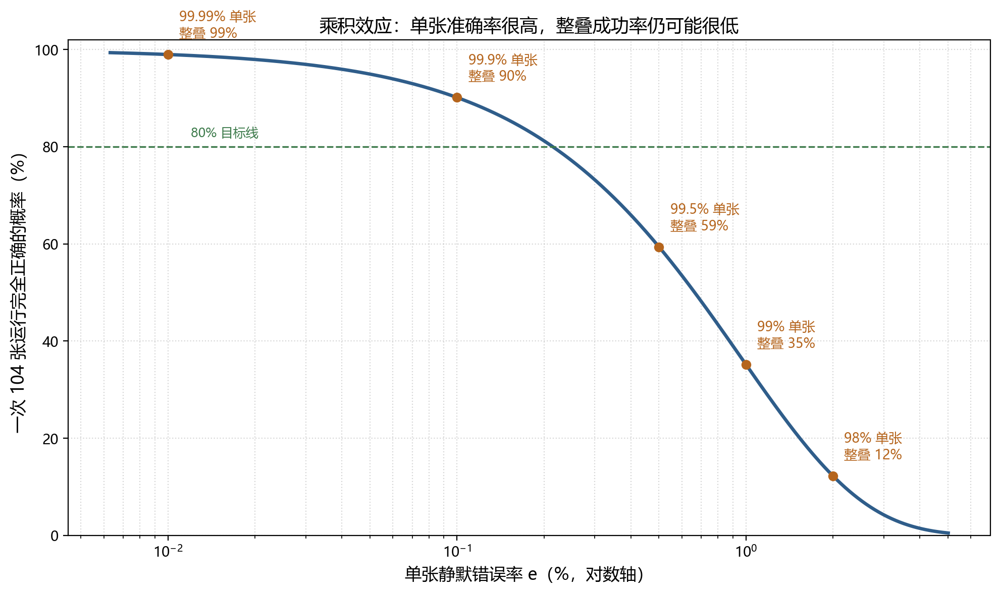
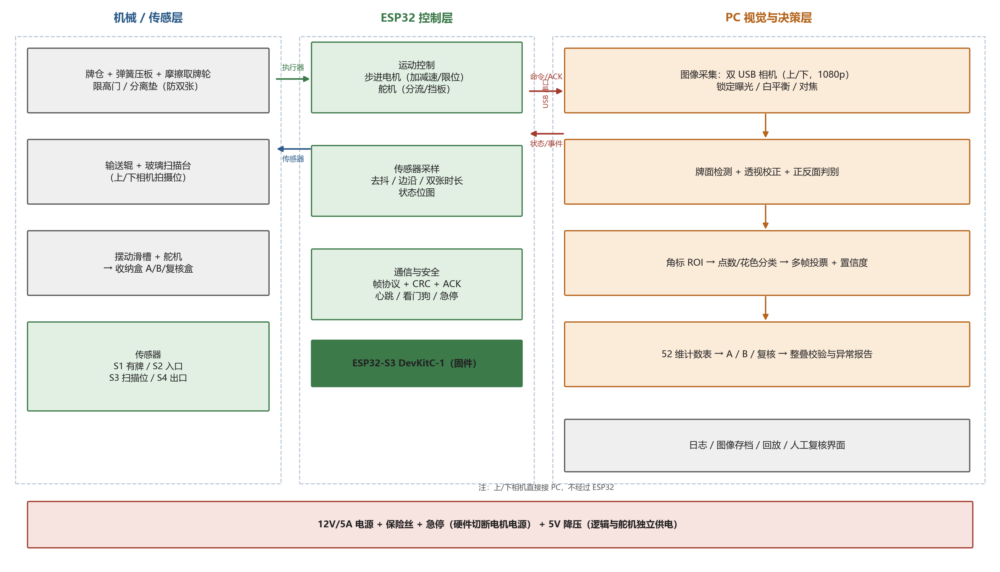
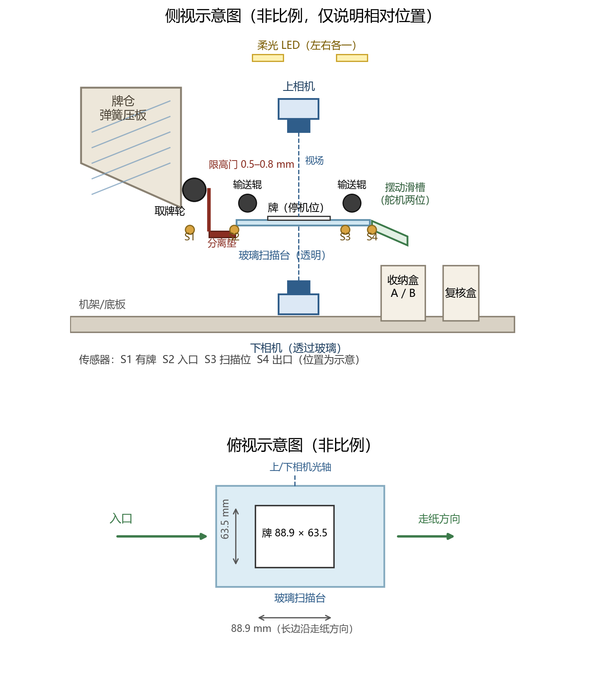
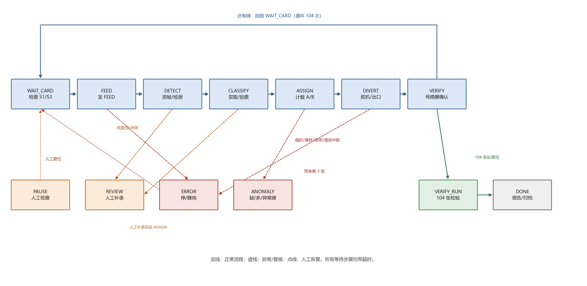

# 0. 摘要与使用说明

## 0.1 文档信息

| 项目 | 内容 |
|---|---|
| 项目名称 | 无标记扑克牌自动分拣机 |
| 任务 | 两副牌背相同的标准扑克牌混合后，自动分拣为两组，每组尽可能是一套完整 52 张 |
| 约束 | 总预算约 1000 元；周期 8 周；团队硬件经验有限；有 3D 打印机与普通电脑；可用 Python/OpenCV/ESP32 |
| 文档版本 | v1.0（2026-10-19） |
| 文档性质 | 工程实施方案 + 文献/硬件/机械调研 + 可执行实验与测试计划 |
| 适用对象 | 课程项目组、指导教师、答辩评委 |

## 0.2 摘要

本项目要解决的不是"判断一张牌原来属于哪一副"，而是"把 104 张牌逐张分类，并在计数约束下分成两套完整牌"。本方案先用数学证明：**只要输入确实是两副标准牌、且每张牌分类正确，那么"每个牌面类别先出现的一张去 A、后出现的一张去 B"就必然得到两组各 52 张、每类恰好一张**；因此"牌组归属识别"既不是目标所需，也在同品牌同批次、无参考样本的条件下不可辨识。

真正的工程难点被重新定位为三件事：**高可靠 52 类牌面分类**、**把不可避免的疑难牌转成可检测的拒识**、**用计数校验与异常报告保证"不输出错误结果"**。本方案用"乘积效应"说明为什么单张 98% 准确率在 104 张上只有约 12% 的整叠成功率，并据此把目标定为"极低静默错误率 + 可容忍的拒识率"。

技术路线上，推荐 **双 USB 1080p 相机 + 停机拍摄 + 角标 ROI + 轻量 CNN + 模板匹配交叉验证 + ESP32 运动控制 + 摩擦进牌 + 翻转滑槽分流**；物理指纹只做不超过 7 天的探索性预研，并给出量化的继续/停止标准。硬件预算约 **935 元**（含 12% 返工余量与备件），8 周计划给出每周交付物、验收条件与负责人建议。全部性能数字均标注为"项目目标值"或"待验证"，引用文献给出可核实的来源与核实状态。

## 0.3 关键结论（先看这 12 条）

1. **不需要解决"牌组归属"**：目标是两组完整牌，不是还原原来的两副；分类正确 + 计数约束即可（定理 1）。
2. **"归属"不可辨识**：同款同批、牌背相同、无参考样本时，"原属哪副"没有稳定物理标签；把它当研究问题会得到伪结论（1.4）。
3. **104 张是乘积关系**：单张静默错误率 1% → 整叠成功率约 35%；0.1% → 约 90%；0.01% → 约 99%（1.6）。所以验收不能只看单张平均准确率。
4. **策略是"宁可拒识，不可乱判"**：置信度拒识 + 多帧投票 + 双分类器交叉验证，把静默错误转成可检测的拒识。
5. **计数校验有盲区**：它能挡住绝大多数异常，但"交叉误判且数量恰好互补"型错误可能漏检（定理 2）；必须如实说明并用交叉验证加固。
6. **推荐算法**：角标 ROI（两角 + 180° 旋转 + 下相机镜像）+ 点数 13 类/花色 4 类轻量 CNN + 模板匹配交叉验证 + 3 帧投票；整牌模板/OCR 只做基线。
7. **物理指纹不进入主线**：即使实例匹配 100% 准确，也不能回答"这张牌是什么牌面"；且 1080p 相机约 271 dpi，只有 Clarkson 方法 1200 dpi 的约 1/4（3.3、4.5.1）。
8. **推荐硬件**：双 1080p USB 相机（必须 MJPG）+ 现有 PC + ESP32-S3；不用树莓派（2026-10 官方 2GB Pi 5 已涨至 77.50 美元）；ESP32-CAM 只做辅助。
9. **推荐机构**：摩擦取纸轮 + 可调分离垫 + 限高唇口 + 同轴双轮 + 透明扫描窗 + 单舵机翻转滑槽；104 张约 31 mm/187 g，取纸 4.2–6 N、0.066 N·m。
10. **相机视场要纠正**：1080p 16:9 在 120 mm 宽时只有 67.5 mm 高，装不下 88.9 mm 的牌；应按 180×101 mm 设计（10.7 px/mm），配 6 mm 镜头、WD≈184 mm。
11. **预算是估算**：约 935 元，余量约 65 元；约一半价格为区间估算，采购前必须复核（第 6 章）。
12. **MVP**：104 张自动进牌 → 双面拍摄 → 分类 → A/B 分流 → 计数校验 → 异常报告；验收拆成"全自动整叠成功率"与"含人工复核后正确率"两个指标（第 10、11 章）。

## 0.4 证据分级与本方案的诚实边界

本报告严格区分以下四类信息，正文中用不同措辞标注：

| 类型 | 含义 | 本方案中的例子 |
|---|---|---|
| **已验证事实** | 有可打开的一手来源直接支持 | OpenCV 透视变换需要 4 对点；RPi 官方 2026-10-01 涨价公告；OV2640 上限 1600×1200 |
| **工程推断** | 多个事实共同支持，但来源未直接这样表述 | 1080p + MJPG + 固定工位可满足角标识别；计数校验能挡住大多数异常 |
| **待验证假设** | 需要本项目实验验证 | 3 品牌训练能否泛化到第 4 品牌；纸纹在扑克牌涂层上是否还有信号 |
| **项目目标值** | 团队设定的目标，不是实测结果 | "单张 Top-1 ≥99%"、"全自动整叠成功率 ≥80%" |

**没有做的事**：本报告没有训练模型、没有实测机械、没有测过任何准确率或节拍。所有性能数字要么是文献引用，要么是工程估算，要么是项目目标值。第 4、10 章给出了产生真实数据的实验与测试方案。

## 0.5 如何使用本方案

- **第 1 周**：读第 1、3、4 章，确定"不做物理指纹"；按 6.3 下单；按 10.2 建数据集与基线。
- **第 2 周**：读第 7 章，做进牌模块与相机工位；按 7.10 做第 1–6 项测试。
- **第 3–4 周**：读第 3、8 章，训练分类器、写状态机、做单张闭环。
- **第 5–6 周**：读第 5、9、10 章，整机集成、异常处理、连续运行。
- **第 7–8 周**：读第 10、11、12 章，跨品牌/异常测试、写报告、准备答辩。
- **决策点**：第 1 周末（是否继续指纹预研）、第 2 周末（进牌是否达标/是否降级）、第 4 周末（单张闭环）、第 6 周末（整叠稳定性）。

## 0.6 交付物清单

| 文件 | 内容 |
|---|---|
| `report/无标记扑克牌自动分拣机_工程实施方案.md` | 本报告（Markdown 源） |
| `report/无标记扑克牌自动分拣机_工程实施方案.docx` | Word 版（便于提交/打印） |
| `report/BOM_预算表.xlsx` | 可计算的 BOM 与预算表（含公式、渠道、说明） |
| `report/figures/` | 系统架构图、状态机图、机械布局图、乘积效应曲线 |
| `research/algorithms.md` | 算法与文献调研（27 条来源、核实状态） |
| `research/hardware-bom.md` | 硬件路线与价格调研（含采购陷阱、代码片段） |
| `research/mechanical.md` | 机械方案与工程计算（含专利证据、16 项测试） |
| `tools/` | 图表、BOM 生成脚本（可复现） |

## 0.7 需求对照表

| 任务书要求 | 对应章节 | 关键产出 |
|---|---|---|
| 1. 数学分析与关键逻辑澄清 | 第 1 章 | 定理 1（充分条件）、归属不可辨识论证、定理 2（计数盲区）、乘积效应 |
| 2. 总体技术路线 | 第 2 章 | 推荐架构、12 项设计决策、降级路径 |
| 3. 四种算法方案比较 | 第 3 章 | A/B/C/D 比较表、推荐 A2+模板交叉验证、鲁棒性矩阵 |
| 4. 物理指纹 7 天预研 | 第 4 章 | 假设、采集协议、防泄漏划分、指标、停止/继续标准、7 天日程 |
| 5. 系统架构与数据流 | 第 5 章 | 硬件拓扑图、软件模块、单张时序、串口协议、日志模型 |
| 6. 硬件 BOM 与预算 | 第 6 章 + `BOM_预算表.xlsx` | 41 项 BOM、935 元预算、采购陷阱、降级方案 |
| 7. 机械结构 | 第 7 章 | 进牌/分离/扫描/分流设计、工程计算、故障表、16 项测试 |
| 8. 软件状态机与伪代码 | 第 8 章 | 7 状态主流程 + REVIEW/PAUSE/ERROR、关键伪代码、开发顺序 |
| 9. 8 周计划与阶段验收 | 第 9 章 | 每周交付物、验收条件、负责人、里程碑 Go/No-Go |
| 10. 测试与风险 | 第 10 章 | 三层指标、样本量与 Wilson 区间、异常注入、15 项风险 |
| 11. MVP | 第 11 章 | P0/P1/P2 范围、验收清单、650～750 元裁剪版 |
| 12. 答辩展示 | 第 12 章 | 4 个创新点、难点、证据清单、10 个问答、5 分钟脚本 |

## 0.8 目录

1. 项目目标的数学分析与关键逻辑澄清
2. 总体技术路线及推荐理由
3. 四种算法方案的比较与推荐
4. 物理指纹预研实验方案（≤7 天，含继续/停止标准）
5. 系统架构与数据流
6. 硬件 BOM 与预算表
7. 机械结构设计建议
8. 软件模块、状态机与关键伪代码
9. 8 周开发计划与阶段验收
10. 测试方案、风险清单与应对措施
11. 最终推荐的最小可行原型（MVP）
12. 答辩展示：创新点、技术难点与实验结果
附录 A 来源清单 · B 术语表 · C 默认参数 · D 检查清单 · E 变更记录

---

# 1. 项目目标的数学分析与关键逻辑澄清

> 本章先回答两个问题：这个任务在数学上到底是什么？以及，题目里隐含的"判断一张牌原来属于哪一副"是否真的需要解决？
> 结论先行：**不需要**。本项目是一个"52 类单张分类 + 多重集计数约束分配 + 异常检测"的问题，不是"两副牌来源判定"问题。把后者当成核心研究问题，会让项目在 8 周内大概率失败。

## 1.1 把任务写成数学对象

设牌面类别集合

```
C = {A,2,3,4,5,6,7,8,9,10,J,Q,K} × {♠,♥,♦,♣},   |C| = 52
```

一副标准牌（不含大小王）对应多重集

```
S = Σ_{c in C} 1·c        （每个类别恰好出现 1 次，共 52 张）
```

输入是 104 张物理牌，其真实类别构成未知多重集 `M_true`；识别系统对第 i 张牌观测到图像 `I_i`，输出

```
f(I_i) = (ĉ_i, p_i)，其中 ĉ_i in C or {None}，p_i in [0,1] 为置信度
```

目标是把这 104 个**物理实例**划分为两个组 `G_A`、`G_B`，使两组的真实类别多重集都尽可能等于 `S`：

```
理想目标：M(G_A) = S  且  M(G_B) = S
```

这里 `M(·)` 表示组内牌面类别的多重集（即"每种牌面各有几张"）。

**注意一个关键区别**：`G_A`、`G_B` 是"输出组"，不是"原副"。题目只要求每组是一套完整牌，**并没有要求 A 组等于原来第 1 副、B 组等于原来第 2 副**。这个措辞差别是整个方案设计的分水岭。

## 1.2 两个必须区分的问题

| 编号 | 问题 | 形式化 | 需要的信息 | 本项目是否需要 |
|---|---|---|---|---|
| P1 | **牌面分类** | `f: I → c in C`（52 类） | 牌面点数、花色 | **必须解决** |
| P2 | **牌组归属识别** | `g: card → {第1副, 第2副}` | 两副牌之间的可区分物理差异 + 参考样本 | **不需要，且不可辨识** |

很多方案把 P2 当成难点，试图用纸纹、印刷噪点、裁切边缘、ORB 特征做"同副牌聚类"。本报告第 2、3 章会说明：这不仅超出题目要求，而且在"同品牌、同批次、牌背相同、事先无标记"的约束下，P2 **在原理上就无法可靠求解**。

## 1.3 核心定理：分类正确时，贪心分配已经数学上保证成功

**定理 1（充分条件）**
若输入恰好是两副标准牌，即 `M_true = 2S`（每个类别恰好 2 张），且识别器对全部 104 张牌都给出正确类别（无错误、无拒识），则算法

> "对每个类别 c，第一张出现的 c 分到 A 组，第二张出现的 c 分到 B 组"

输出的 `G_A`、`G_B` 必然各是一套完整的 52 张牌。

**证明**
对任意 `c in C`，`M_true = 2S` 说明恰有 2 张真实类别为 c 的牌。识别器全部正确，故这 2 张都被标记为 c。按规则，第一张进入 `G_A`，第二张进入 `G_B`。于是对每个 c，`G_A` 含 1 张、`G_B` 含 1 张。C 有 52 个类别，故 `|G_A| = |G_B| = 52`，且两组的多重集都等于 `S`。（证毕）

**推论 1.1** 在上述前提下，分组正确性**完全由"每张牌分类正确 + 计数正确"保证**，与"这张牌原来在哪一副"无关。算法复杂度 O(104)，不需要聚类、不需要匹配、不需要任何物理指纹。

**推论 1.2** 因此，P2 不是"更难一点"，而是"对目标没有贡献"。即使我们拥有一个 100% 准确的"同副牌判定器"，也不能让定理 1 的结论更强；而如果分类会出错，物理指纹也救不了——因为指纹同样会受光照、角度、压缩影响，而且没有任何标签可以用来校准"哪副是哪副"。

## 1.4 为什么"牌组归属"在本项目中不可辨识

这不是"技术不够好"，而是问题本身没有定义好。论证如下：

1. **目标是输出两套完整牌，不是还原历史。** 两副同款牌在洗混后，物理上没有任何"原属"标记。所谓"原属第 1 副"是一个**历史标签**，不是一个可观测的物理属性。
2. **同品牌同批次时，两副牌在统计上同分布。** 纸张纹理、印刷噪点、裁切偏差都是制造过程的随机量；它们对"这副牌 vs 那副牌"没有系统性差异。把它们当作"副别特征"，等于把随机噪声当信号。
3. **没有参考样本。** 即使假设两副牌存在微弱差异，要判断"某张牌属于哪一副"，也必须事先用该副牌的若干张牌标定其特征分布；而题目明确要求不预标记、混合后分拣，参考样本不存在。
4. **可辨识的必要条件不成立。** 要让 P2 可解，至少需要：每副牌有稳定、可重复、互不相同的制造签名，并且能事先采集该副牌的参考样本。本项目两条都不满足。

**结论**：P2 在本项目的约束下是**不可辨识（unidentifiable）**的，不是"识别精度不够"。把它作为研究问题，必然得到"看起来有特征、实际不可用"的伪结论。

### 1.4.1 什么情况下才真的需要实例级识别？

- 要求"把每张牌放回它原来那一副"——需要实例追踪 + 参考库，本项目不可行；
- 要求防伪/溯源/司法鉴定——需要受控扫描设备与数据库，属于另一个问题；
- 两副牌品牌不同，需要按品牌分开——那是**品牌分类**，不是"同副判定"，而且与"每组一套完整牌"的目标无关。

## 1.5 异常输入：数学刻画与可检测性边界

题目要求"缺牌、多牌、大小王、识别失败、非标准牌组应能检测异常，而不是强行输出错误结果"。把异常写成可计算的形式：

| 编号 | 异常类型 | 数学表现 | 检测手段 |
|---|---|---|---|
| E1 | 缺牌 / 多牌 | 总张数 ≠ 104 | 总计数 |
| E2 | 某类重复或缺失 | 存在 c 使 `count[c] ≠ 2` | 52 维计数向量 |
| E3 | 大小王 / 广告牌 / 非标准牌 | 出现 `c 不属于 C` | 类别集合 + 拒识 |
| E4 | 识别失败 | `ĉ = None` 或 `p < τ` | 置信度阈值 |
| E5 | 机械异常 | 双张、卡牌、超时 | 传感器时序 + 超时 |
| E6 | 牌面损坏 / 空白 | 两个方向都检测不到有效牌面 | 双面图像一致性检查 |

**定理 2（计数校验的检测能力与盲区）**
设识别结果的类别多重集为 `M_hat`。若 `M_hat ≠ 2S`，则一定存在计数异常，可被 52 维计数向量检测；但若 `M_hat = 2S` 而识别过程中出现了"数量恰好互补"的交叉误判，仅靠计数校验**无法发现**分组错误。

**证明（前半部分）**：由定义直接得到。
**证明（后半部分，构造反例）**：只考虑三个类别 c、d、e，真实输入各 2 张，其余类别正常。假设识别器产生如下误判：

| 真实类别 | 第 1 张被判为 | 第 2 张被判为 |
|---|---|---|
| c | d | e |
| d | c | d |
| e | c | e |

则识别后的计数为：c = 2（来自真实 d、e）、d = 2（来自真实 c、d）、e = 2（来自真实 c、e），**`M_hat = 2S`，计数校验完全通过**。但按"每类先出现去 A、后出现去 B"分组时，A 可能拿到：识别为 c 的真实 d 牌、识别为 d 的真实 c 牌、识别为 e 的真实 c 牌 → A 的真实多重集为 `{c, c, d}`，B 为 `{d, e, e}`，两组都不完整。（证毕）

**这个反例说明**：计数校验是强校验，但不是形式化证明；它要求识别错误不能"恰好互补"。工程上通过置信度拒识、多帧投票、双分类器交叉验证和混淆矩阵分析来降低这类错误的概率，并在报告中如实说明该盲区。

**工程含义**：
1. 计数校验能挡住绝大多数错误（缺牌、多牌、单张误判、拒识），必须实现；
2. 它**不是**形式化证明，不能把"计数通过"宣传成"绝对正确"；
3. 对"系统性混淆对"（如 6/9、红黑花色、同点数不同花色）要用**混淆矩阵 + 置信度拒识 + 多帧投票**专门加固；
4. 可选加固：对低置信或易混类别，强制二次拍摄/第二次独立分类，两次一致才放行（把静默错误转成可检测拒识）。

## 1.6 端到端成功率的定量关系（本项目最重要的数量级判断）

设单张牌的**静默错误率**为 `e_s`（识别错了但系统没有察觉），机械环节成功率为 `e_m`（不卡牌、不双张、能正常完成），则一次 104 张全自动运行"两组都完整"的概率近似为

```
P_success ≈ (1 - e_s)^104 × (1 - e_m)
```

代入不同 `e_s`（忽略机械项）：

| 单张静默错误率 e_s | (1-e_s)^104 | 含义 |
|---|---|---|
| 2% | 12% | "识别率 98%"听起来不错，整叠几乎必错 |
| 1% | 35% | 仍然不可接受 |
| 0.5% | 59% | 约一半运行失败 |
| 0.1% | 90% | 可用，但每次运行仍有 1/10 概率失败 |
| 0.05% | 95% | 较好 |
| 0.01% | 99% | 需要 1/10000 的单张静默错误率 |

**这张表直接推翻了两类常见错误目标设定**：
- "单张识别准确率 98% 就算成功"——整叠成功率只有约 12%；
- "先做识别 demo，机械后面再说"——识别指标必须按 104 张的乘积来定，不能按单张平均来定。

{width=92%}

**正确的工程策略**（本方案采用）：
1. 不追求"平均准确率"，追求**极低的静默错误率**；
2. 用**置信度拒识**把"可能错"的牌转成"明确拒识"，拒识牌进入复核区，由人处理——拒识率可以容忍（如 2%），静默错误不可容忍；
3. 用**多帧投票 + 双方法交叉验证**压低随机错误；
4. 验收指标拆成两层：`全自动整叠成功率` 与 `含人工复核后的分拣正确率`，分开报告，不混为一谈。

## 1.7 分配与校验算法（形式化）

```
初始化：count[c] = 0 (c in C)，A = []，B = []，REVIEW = []，anomaly = []

对每张识别结果 (ĉ, p)：
    if ĉ == None or p < τ_low:
        REVIEW.append(card)                 # 拒识，不参与分组
    else if count[ĉ] == 0:
        A.append(card); count[ĉ] = 1
    else if count[ĉ] == 1:
        B.append(card); count[ĉ] = 2
    else:
        anomaly.append(("E2", ĉ, card))     # 第三次出现，类别异常

结束校验：
    if |A| + |B| + |REVIEW| + |anomaly| ≠ 104: 报告 E1
    if 存在 count[c] ≠ 2: 报告 E2，列出 missing = {c: count=0}、extra = {c: count≥3}
    if REVIEW 非空 或 anomaly 非空: 报告 E4/E2，等待人工处理
    else: 输出 A、B，并记录"计数校验通过（不等价于绝对正确，见定理 2）"
```

**设计要点**：
- 采用"先出现去 A、后出现去 B"，而不是"随机分"或"按图像聚类"：确定性、可追溯、可重放。
- 不做"最小编辑修复"（例如把多出来的牌强行补到缺的类别）。修复会掩盖系统性错误，违反"不强行输出错误结果"的要求。正确做法是报告异常，由人决定重跑还是手工修正。
- 每张牌记录 `(序号, 时间, 相机, 图像路径, ĉ, p, 分配结果, 传感器状态)`，支持事后回放定位问题。

## 1.8 对项目目标的建议改写（可直接用于开题/答辩）

**原始表述**：把两副混合的标准扑克牌自动分拣成两组，使每组尽可能是一套完整 52 张。

**工程化表述**：
> 对 104 张牌逐张进行点数与花色分类，在"每个牌面类别恰好出现两次"的多重集约束下，把同一类别的两张牌分别分配到 A、B 两组；当输入不满足约束（缺牌、多牌、大小王、非标准牌）或单张置信度不足时，系统明确报告异常并进入人工复核，而不是输出一个看似完整、实际错误的结果。

这个改写带来三个好处：
1. 研究问题清晰：核心是**高可靠 52 类分类 + 约束校验 + 异常处理**；
2. 验收可量化：分类指标、拒识率、整叠成功率、异常检出率；
3. 明确排除了不可辨识的"来源判定"，避免团队把时间花在物理指纹上。

## 1.9 本章结论

1. **只需解决 P1（牌面分类），不需要 P2（牌组归属）**；P2 在同款同批、无参考样本的条件下不可辨识。
2. 分类全部正确时，"每类两张分别去 A/B"的贪心算法**数学上保证**两组完整（定理 1）。
3. 真正的工程难点是：把 104 张的**静默错误率**压到 0.1% 以下，同时把不可避免的疑难牌转成**可检测的拒识**。
4. 计数校验能检测绝大多数异常，但对"交叉误判且数量恰好互补"的错误有盲区（定理 2），必须用置信度、多帧投票和交叉验证加固。
5. 建议把验收拆成"全自动整叠成功率"和"人工复核后正确率"两个指标，避免用单张平均准确率掩盖整叠失败。

---

# 2. 总体技术路线及推荐理由

## 2.1 设计原则

本项目是"8 周、1000 元、硬件经验有限"的课程项目，技术路线必须服从以下五条原则：

1. **先保证正确，再追求自动化程度。** 允许人工处理少量疑难牌，但不允许系统"悄悄输出错误结果"。
2. **把复杂度放在软件，把可靠性放在机械。** 视觉算法可以迭代，机械卡牌很难返工；运动机构越简单越好。
3. **每个环节可观测。** 每个动作都有传感器确认、有日志、有图像留档，出问题能定位。
4. **有降级路径。** 双相机坏一个、自动进牌不稳定时，系统仍能以较低自动化程度完成任务。
5. **不引入与目标无关的技术。** 物理指纹、聚类、复杂深度学习、云端服务都不解决本项目真正的问题（见第 1、3 章）。

## 2.2 推荐总体架构

推荐采用 **"PC 做视觉与决策 + ESP32 做实时运动控制 + 双 USB 相机 + 停机拍摄"** 的架构：

```
                     ┌──────────────────────────── Windows 普通电脑 ────────────────────────────┐
                     │  Python 3.x + OpenCV                                                   │
   ┌──────────┐      │  ┌────────────┐   ┌─────────────┐   ┌──────────────┐   ┌────────────┐  │
   │ 上相机   │─USB─->│  │ 图像采集   │──->│ 牌面检测/   │──->│ 角标分类     │──->│ 计数分配   │  │
   │ 1080p    │      │  │ (双缓冲)   │   │ 透视校正    │   │ (rank+suit)  │   │ + 异常检测 │  │
   └──────────┘      │  └────────────┘   └─────────────┘   └──────────────┘   └─────┬──────┘  │
   ┌──────────┐      │                                                               │         │
   │ 下相机   │─USB─->│  ┌───────────────────────────────────────────────────────────┐│         │
   │ 1080p    │      │  │ 日志 / 图像存档 / 回放 / 人工复核界面                      ││         │
   └──────────┘      │  └───────────────────────────────────────────────────────────┘│         │
                     └───────────────────────────────────┬───────────────────────────────┘         │
                                                         │ USB 串口（命令 + 状态 + CRC）
                     ┌───────────────────────────────────▼───────────────────────────────┐
                     │ ESP32（Arduino/PlatformIO 固件）                                    │
                     │ 进牌步进电机 / 分离机构 / 输送辊 / 分流舵机 / 传感器 / 急停 / 蜂鸣器  │
                     └───────────────────────────────────┬───────────────────────────────┘
                                                         │
                                          12V 电源 → 电机驱动；5V → 逻辑
```

**分工原则**：

| 任务 | 执行者 | 原因 |
|---|---|---|
| 图像采集、牌面检测、分类、分配决策、日志、界面 | PC（Python/OpenCV） | 算力充足、开发调试快、模型生态成熟 |
| 进牌步进、辊轮启停、舵机分流、传感器采样、急停 | ESP32 | 实时性、PWM/GPIO、与 PC 解耦，PC 崩溃时能安全停机 |
| 断电保护、急停 | 硬件电路（继电器/急停开关切断电机电源） | 软件不可靠时的最后防线 |

## 2.3 单张牌的工作循环（设计基准）

```
(1) 上位机发 FEED
(2) ESP32 启动进牌辊，把一张牌从牌仓送到扫描玻璃台
(3) 入口/到位传感器触发，辊轮停，牌停在扫描窗口（停机拍摄）
(4) PC 同时抓取上、下相机各 3 帧
(5) PC 判断哪一面是牌面，提取角标 ROI，分类得到 (点数, 花色) 与置信度
(6) PC 查计数表，决定去 A 组、B 组还是复核区，发 DIVERT_A / DIVERT_B / REJECT
(7) ESP32 转分流舵机到对应位置，启动输送辊把牌送入对应收纳盒
(8) 出口传感器确认牌离开，机构复位，进入下一张
```

单张节拍目标 4～6 s（含机械动作与 3 帧采集、推理），104 张约 8～12 min。对课程项目演示，这个速度完全可以接受；**用速度换稳定性是值得的**。

## 2.4 关键设计决策

| 编号 | 决策 | 选择 | 主要理由 | 备选与代价 |
|---|---|---|---|---|
| D1 | 视觉算力 | 普通 PC + 2 个 USB 相机 | 成本最低、OpenCV/PyTorch 生态成熟、调试最快 | 树莓派：整机 900 元以上且调试慢；ESP32-CAM：分辨率/算力不足 |
| D2 | 拍摄方式 | 停机拍摄（stop-and-scan） | 无运动模糊、曝光可控、几何校正简单、成功率优先 | 连续拍摄：需全局快门/强光/更高帧率，复杂度和成本上升 |
| D3 | 正反面 | 上下双相机同时拍 | 牌面朝向随机，单相机必然有一半拍不到牌面 | 单相机 + 机械翻面：增加机构与故障点；单相机 + 人工理牌：牺牲自动化 |
| D4 | 分类方法 | 角标 ROI + 轻量 CNN 为主，模板匹配为辅 | 跨品牌潜力最好，数据采集成本可控，可做置信度拒识 | 纯模板匹配跨品牌差；纯 OCR 对艺术字/小字不稳 |
| D5 | 进牌 | 摩擦取牌轮 + 限高门/分离垫 + 弹簧压板 | 打印机进纸的成熟原理，3D 打印可实现 | 真空吸盘/弹匣推卡：结构复杂、成本高 |
| D6 | 分流 | 出口摆动滑槽 + 舵机两位 | 一个舵机、无反向运动、卡片靠重力落盒、故障点少 | 推板/挡板：需要额外直线机构或更大舵机 |
| D7 | 通信 | USB 串口（115200 或更高），帧头+长度+CRC+ACK | 稳定、简单、可抓包调试 | WiFi/MQTT：增加配对、断连、延迟问题，无必要 |
| D8 | 异常处理 | 复核区 + 异常报告 + 人工确认 | 满足"不强行输出错误"的要求 | 自动修复：会掩盖系统性错误，禁止 |
| D9 | 训练数据 | 3 个品牌 × 52 张牌面扫描 + 强增强 | 数据量小、可控、可做留一品牌测试 | 只用 1 个品牌：无法评估跨品牌；公开数据集：品牌/许可不确定 |
| D10 | 物理指纹 | 仅做 7 天探索性预研，默认不进入主线 | 对目标无贡献、不可辨识、时间成本高 | 作为主线：高风险、低收益（见第 4 章） |
| D11 | 结构 | 3D 打印模块 + 亚克力扫描台 + 铝型材框架 | 可迭代、可拆装、成本低 | 全亚克力/全铝：加工门槛或成本更高 |
| D12 | 软件形态 | 单进程 Python + 状态机 + JSON 日志 | 初学者可维护、易调试 | 多进程/ROS：学习成本过高 |

## 2.5 为什么选"USB 相机 + 电脑"而不是树莓派或 ESP32-CAM

### 2.5.1 成本与算力对比（2026-10 调研，价格为估算/检索值，采购前需复核）

| 路线 | 主要组成 | 参考成本（元） | 视觉算力 | 开发难度 | 本项目适配度 |
|---|---|---|---|---|---|
| **A. USB 相机 + 现有 PC** | 2×1080p USB 相机 + 有源 HUB + 线材 | 180～300 | 普通 CPU 足够跑轻量 CNN、OpenCV | 低 | **推荐** |
| B. 树莓派本地 | Pi 5（2GB 官方价 77.50 美元，2026-10-01 起）+ 相机 + SD + 电源 | 900～1300+ | 可跑轻量模型，但需交叉编译/远程调试 | 中高 | 不建议（吃掉全部预算） |
| C. ESP32-CAM | ESP32-CAM 模块 ×2 | 60～120 | 1600×1200 JPEG，内存/算力有限，难跑 52 类模型 | 高 | 仅可作备用相机，不作主方案 |
| D. 手机 + 电脑 | 手机当摄像头（USB/网络） | 0～100 | 依赖手机 App 与协议，曝光/对焦不可控 | 中 | 仅应急 |

**说明**：树莓派官方在 2025-12 与 2026-10-01 两轮公告中因内存涨价多次上调价格；2026-10-01 的最新公告将 2GB 版 Pi 5 调至 **77.50 美元**、2GB 版 Pi 4 调至 67.50 美元（来源：[Raspberry Pi 官方新闻，2026-10-01](https://www.raspberrypi.com/news/price-increases-for-2gb-raspberry-pi-4-and-raspberry-pi-5/)）。按此价格，加相机、SD 卡、电源、散热与外壳后整机落地通常超过 900 元，占预算 90% 以上，且本地调试效率低于直接用现有电脑。因此**不推荐树莓派路线**。

### 2.5.2 ESP32-CAM 为什么不适合做主相机

- 官方模组为 1600×1200（约 200 万像素）JPEG 输出，低照度噪声大、镜头视场角固定、对焦不可调；
- 需要 WiFi 传图，增加延迟与断连风险；
- 其算力（240 MHz 双核，无向量单元）不适合在端侧跑 52 类分类；若只做传图，则它相对"USB 相机"没有优势。
- 结论：ESP32-CAM 可作为"第二相机"的低成本备选，但主方案用 USB 相机 + PC 更稳。

## 2.6 为什么必须"停机拍摄"

连续运动拍摄会同时引入三类误差：

1. **运动模糊**：普通 USB 相机曝光时间若为 10 ms、卡片速度 100 mm/s，则模糊长度约 1 mm；角标字符高度只有 8～10 mm，模糊会显著降低分类置信度。
2. **卷帘快门畸变**：CMOS 逐行读出，运动中的卡片边缘会产生剪切/倾斜，透视校正是按"平面刚体"做的，卷帘畸变会破坏校正模型。
3. **曝光/白平衡漂移**：自动曝光在运动与静止时不同，导致训练集与推理集分布不一致。

停机拍摄把这三个问题同时消除，代价只是节拍变慢。对 104 张的演示任务，8～12 分钟的整叠时间完全可以接受。

## 2.7 为什么需要双相机

标准扑克牌只有一面印有牌面，另一面是统一牌背。混合后的牌面朝向是随机的：

- 若只装上方相机：约一半的牌拍到的是牌背，分类必然失败；
- 若只装下方相机：同理；
- 若要求人工把 104 张牌全部翻到同一面：可行，但增加人工准备时间，且与"自动进牌"的演示效果冲突。

**双相机方案**：玻璃扫描台上方、下方各一个 USB 相机；牌停稳后同时抓图，分别判断"这一面是否是牌面"，取置信度高的一侧作为分类输入。成本增加约 100～160 元，换来决定性的鲁棒性。

**备选（降级）方案**：只装一个相机 + 人工把牌整理成同一朝向，作为预算或时间不足时的 Plan B。

## 2.8 为什么分类以"角标 ROI + 轻量 CNN"为主

| 方法 | 同品牌准确率潜力 | 跨品牌 | 数据需求 | 结论 |
|---|---|---|---|---|
| 全牌模板匹配 | 高 | 差（字体/图案一变就失效） | 每品牌 52 张模板 | 仅作辅助/兜底 |
| 角标 OCR（Tesseract） | 中 | 中 | 无 | 作为基线对比，不作主线 |
| 角标 ROI + 轻量 CNN | 高 | 中高（取决于训练品牌数） | 3 品牌 × 52 张 + 增强 | **主线** |
| 整牌 52 类 CNN | 高 | 中 | 同上，但模型更大、更慢 | 可作对照实验 |

**角标方案的优势**：
- 牌面大部分区域是白底或花纹，信息量集中在两个角的"点数 + 花色"小图；
- 角标 ROI 面积小（约 100×120 px），分类网络可以很小（<1 MB），CPU 推理 <20 ms；
- 两个对角都有角标，天然支持 180° 旋转；
- 与整牌方案相比，对纸张泛黄、折痕、局部污渍更不敏感（只依赖角标区域）；
- 可以分别训练"点数 13 类"和"花色 4 类"，降低类间混淆，也便于输出可解释的置信度。

**为什么还要模板匹配**：同一个品牌/同一批牌时，模板匹配（归一化互相关）几乎不需要训练、可解释、速度快，可作为 CNN 的"第二意见"。两者一致 → 高置信；不一致 → 复核。这就是第 3 章方案 D 中**真正有价值的部分**——不是"物理指纹融合"，而是"两种牌面分类器的交叉验证"。

## 2.9 为什么物理指纹不进入主线（一句话版本）

即使做出一个 100% 准确的"同一张牌重复拍摄可匹配"系统，它也只能回答"这两张照片是不是同一张物理牌"，而本项目需要的是"这张牌是什么牌面"。**前者对后者没有任何信息增益**；而"这张牌原来属于哪一副"在本项目约束下不可辨识（见 1.4）。因此物理指纹最多是一个 7 天的探索性预研，用来在报告中给出有数据支撑的"否证"，而不是产品功能。

## 2.10 降级路径（必须提前设计）

| 风险 | 触发条件 | 降级方案 | 对验收的影响 |
|---|---|---|---|
| 双相机之一故障 | 相机掉线/图像全黑 | 单相机 + 人工统一朝向 | 自动化程度下降，功能仍完整 |
| 自动进牌不稳定 | 双张率 >10% 或频繁卡牌 | 人工单张放牌（保留识别/分流） | 仍满足"识别+分类+收集"，进牌自动化降级 |
| 分流舵机故障 | 舵机堵转/丢位 | 固定单侧出口 + 人工二次分拣 | 演示效果下降 |
| PC 崩溃/串口断 | 心跳超时 | ESP32 停止电机、蜂鸣器报警、保持安全状态 | 无损坏，可恢复 |
| 分类置信度普遍偏低 | 拒识率 >10% | 换用该品牌的模板匹配兜底 / 重新采集该品牌数据 | 速度下降，正确率优先 |

## 2.11 技术路线与项目约束的对齐

| 约束 | 本路线的应对 |
|---|---|
| 1000 元预算 | 视觉用现有 PC，省下最大一块；BOM 控制在 800～950 元（见第 6 章） |
| 8 周周期 | 第 1 周出分类基线，第 2 周出进牌模块，第 4 周完成单张闭环，第 6 周完成整叠 |
| 硬件经验有限 | 运动机构只用步进电机 + 舵机 + 红外传感器；不用气动、不用闭环伺服、不用复杂传动 |
| 3D 打印 | 进牌模块、相机支架、扫描台、分流滑槽、收纳盒全部可打印 |
| 不依赖特定品牌 | 3 品牌训练 + 留一品牌测试；置信度拒识；必要时模板兜底 |
| 异常检测 | 计数校验 + 拒识 + 传感器时序 + 异常报告（见 1.5、8.4） |

## 2.12 本章结论

1. **推荐路线**：PC（Python/OpenCV/轻量 CNN）+ 双 USB 1080p 相机 + ESP32 运动控制 + 停机拍摄 + 摩擦进牌 + 摆动滑槽分流。
2. **核心方法论**：把问题收敛为"52 类高可靠分类 + 多重集计数约束 + 拒识/异常处理"，不解决不需要且不可辨识的"来源判定"。
3. **不推荐**：树莓派本地（预算与调试效率）、ESP32-CAM 主相机（分辨率/算力）、连续拍摄（模糊与卷帘畸变）、纯模板匹配主方案（跨品牌差）、物理指纹主线（对目标无贡献）。
4. **必须保留降级路径**：单相机、人工放牌、单侧出口，保证任何单点故障都不导致项目归零。

---

# 3. 四种算法方案的比较与推荐

> 本章比较的四种方案，对应任务书中的 A/B/C/D。所有"准确率潜力"均为**项目目标值或工程推断**，不是已经测得的实验结果；真实数字必须由第 4 章和第 10 章的实验产生。本报告不会伪造准确率。

## 3.1 方案 A：角标识别 + 计数约束分配

**核心思想**：把"分拣"拆成"逐张分类"和"查表分配"两件事。分类只依赖牌角（点数 + 花色），分配只依赖 52 维计数表（见 1.3 定理 1）。

**处理流程**：

```
双相机图像
  → 牌面/牌背判别（取有角标的一侧）
  → 牌面四边形检测 + 透视校正（或固定工位直接裁剪）
  → 提取两个对角的角标 ROI（含 180° 旋转处理；下相机图像需水平镜像）
  → 点数分类（13 类）+ 花色分类（4 类），输出置信度
  → 多帧投票 + 置信度阈值
  → 查 52 维计数表 → A / B / 复核区
  → 整叠计数校验 → 异常报告
```

**两种实现子型**：

| 子型 | 分类器 | 优点 | 缺点 | 建议 |
|---|---|---|---|---|
| A1 | 角标模板匹配（NCC/SSIM） | 无需训练、可解释、同品牌极稳 | 换品牌/换字体失效；对光照敏感 | 作为基线、同品牌兜底、交叉验证 |
| A2 | 角标 ROI + 轻量 CNN（MobileNetV3-Small 或小型自建 CNN） | 跨品牌潜力最好；可输出置信度；CPU 可跑 | 需要采集/标注 3 品牌数据；需防过拟合 | **主线** |

**输入/输出**：输入为 1920×1080 或更高分辨率的单帧图像；输出为 `(rank in 13, suit in 4, p_rank, p_suit, p_joint)` 或 `None`（拒识）。

**适用条件**：牌面角标可辨认；相机分辨率使角标字符高度 ≥25 px；光照相对均匀；牌面没有大面积污损。

**资源需求**：普通 CPU（i5 级别）即可，单帧推理 <50 ms；训练在 CPU 上数分钟到数十分钟（数据量小）；无需 GPU。

**主要失败模式**：
- 角标被手指/污渍/折角遮挡；
- 强反光导致角标局部过曝；
- 牌严重翘曲导致角标离焦；
- 非标准字体（艺术字、超大索引、四角索引）导致训练分布外；
- 牌面上下方向判错（应通过两角 + 投票避免）；
- 下相机镜像处理错误导致花色左右颠倒（♦/♥ 不受影响，但数字可能误读）。

## 3.2 方案 B：整牌模板匹配 / 传统图像处理

**核心思想**：把每张牌的整幅牌面与 52 张标准模板做归一化互相关，取最高分。或者用 ORB/SIFT 关键点 + RANSAC 做几何匹配。

**输入/输出**：输入校正后的整牌图像；输出最相似模板的类别与相似度分数。

**适用条件**：测试牌与模板牌**同品牌、同版本、同印刷**，且光照、角度、尺度受控。

**优点**：实现最简单（OpenCV `matchTemplate` 十几行代码）；无需训练数据；结果可解释；在受控条件下同品牌准确率可以很高。

**缺点**：
- **跨品牌几乎必然失效**：字体、花色图案、边框、白边宽度都会变化；
- 对光照/白平衡/曝光敏感（NCC 对线性亮度变化有一定鲁棒性，但对阴影、反光不行）；
- 对旋转/透视需要先做几何校正，否则分数骤降；
- 牌面磨损、污渍会拉低全局相似度；
- 无法给出可信的"拒识"概率（分数阈值需按品牌分别标定）。

**资源需求**：极低；CPU 毫秒级。

**失败模式**：换品牌、换批次、牌面局部污损、强反光、模板与实物版本不一致。

**结论**：适合作为**方案 A 的对照基线**和**同品牌兜底**，不适合作为唯一主方案（违反"尽量不依赖特定品牌"的约束）。

## 3.3 方案 C：物理特征 / 实例匹配 / 聚类

**核心思想**：提取纸纹、印刷噪点、裁切边缘、传感器指纹（PRNU）等"物理特征"，判断两张照片是否同一张牌，或把牌聚成两类。

**输入/输出**：输入受控拍摄的牌面/牌背图像；输出实例相似度或聚类标签。

**适用条件**：固定拍摄装置、固定光照、固定焦距、无损或高质量图像、有参考样本、同一张牌可重复拍摄。

**已有证据（详见第 4 章与附录来源表）**：
- **纸张表面指纹（扫描仪）**：Clarkson 等（IEEE S&P 2009；方法与数字见其 2012 普林斯顿博士论文 TR-921）用 1200 dpi 平板扫描仪、3×3 英寸区域、4 个角度扫描，构造 3200 bit 指纹；同一张纸的两次扫描汉明距离均值约 99/3200（3.1%），不同纸约 1600/3200（50%）；在 1000 bit 编码下可做到"全部正确且 0 误报"。**前提是 1200 dpi 扫描 + 4 角度 + 受控光路。**
- **纸张透射指纹**：Toreini 等（ACM TOPS 2017）用背光透射 + 普通相机单张照片，2048 bit，在其自建数据集上报告 0% FRR / 0% FAR；但需要背光装置，且识别的是"单张纸"，不是"同副"。
- **纸纹做品牌识别**：Shang 等（2011）用 1200 dpi 扫描 + GLCM/傅里叶 114 维特征 + SVM，对 21 种纸/19 个品牌在分块 ≥1.5×1.5 cm² 时接近 100%；但同一张纸正反面相似会导致误判，未知品牌未解决。**品牌级 ≠ 同副级。**
- **PRNU 是"相机指纹"而不是"纸/牌指纹"**：它识别的是拍摄设备，且对压缩、旋转、缩放、去噪敏感；与本任务无关。
- 这类方法的成立依赖**受控扫描/背光、固定光路、无压缩或低压缩、可对齐**；普通 USB 相机 + 自由拍摄时，光照、白平衡、自动曝光、JPEG 压缩、对焦呼吸、角度变化会淹没纸纹这种低对比度的高频信号。
- **分辨率算术**：1200 dpi × 3 英寸 = 3600×3600 像素；1080p 整帧只有 1920×1080，等效 1200 dpi 时只能覆盖约 1.6×0.9 英寸；一张 63×89 mm 的牌面要达到该分辨率约需 3000×4200 像素。普通 USB 相机做不到，这是硬约束而非调参问题。

**关键逻辑问题（必须写进报告）**：
1. "同一张牌重复拍摄能匹配" ≠ "两张牌来自同一副牌"。前者是实例再识别（instance re-identification），后者是**分组归属**；
2. 即使实例匹配 100% 准确，本项目也不受益：104 张牌每张只出现一次，不需要"再识别"；而"哪副"没有参考样本、没有稳定签名（见 1.4）；
3. 物理特征对光照、角度、压缩极其敏感，实验稍有不慎就会把"光照差异"误判为"物理差异"，得出虚高的同副/异副区分度。

**关于裁切边缘/印刷细节**：裁切毛刺、刀痕、墨点位置确实具有随机性，可作为纸张/印刷的微观特征；但它们尺寸在几十微米量级，需要微距或高分辨率扫描，且牌在使用中边缘最先磨损，跨时间稳定性差。对"同一张牌重复拍摄"或许可用，对"同副判定"仍没有可用的标签意义。

**资源需求**：高——需要固定拍摄夹具、可控光源、标定流程、特征工程/度量学习、较大数据量；调试周期以周计。

**失败模式**：换光照/角度即失效；同批牌无区分度；跨品牌不可用；把噪声当特征；数据泄漏导致评估虚高。

**结论**：**不进入主线**。可做 ≤7 天的探索性预研（第 4 章），用于在报告中给出有数据支撑的否证结论。

### 3.3.1 图像嵌入/度量学习为什么也不改变结论

"图像嵌入 + 度量学习"（siamese/triplet 网络、对比学习）确实可以训练一个"两张图是否同一实例"的相似度函数，在受控条件下可能比 ORB 更鲁棒。但它解决的是**实例验证/再识别**：

- 训练需要大量"同实例/不同实例"配对，而本项目的 104 张牌每张只出现一次，**没有可用于训练的正样本对**；只能靠外部数据或强增强合成，分布与实拍不一致；
- 即使训练成功，输出仍是"两张图相似度"，而本项目需要"这张牌是什么牌面"和"两组是否完整"；
- 它同样无法回答"原属哪副"（1.4 的不可辨识性），也无法替代 52 类分类。

**结论**：度量学习可作为物理指纹预研中的 B4 基线（第 4 章），不进入主线；主线用"分类 + 计数约束"更直接、更可验证。

## 3.4 方案 D：融合方案

需要区分两种"融合"，它们价值完全不同：

### D1：牌面分类器之间的融合（推荐）
- 角标 CNN + 角标模板匹配（或整牌模板匹配）交叉验证；
- 两者一致 → 接受；不一致 → 复核；
- 收益：把一部分静默错误转成可检测的冲突，降低 1.6 节中的 `e_s`；
- 成本：低（模板匹配几乎零成本）；
- 风险：两者可能因同一原因（如反光）同时出错，相关性会削弱收益，需要实测验证。

### D2：牌面 + 物理指纹融合（不推荐）
- 把物理相似度作为额外特征参与分类/分组；
- 理论上最多帮助"区分两副"，但本项目不需要；
- 物理特征本身不可靠，融合只会增加调参维度与过拟合风险；
- 收益无法证明，风险显著增加。

**结论**：采用 **D1**（A2 + A1 交叉验证），不采用 D2。

## 3.5 四方案比较表

评分说明："高/中/低"为工程推断；"准确率潜力"是**目标值**，非实测。

| 维度 | A. 角标识别 + 计数 | B. 整牌模板匹配 | C. 物理指纹/聚类 | D. 融合（A+物理） |
|---|---|---|---|---|
| 核心方法 | 角标 ROI + CNN（+模板） | NCC/ORB 整牌匹配 | 纸纹/PRNU/纹理特征 + 匹配/聚类 | 牌面分类 + 物理相似度 |
| 同品牌准确率潜力 | 高（目标 ≥99.9% 静默正确） | 高（目标 ≥99%，受控条件） | 未知（推测中低） | 不高于 A |
| 跨品牌泛化 | 中高（需多品牌训练+留一品牌测试） | **低** | **低/不可用** | 低（受物理特征拖累） |
| 数据采集成本 | 中（3 品牌 ×52 张扫描 + 增强） | 低（同品牌 52 张模板） | **高**（多条件、多重复、固定夹具） | 高 |
| 开发难度 | 中 | **低** | **高** | 高 |
| 硬件要求 | 低（PC + 双相机） | 低 | 中高（稳定光路/夹具/标定） | 中高 |
| 调试成本 | 中 | 低 | 高 | 高 |
| 项目风险 | 中低 | 高（换品牌即失效） | **很高**（很可能做不出来且无收益） | 高 |
| 8 周内可行性 | 可行 | 可行（但只对同品牌） | 不可行/无意义 | 不建议 |
| 对"每组完整"的贡献 | 直接（计数约束） | 直接（若分类对） | 间接且不必要 | 无额外贡献 |
| 结论 | **主方案** | 基线/兜底/交叉验证 | **仅 7 天预研** | 仅 D1（分类器融合） |

## 3.6 推荐方案与理由

**推荐：A2（角标 ROI + 轻量 CNN）为主，A1（模板匹配）为辅，采用 D1 交叉验证，不采用 C。**

理由按优先级：

1. **目标匹配**：A 直接解决 P1，并通过计数约束解决 P2 所不需要的部分；C 解决的是一个不可辨识的问题。
2. **跨品牌**：A2 通过多品牌训练 + 强增强 + 留一品牌测试，有可验证的泛化路径；B 和 C 没有。
3. **数据成本可控**：3 品牌 ×52 张牌面，用手机扫描 App 一天可采完；增强后可训练小模型。C 需要多光照/多角度/多重复的数据，且没有明确标签定义。
4. **算力可控**：小 CNN 在普通 CPU 上推理 <50 ms，不需要 GPU。
5. **可验证**：A 的每个模块都能单独测（检测率、角标准确率、置信度校准、整叠成功率）；C 的评估容易被数据泄漏和光照混淆污染。
6. **风险可控**：A 失败时可以降级到 B（同品牌）或 OCR；C 失败则整个项目没有退路。

## 3.7 方案 A 的具体实现设计

### 3.7.1 图像与几何

- 相机：2×USB 1080p，**FOV 约 180×101 mm（16:9）或 130×97.5 mm（4:3）**，6 mm M12 镜头，固定焦距，手动锁定曝光/白平衡/增益（OpenCV `CAP_PROP_AUTO_EXPOSURE` 等，具体属性名因后端而异，需在第 2 周实测）。
- 工位：透明亚克力/玻璃扫描台，牌由输送辊推到固定位置；**不做高精度机械定位**，允许 ±3 mm、±3° 偏差，由软件校正。
- 检测：灰度 → 高斯模糊 → Canny → 轮廓 → `approxPolyDP` 四边形；若失败，回退到固定 ROI（标定阶段用参考牌确定）。
- 校正：透视变换到 600×840 标准牌面（比例 63.5:88.9 ≈ 0.714）；校正后角标位置固定，便于裁剪。
- 牌面/牌背判别：对两侧图像分别提取角标 ROI 并分类，取联合置信度高的一侧；若两侧都低 → 拒识。
- 下相机图像：水平镜像后再做同样处理（因为是从背面看牌面）。

### 3.7.2 角标 ROI 与分类器

- 标准牌面校正到 600×840 后，左上角标区域约为 `x in [8,120], y in [8,150]`，右下角标为旋转 180° 的对称区域；两块都送分类器，取较高分。
- 分类头：`rank` 13 类 + `suit` 4 类；联合置信度 `p = p_rank × p_suit`（或训练一个 52 类头，二选一，第 3 周用验证集比较）。
- 网络：MobileNetV3-Small（ImageNet 预训练，输入 96×96 或 128×128）微调，或 4 层小 CNN；导出 ONNX/ TorchScript，CPU 推理。
- 训练数据：3 个品牌 ×52 张牌面扫描图；每张图裁两个角标 → 312 个样本；增强：旋转 ±10°、透视扰动、亮度/对比度/色温、运动模糊、JPEG 压缩、噪声、局部遮挡。留出整个品牌做跨品牌测试。
- 置信度校准：在验证集上做温度缩放（temperature scaling）或直接按目标误接受率选阈值 `τ`；τ 的选择必须按"整叠成功率"而非单张准确率来定。

### 3.7.3 多帧与拒识策略

- 每次停机拍 3 帧（可微调曝光），三帧多数投票；
- 若三帧不一致，或最高置信度 < τ_high，进入"二次拍摄"（换曝光再拍 3 帧）；
- 仍不确定 → 复核区（不参与分组），由人工判断后通过界面补录；
- 所有拒识/冲突样本自动存档，作为后续迭代数据。

### 3.7.4 预期误差来源与对策

| 误差来源 | 影响 | 对策 |
|---|---|---|
| 反光/过曝 | 角标字符丢失 | 漫射光源、偏振片、双曝光、避免直射 |
| 阴影 | 局部对比度下降 | 多点漫射光、遮光罩 |
| 牌面翘曲 | 离焦/透视异常 | 压平辊/玻璃台、检测清晰度并重拍 |
| 磨损/污渍 | 字符残缺 | 双角标投票、置信度拒识 |
| 艺术字体 | 分布外 | 多品牌训练、模板兜底、拒识 |
| 双张进牌 | 图像出现两张牌 | 传感器时长检测 + 图像边缘检测 + 复核 |
| 上下/镜像错误 | 类别系统性偏移 | 两角标 + 两面投票 + 固定镜像规则 |

### 3.7.5 跨条件鲁棒性：设计、验证与边界

| 条件 | 影响机制 | 设计对策 | 验证方法 | 验收目标（项目目标值） |
|---|---|---|---|---|
| 光照变化 | 曝光/白平衡漂移、反光过曝 | 漫射环光、遮光罩、锁定曝光/白平衡、双曝光重拍 | 3 种光照 × 每类 ≥30 张 | Top-1 相对标准光照下降 ≤3 个百分点 |
| 旋转（0/90/180/270°） | 角标位置变化 | 校正后两角标 + 180° 旋转分支；几何检测 | 4 个朝向 × 全类别 | 各朝向 Top-1 下降 ≤2 个百分点 |
| 透视变形（±15°） | 角标形变、尺度变化 | 四边形检测 + 单应性校正；训练增强透视扰动 | 手持 ±15° 拍摄 | Top-1 ≥90%（目标） |
| 磨损/污渍 | 角标笔画残缺 | 只依赖角标 ROI、双角标投票、置信度拒识 | 旧牌/污损牌各 30 张 | 拒识率升高可接受，静默错误不升高 |
| 不同品牌 | 字体/花色图案/白边不同 | 3 品牌训练、留出品牌测试、模板兜底 | 留出品牌全 52 类 | Top-1 ≥90%（目标） |
| JPEG/传输压缩 | 高频细节丢失 | 采集用高质量 JPEG/MJPG；训练增强压缩 | 不同质量因子对比 | 下降 ≤2 个百分点 |
| 运动/停位偏差 | 模糊、角标出框 | 停机拍摄；FOV 四周留 ≥5 mm | 停位 ±3 mm/±3° 重复测试 | 检测成功率 ≥99% |

> 表中的"验收目标"是团队设定的目标，不是已有实测结果；第 10 章给出样本量与置信区间的计算方法。

## 3.8 本章结论

1. **推荐 A2（角标 CNN）+ A1（模板匹配交叉验证）+ 计数约束**；B 只作基线/兜底，C 只作预研，D 只保留"分类器融合"。
2. 方案 C 的根本问题不是"难"，而是**即使成功也不能解决本项目目标**，且"同副归属"不可辨识。
3. 所有准确率数字都必须由实验产生；本章只给目标值与比较框架。

---

# 4. 物理指纹预研实验方案（≤7 天，含继续/停止标准）

> **定位**：这是一个**探索性、可证伪**的预研，不是主线功能。无论结果如何，主方案（角标分类 + 计数约束）都不改变。它的价值有两个：
> 1. 用真实数据回答"廉价相机 + 纸纹/印刷特征能否做实例级匹配"，避免团队凭想象争论；
> 2. 在技术报告中给出有方法学支撑的"否证"或"有条件成立"的结论，这本身就是工程研究的一部分。
>
> **前置判断**：见 1.4 与 3.3，即使实验成功，也无法解决"牌组归属"（不可辨识），更不解决"每组完整"的目标。因此**只有在第 1 周人力有富余时才启动**，且必须设硬性停止点。

## 4.1 研究假设

| 编号 | 假设 | 预期 | 判定方式 |
|---|---|---|---|
| H1 | 在固定工位、固定光照下，同一张牌的不同照片可以被正确匹配（实例再识别） | 可能成立 | 同卡 Top-1、FMR |
| H2 | 在手持/光照变化下，同一张牌的匹配仍然可靠 | 可能不成立 | 跨条件 Top-1 |
| H3 | 可以区分"两张牌是否来自同一副牌" | **预期不成立**（不可辨识） | 同副/异副配对 AUC |
| H4 | 物理特征可以提升牌面分类准确率 | 预期无显著提升 | 与纯牌面分类对比 |

**H3 的特别说明**：实验前必须把"牌组归属"操作化。做法是采集时把两副牌分开放置并记录 `deck_id in {1,2}`，但要在报告中明确：这个标签是**采集时人为赋予的**，不是牌上可观测的属性；如果两副牌是同品牌同批次，H3 的零假设就是"没有可区分信号"。**不允许**在实验后因为"看起来能分"就宣称解决了归属问题。

## 4.2 变量与对照设计

| 因素 | 水平 | 目的 |
|---|---|---|
| 卡片实例 | 104 张（2 副 ×52） | 匹配库与查询集的主体 |
| 品牌/批次 | ≥2 种（目标 3 种） | 跨品牌泛化 |
| 拍摄条件 | C1 固定夹具+漫射光；C2 手持 ±15°；C3 侧光/暖光+自动曝光 | 稳健性 |
| 重复次数 | 每卡每条件 3 张 | 估计类内方差 |
| 相机 | 同一台 USB 相机（与整机一致） | 贴近实际 |
| 对照 | 同卡不同照 vs 异卡同条件 vs 异卡异条件 | 区分"实例信号"与"条件信号" |

## 4.3 数据采集协议

**设备**：与整机相同的 USB 相机、固定支架、漫射 LED 光源、灰卡、卷尺、标记贴（贴在牌套/采集台上，不贴牌面）。

**流程（每张牌）**：

1. 从牌盒取出牌 i，记录 `card_id`、`deck_id`、`brand`、`rank`、`suit`；
2. 放到采集台定位框内（框只用于摆位，不接触牌面）；
3. C1：固定相机、固定光源、手动曝光，拍 3 张（每次重新摆放，模拟重复拍摄）；
4. C2：手持相机，角度在 ±15° 内随机，距离 20～30 cm，拍 3 张；
5. C3：改用侧向台灯/暖光，自动曝光，拍 3 张；
6. 图像按 `brand/cardID/condition/repeat.jpg` 命名，原始文件不裁剪、不压缩二次转存；
7. 当天备份，记录拍摄日志（时间、光照、相机参数）。

**数据量**：2 品牌 ×52 张 ×3 条件 ×3 重复 = 936 张；若加第 3 品牌为 1404 张。按每张 10 s 计，采集约 3～4 小时，分 2 天完成。

**质量要求**：
- 角标完整、无手指遮挡；
- 每张至少 1 张可读的参考图（用于人工核对 card_id）；
- 记录失败/重拍，不删除"拍坏了"的样本（它们属于真实分布）。

## 4.4 数据集划分（防泄漏是第一原则）

**核心规则：按物理卡片实例划分，绝不按照片随机划分。**

| 集合 | 划分依据 | 用途 |
|---|---|---|
| Gallery（注册集） | 每张牌在 C1 下取 1 张 | 匹配库 |
| Query（查询集） | 每张牌在 C2/C3 下的照片 | 测试匹配 |
| Train（仅学习方法需要） | 70% 的卡片实例（按 card_id 取模） | 训练嵌入/分类器 |
| Val | 15% 的卡片实例 | 选阈值/早停 |
| Test | 15% 的卡片实例 | 最终报告 |
| 跨品牌测试 | 整个品牌留出 | 泛化评估 |

**防泄漏检查清单**：
- [ ] 同一张牌的所有照片只出现在一个 split；
- [ ] 同一张牌的不同重复不能同时进 train 和 test；
- [ ] 阈值只能在 val 上选，不能在 test 上调；
- [ ] 跨品牌测试品牌的任何图像不得参与训练（包括预训练模型的领域适配）；
- [ ] 图像增强只在 train 内做，不能对 test 做"针对性增强"；
- [ ] 如果使用公开预训练模型，需说明其训练数据是否可能包含扑克牌（一般不会，但要记录）。

## 4.5 匹配方法与基线

| 编号 | 方法 | 输入 | 输出 | 说明 |
|---|---|---|---|---|
| B1 | 对齐后像素相关 | 校正后的牌面/纹理 ROI | 相关系数 | 最朴素基线，验证"对齐是否成立" |
| B2 | ORB + FLANN + RANSAC | 灰度图 | 内点数/匹配数 | 局部特征基线，检验视角鲁棒性 |
| B3 | LBP / GLCM + 距离或 SVM | 纹理 ROI | 特征向量/相似度 | 纹理描述基线 |
| B4 | CNN 嵌入 + 余弦距离 | 整牌或纹理 ROI | 嵌入向量 | 用 MobileNetV3 预训练特征或孪生网络微调 |
| B5 | 传感器 PRNU | 原始/近原始图像 | 指纹 | **本项目的 USB/JPEG 链路难以获得可靠 PRNU，仅作文献对照，不作为必做项** |

**纹理 ROI 建议**：牌背中央无图案区或牌面白边区（避免印刷图案主导）；用固定几何位置裁剪 256×256，并用 B2 做精细对齐后再比较。

## 4.5.1 已有文献证据与"分辨率红线"（决定本实验预期）

在动手前必须知道三件事，否则会重复别人已经证明过的失败：

1. **纸张表面指纹需要高分辨率扫描。** Clarkson 等（IEEE S&P 2009；具体方法与数字见其 2012 普林斯顿博士论文 TR-921 第 3 章）使用 1200 dpi 平板扫描仪、3×3 英寸区域、从 0°/90°/180°/270° 四个角度扫描，构造 3200 bit 指纹。同一张纸的两次扫描汉明距离均值约 99/3200（3.1%，标准差 24.29），不同纸约 1600/3200（50%，标准差 33.42）；在 1000 bit 编码下报告"全部正确且 0 误报"。**这些数字的前提是 1200 dpi、四角度、受控光路。**
2. **透射指纹需要额外硬件。** Toreini 等（ACM TOPS 2017）用背光透射 + 普通相机单张照片，2048 bit，在其自建数据集上报告 0% FRR / 0% FAR、807 自由度；但需要背光装置，且识别对象是"单张纸"，不是"同一副牌"。
3. **本项目的相机分辨率差一个数量级。** 1200 dpi × 3 英寸 = 3600×3600 像素；1080p 整帧只有 1920×1080。按推荐 FOV 约 180×101 mm 计算，有效分辨率约 **10.7 px/mm ≈ 271 dpi**，只有 Clarkson 方法（1200 dpi）的约 **1/4**；再叠加 MJPG 压缩与自动曝光，纸纹这类低对比度高频信号很可能在采集阶段就丢失。**这是"物理指纹在本项目不可行"的硬约束，不是调参能解决的。**
4. **文献没有回答"同副可辨识性"。** 我们检索到的证据只支持"单张纸/单台相机"的识别与"纸张品牌"的分类，**没有找到**"同品牌同批次两张牌属于同一副"的可辨识性研究；这符合 1.4 的论证（该问题本身没有稳定物理标签）。

**对实验设计的直接影响**：
- 必须在 **C1 固定工位**下先测"同一张牌重复拍摄"的上限；如果 C1 都做不到，直接停止；
- 必须记录相机实际分辨率、压缩格式（MJPG/JPEG 质量）、曝光与白平衡设置，否则结果不可比；
- 任何"高准确率"都必须排除"同一条件下的光照/背景相关性"这一混淆因素（对照实验见 4.2）。


## 4.6 评价指标

设 Gallery 有 N 张牌（N=104），Query 有 Q 张。对每个 query：

- **Top-1 正确率**：排名第一的 gallery 项就是同一张物理牌的比例；
- **Top-5 正确率**：正确项出现在前 5 的比例；
- **FMR（误匹配率）**：不同物理牌对中，相似度超过阈值 τ 的比例；
- **FNMR（漏匹配率）**：同一张牌对中，相似度低于 τ 的比例；
- **EER**：FMR = FNMR 时的错误率；
- **同副/异副配对 AUC（H3）**：把 `deck_id` 相同的牌对视为正类，计算 ROC-AUC；AUC≈0.5 表示无可区分信号；
- **跨条件衰减**：Top-1(C1→C2) − Top-1(C1→C1)，量化光照/角度影响。

**阈值选择**：在 val 上选使 FMR ≤1% 的 τ，再报告对应 TAR（真正例率）；同时报告 EER，避免只报一个好看的点。

**置信区间**：比例指标用 Wilson 区间；N=104 时，Top-1 的 95% 区间宽度约 ±9%，因此**不能**用 104 张牌得出"99% 准确"的结论，必须扩大测试集或明确说明不确定度。

## 4.7 7 天日程

| 天 | 任务 | 产出 | 负责人建议 |
|---|---|---|---|
| D1 | 搭采集台、固定相机/光源、写采集脚本与命名规范；拍 10 张试采 | 采集 SOP、试采数据 | 1 人 |
| D2 | 采集品牌 1（52 张，C1/C2/C3） | 468 张 | 1～2 人 |
| D3 | 采集品牌 2（52 张）；补拍失败样本 | 468 张 | 1～2 人 |
| D4 | 预处理：卡片检测、透视校正、ROI 裁剪、质量筛选；实现 B1/B2 | 对齐管线、B1/B2 结果 | 1 人 |
| D5 | 实现 B3/B4；跑通训练/验证/测试划分；防泄漏检查 | 全部基线结果 | 1 人 |
| D6 | 复跑、统计、跨条件/跨品牌分析；画 ROC/EER 图 | 结果表 + 图 | 1 人 |
| D7 | 写 3～5 页预研报告；开继续/停止评审会 | 决策备忘录 | 全体 |

**人力预算**：≤1.5 人周；不得占用第 2 周进牌机构的调试人力。

## 4.8 继续 / 停止标准（必须在 D7 评审前写在纸上）

### 4.8.1 停止条件（满足任一即停止，回到主线）

1. D4 结束时，C1 条件下的自动对齐成功率 <90%（说明连预处理都不稳）；
2. C1 同卡 Top-1 <90%，或 FMR@1% 阈值下 TAR <80%（说明连受控条件都不成立）；
3. C2 同卡 Top-1 <70%（说明对角度/手持不稳定，无法用于实际整机）；
4. H3 的同副/异副 AUC ≤0.6（说明"归属"没有可区分信号，符合预期）；
5. D5 结束时仍无法完成一次完整的防泄漏评估（说明方法学不可靠）。

### 4.8.2 继续条件（全部满足才进入"可选模块"）

1. C1 同卡 Top-1 ≥95%，FMR@1% 时 TAR ≥90%；
2. C2 同卡 Top-1 ≥80%；
3. 在留出品牌上，同卡 Top-1 相对同品牌下降 ≤15 个百分点；
4. 能用 ≤5 页说明"它为什么仍不解决牌组归属问题"。

**即使全部满足**，也只允许作为"可选的实例日志/防重复投牌"功能，**不得**改变主线的分类+计数方案。原因见 1.4：目标不需要归属，且同批同款不可辨识。

### 4.8.3 决策树

```
D7 评审
├─ 触发任一停止条件 → 停止；写"负结果报告"；资源全部回到主线
├─ 全部满足继续条件 → 作为可选模块（≤3 天集成），主线不变
└─ 介于两者之间 → 不进入整机；只保留实验报告与数据，供答辩展示方法学
```

## 4.9 预期结果与"负结果"的价值

基于文献与工程常识，**最可能的结局**是：

- C1（固定夹具）下同卡匹配较好，但主要来自"拍摄条件相同"，而不是纸纹；
- C2/C3 下性能显著下降；FMR 随条件变化剧烈，阈值无法跨条件迁移；
- H3 的 AUC 接近 0.5（同品牌同批次没有可区分信号）。

这个负结果对项目**非常有价值**：
1. 它用数据证明了"不该把物理指纹作为主线"，避免第 3～6 周返工；
2. 它展示了团队理解"实例匹配 vs 归属判定"的区别（答辩加分点）；
3. 它训练了受控采集、划分、指标、防泄漏的完整实验方法，可直接迁移到牌面分类的数据集建设。

## 4.10 风险与应对

| 风险 | 应对 |
|---|---|
| 采集耗时超预期 | 先做 2 品牌 ×26 张的快速版，D3 晚评估是否扩展 |
| 对齐失败 | 用固定定位框 + 手动角点兜底，确保 B1 可跑 |
| 评估虚高 | 严格执行 4.4 的按实例划分；D6 专门做一次"泄漏审计" |
| 团队误读结果 | D7 评审必须回答"H3 是否可辨识"，而不是只看 Top-1 |
| 影响主线进度 | 预研人力上限 1.5 人周；D7 后无论结果如何都停止 |

---

# 5. 系统架构与数据流

{width=100%}

## 5.1 硬件拓扑

```
                          ┌──────────────────────────────┐
                          │        12V / 5A 电源          │
                          │  保险丝 + 急停开关 + 总开关    │
                          └───────┬──────────────┬───────┘
                                  │12V           │经降压模块 5V
              ┌───────────────────┼──────────────┼───────────────────┐
              │                   │              │                   │
      ┌───────▼────────┐  ┌───────▼───────┐  ┌───▼──────────┐  ┌─────▼──────┐
      │ 步进驱动器      │  │ 舵机电源       │  │ ESP32-S3     │  │ USB 相机 ×2 │
      │ (A4988/DRV8825) │  │ (独立 5V/6V)   │  │ DevKitC-1    │  │ (1080p)     │
      └───────┬────────┘  └───────┬───────┘  └───┬──────────┘  └─────┬──────┘
              │                   │              │                   │
      ┌───────▼────────┐  ┌───────▼───────┐      │ GPIO/PWM/ADC      │ USB
      │ 进牌步进电机    │  │ 分流舵机       │      │                   │
      │ (42 步进)       │  │ (MG996R)      │      │                   │
      └───────┬────────┘  └───────┬───────┘      │                   │
              │                   │              │                   │
      ┌───────▼───────────────────▼──────────────▼───────────────────▼──────┐
      │                        机械本体（3D 打印 + 亚克力 + 铝型材）           │
      │  牌仓 → 摩擦取牌轮/限高门 → 输送辊 → 玻璃扫描台（上下相机）            │
      │       → 出口输送辊 → 摆动滑槽（A/B）→ 收纳盒 A / 收纳盒 B / 复核盒     │
      │  传感器：S1 牌仓有牌、S2 入口、S3 扫描位、S4 出口、S5 收纳盒满          │
      └──────────────────────────────────────────────────────────────────────┘
                                  │
                                  │ USB 串口（115200/921600，帧+CRC）
                          ┌───────▼───────┐
                          │  Windows PC   │
                          │ Python/OpenCV │
                          └───────────────┘
```

**关键连接说明**：
- 电机与舵机使用独立电源或至少独立稳压，避免堵转电流拉低逻辑电压导致 ESP32 复位；
- 所有地线共地；步进驱动器、舵机、继电器加续流/去耦；
- 急停开关直接切断电机电源（硬件），同时给 ESP32 一个检测信号，软件进入安全状态；
- 相机直接接 PC，不经过 ESP32，减少带宽与实时性耦合。

## 5.2 软件架构

### 5.2.1 PC 端（Python）

| 模块 | 文件建议 | 职责 |
|---|---|---|
| `app` | `app.py` | 启动、配置加载、主循环、状态机、优雅退出 |
| `camera` | `camera.py` | 双相机枚举、打开、参数锁定（曝光/白平衡/对焦）、抓帧、掉线检测 |
| `vision.detect` | `detect.py` | 牌面四边形检测、透视校正、固定 ROI 回退、清晰度检测 |
| `vision.classify` | `classify.py` | 角标提取、点数/花色模型推理、模板匹配、多帧投票、置信度校准 |
| `vision.side` | `side.py` | 上下图像牌面/牌背判别、镜像处理 |
| `decision` | `decision.py` | 52 维计数表、A/B/复核分配、整叠校验、异常报告 |
| `serial_link` | `serial_link.py` | 串口打开、帧编解码、CRC、ACK/重发、心跳、状态解析 |
| `orchestrator` | `orchestrator.py` | 单张流程编排、超时、重试、异常恢复 |
| `logging_store` | `store.py` | JSONL 事件、CSV 汇总、图像存档、run 目录管理 |
| `ui` | `ui.py` | 开始/暂停/继续/急停、实时状态、计数矩阵、复核队列、手动补录 |
| `replay` | `replay.py` | 用历史图像重跑视觉管线，离线调试 |
| `calibrate` | `calibrate.py` | 相机内参/工位 ROI/颜色白平衡标定 |

**技术栈**：Python 3.10/3.11、opencv-python、numpy、onnxruntime 或 torch(CPU)、pyserial、PySide6（或 tkinter，按团队熟悉度）、pandas（可选）。依赖锁定版本，提前离线安装，避免现场无网络。

### 5.2.2 ESP32 端（Arduino/PlatformIO）

| 模块 | 职责 |
|---|---|
| `main` | 初始化、主循环、命令分发 |
| `motion` | 步进电机加减速、限位、堵转检测（时间/电流）、舵机角度 |
| `sensors` | 红外/微动去抖、边沿检测、双张时长判定 |
| `protocol` | 帧解析、CRC、ACK/NAK、序号去重 |
| `safety` | 急停、心跳丢失、超时、看门狗、安全态 |
| `state` | 子状态机（IDLE/FEED/AT_SCAN/DIVERT/EJECT/ERROR） |

**为什么让 ESP32 管运动状态机**：PC 可能因操作系统调度、杀毒软件、相机重连而卡顿；ESP32 独立执行"到位即停、超时即停"，保证机械安全。PC 只发"意图"（去 A/去 B/退牌），不直接控制每个脉冲。

## 5.3 数据流

```
[物理层] 牌仓 → 取牌 → 输送 → 停在扫描台
   │
   ├─(传感器) S2/S3 边沿 → ESP32 记录时间戳，回复 AT_SCAN
   │
[图像层] 上/下相机各 3 帧 → 内存缓冲 → 质量检查（清晰度/亮度/是否检测到牌）
   │
[几何层] 牌面四边形检测 → 透视校正 600×840 →（失败则固定 ROI）
   │
[判别层] 上/下两侧角标 ROI → rank/suit 模型 → 置信度 → 选牌面侧 → 多帧投票
   │
[决策层] (rank, suit, confidence) → 计数表 → A/B/REJECT → 生成 DIVERT 命令
   │
[执行层] PC → 串口 → ESP32 → 舵机到位 → 输送辊 → 出口传感器 → ACK
   │
[记录层] 每张牌：图像路径 + 预测 + 置信度 + 分配 + 时间戳 + 传感器事件 → JSONL
   │
[校验层] 104 张结束 → 计数矩阵校验 → 缺失/多余/拒识报告 → 人工复核
```

## 5.4 单张牌的时序

```
PC                         ESP32                         机械/传感器
 │  FEED(seq=n)              │                               │
 ├─────────────────────────->│ 启动进牌电机                    │
 │                          ├──────────────────────────────->│ 牌前进
 │                          │<-──── S2 触发 ──────────────────┤
 │                          │ 停/输送到扫描位                 │
 │                          │<-──── S3 触发 ──────────────────┤
 │  AT_SCAN(seq=n, t)       │                               │
 │<-─────────────────────────┤                               │
 │ 抓图×3（上/下）           │                               │
 │ 推理+决策（<300ms）       │                               │
 │  DIVERT(A/B/REJECT)      │                               │
 ├─────────────────────────->│ 舵机转到位（带反馈/超时）        │
 │                          │ 启动出口辊                      │
 │                          ├──────────────────────────────->│ 牌离开
 │                          │<-──── S4 下降沿 ────────────────┤
 │  DONE(seq=n, result)     │ 舵机回中、机构复位               │
 │<-─────────────────────────┤                               │
 │  记录 + 下一张            │                               │
```

**超时**：每个等待步骤都有超时（如进牌 5 s、扫描位 3 s、舵机 2 s、出牌 4 s）。超时后 ESP32 停止电机、蜂鸣器报警、上报错误码；PC 进入异常处理，不盲目继续。

## 5.5 串口通信协议

### 5.5.1 帧格式

```
偏移   字段      长度   说明
0      MAGIC0    1     0xAA
1      MAGIC1    1     0x55
2      LEN       1     SEQ+CMD+PAYLOAD 的字节数（0~255）
3      SEQ       1     序号 0~255，回绕
4      CMD       1     命令/响应码
5..    PAYLOAD   N     参数
末尾   CRC16     2     CRC16-CCITT，覆盖 LEN..PAYLOAD
```

- 小端；CRC 多项式 0x1021，初值 0xFFFF；
- 接收端校验失败 → 回 NAK 并请求重发；
- 同一 SEQ 重复收到 → 只执行一次，回相同 ACK（幂等）；
- 心跳：PC 每 500 ms 发 PING；ESP32 连续 2 s 未收到 → 停电机、蜂鸣、进入 SAFE 状态。

### 5.5.2 命令集（示例）

| CMD | 名称 | 方向 | 参数 | 响应 |
|---|---|---|---|---|
| 0x01 | PING | PC→MCU | 无 | ACK + 状态 |
| 0x02 | HOME | PC→MCU | 无 | ACK + 完成/超时 |
| 0x03 | FEED | PC→MCU | timeout_ms | ACK(开始) / EVENT(AT_SCAN) |
| 0x04 | DIVERT | PC→MCU | 0=A,1=B,2=REJECT | ACK + 完成 |
| 0x05 | EJECT | PC→MCU | timeout_ms | ACK + DONE |
| 0x06 | STOP | PC→MCU | 无 | ACK（立即停） |
| 0x07 | CLEAR_JAM | PC→MCU | 方向/时长 | ACK |
| 0x08 | GET_STATUS | PC→MCU | 无 | ACK + 状态位图 |
| 0x09 | SET_OUTPUT | PC→MCU | LED/蜂鸣器 | ACK |
| 0x80 | EVENT | MCU→PC | 事件码 + 数据 | 无需 ACK |
| 0x81 | ERROR | MCU→PC | 错误码 + 上下文 | 无需 ACK |

**状态位图**：bit0 S1 有牌、bit1 S2 入口、bit2 S3 扫描位、bit3 S4 出口、bit4 急停、bit5 舵机到位、bit6 电机运动、bit7 故障。

### 5.5.3 错误码

| 码 | 含义 | 处理 |
|---|---|---|
| E01 | 进牌超时 | 检查牌仓/摩擦轮；允许 CLEAR_JAM |
| E02 | 扫描位超时 | 检查输送辊/传感器 |
| E03 | 双张进牌 | 牌送复核盒，记录；调整限高门 |
| E04 | 出口超时 | 检查滑槽/收纳盒是否满 |
| E05 | 舵机堵转/未到位 | 停舵机，人工复位，检查卡牌 |
| E06 | 急停触发 | 全部停止，等待人工复位 |
| E07 | 心跳丢失 | 安全态，等待重连 |
| E08 | 相机掉线 | PC 暂停流程，提示检查 |
| E09 | 串口断开 | PC 重连，ESP32 安全态 |

## 5.6 数据模型与日志

### 5.6.1 单张记录（JSONL，一行一张）

```json
{
  "run_id": "2026-11-20T19-30-00",
  "card_index": 37,
  "timestamp": "2026-11-20T19:36:12.431+08:00",
  "camera_side": "top",
  "images": {"top": "runs/.../037_top.jpg", "bottom": "runs/.../037_bottom.jpg"},
  "detect": {"ok": true, "quad": [[12,8],[590,10],[588,832],[10,830]], "sharpness": 412.3},
  "pred": {"rank": "7", "suit": "H", "p_rank": 0.997, "p_suit": 0.999, "p_joint": 0.9961},
  "votes": [["7H", 0.997], ["7H", 0.991], ["7H", 0.994]],
  "assigned": "A",
  "status": "OK",
  "sensor_events": [["S2", 19.361], ["S3", 19.980]],
  "mcu_state": "AT_SCAN"
}
```

### 5.6.2 整叠汇总（CSV/JSON）

```json
{
  "run_id": "...",
  "total_cards": 104,
  "counts": {"AS": 2, "2S": 2, "...": 2},
  "group_A": 52, "group_B": 52,
  "rejects": 1, "anomalies": [],
  "missing": [], "extra": [],
  "duration_s": 612.4,
  "verdict": "PASS_WITH_REVIEW",
  "notes": "1 张拒识已人工补录为 9D"
}
```

**用途**：每个 run 一个目录，含原始图像、处理图、JSONL、汇总、配置快照；支持 `replay` 离线复现任意一张的决策过程。这是调试和写报告的核心资产。

## 5.7 延迟与算力预算

| 阶段 | 目标耗时 | 备注 |
|---|---|---|
| 进牌到扫描位 | 1.5～2.5 s | 步进速度可调 |
| 停稳 + 抓 6 帧 | 0.2～0.4 s | USB 1080p，MJPG |
| 检测 + 校正 | 30～80 ms | OpenCV CPU |
| 两次分类（上/下 ×3 帧） | 60～200 ms | 小 CNN，CPU |
| 决策 + 串口 | <10 ms | — |
| 舵机分流 | 0.4～0.7 s | MG996R |
| 出牌 + 传感器确认 | 0.5～1.0 s | — |
| **单张合计** | **4～6 s** | 104 张约 7～10 min |

> 若 CPU 较慢，优先降低推理频率（3 帧改 2 帧）、缩小模型输入，而不是跳过几何校正或置信度检查。

## 5.8 可靠性与安全设计

| 机制 | 实现 | 目的 |
|---|---|---|
| 硬件急停 | 急停开关切断电机 12V，同时给 GPIO 信号 | 任何软件故障下都能停 |
| 心跳/看门狗 | PC 500 ms PING；ESP32 2 s 超时进 SAFE | 防 PC 卡死导致机械继续动作 |
| 命令幂等 | SEQ 去重 | 防重发导致重复进牌 |
| 超时 | 每步独立超时 | 防堵转烧电机 |
| 传感器互锁 | S2/S3/S4 状态矛盾 → 报错 | 防"没牌却继续"或"有牌却放行" |
| 上电自检 | 相机、串口、传感器、舵机 HOME | 早发现接线问题 |
| 安全位置 | 断电时舵机回中、电机断电 | 牌不卡死、可手动取出 |
| 图像质量门 | 清晰度/亮度/牌面检测 | 不合格先重拍，不进入分类 |
| 异常留档 | 所有拒识/冲突图像存档 | 迭代数据来源 |

## 5.9 部署环境

- 操作系统：Windows 10/11（团队现有电脑）；
- Python 3.10/3.11 64 位；虚拟环境 `venv`；
- 关键依赖：`opencv-python`、`numpy`、`onnxruntime`（或 `torch` CPU 版）、`pyserial`、`PySide6`、`pandas`；
- 相机后端：Windows 下优先 `cv2.CAP_DSHOW`，设置 MJPG 四字符码与分辨率；具体属性枚举需在第 2 周用实际相机验证；
- 离线安装：提前下载 whl 包，避免现场无网络；
- 配置：`config.yaml` 保存相机索引、ROI、阈值、步进参数、舵机角度、串口端口；
- 版本管理：Git（或至少每日 zip 备份），模型文件、配置、标注数据分开存放。

## 5.10 本章结论

1. 架构采用"PC 视觉决策 + ESP32 实时运动 + 双 USB 相机 + 停机拍摄"，职责清晰、可降级。
2. 通信协议必须带帧头、长度、CRC、序号、ACK 和心跳；这是初学者最容易忽略、但最影响稳定性的部分。
3. 每张牌的全链路数据都要落盘，支持离线回放；否则调试只能靠猜。
4. 安全设计以"硬件急停 + 心跳超时 + 上电自检 + 安全位置"为底线。

---

# 6. 硬件 BOM 与预算表

> 价格口径：本章价格均为 **2026-10-19（Asia/Shanghai）** 检索的**估算/区间中值**，来源包括官方规格页、电商搜索结果与同类商品经验值。淘宝/京东商品页普遍反爬，除注明"页面标价"的条目外，**采购前必须由采购人复核**。本表不构成报价承诺。
>
> 汇率：USD→CNY 按 6.69 折算（2026-10-19）。

## 6.1 路线结论

推荐 **USB 相机 + 现有 Windows 电脑 + ESP32-S3 运动控制**，不采用树莓派本地处理，不以 ESP32-CAM 作为识别主相机。三条路线的完整对比见 2.5 节，结论如下：

| 路线 | 增量成本（元，估） | 视觉能力 | 调试难度 | 结论 |
|---|---|---|---|---|
| **USB 相机 + PC** | 350～450 | 普通 CPU 可跑轻量 CNN/OpenCV | 低 | **采用** |
| 树莓派 4B/5 本地 | 900～1300 | 可跑轻量模型，但需 Linux/远程调试 | 中高 | 不采用（吃满预算） |
| ESP32-CAM | 150～250 | 1600×1200 JPEG，难跑 52 类模型 | 高 | 仅可作到位检测/备选 |
| 手机 + PC | 0～100 | 受 App/对焦/延迟限制 | 中 | 仅应急 |

树莓派价格依据：官方 2026-10-01 公告，因内存成本上涨，2GB 版 Pi 5 调至 **77.50 美元**、2GB 版 Pi 4 调至 67.50 美元（[Raspberry Pi 官方新闻](https://www.raspberrypi.com/news/price-increases-for-2gb-raspberry-pi-4-and-raspberry-pi-5/)）。ESP32-CAM 规格依据：OV2640 最高 1600×1200，除 CIF 及以下 JPEG 外需要 PSRAM，YUV/RGB 模式易丢数据（[espressif/esp32-camera](https://github.com/espressif/esp32-camera)）。

## 6.2 BOM 编制口径

- 数量按"一台样机 + 少量易损备件"计；
- 单价取区间中值并向上取整，避免预算过于乐观；
- "必需"= 不做会直接影响验收；"建议"= 提升稳定性/寿命；"备件"= 答辩前保险；
- 学校/实验室已有的物品（3D 打印、亚克力激光切割、螺丝、工具）在"可省"列注明；
- **总预算控制在 935 元左右**，为返工、耗材、涨价留出约 65 元余量。

## 6.3 详细 BOM

### 6.3.1 控制与视觉

| 编号 | 部件 | 建议规格 | 功能 | 数量 | 单价(元) | 小计(元) | 必需 | 可替代型号 | 采购注意 |
|---|---|---|---|---|---|---|---|---|---|
| A01 | ESP32-S3 开发板 | ESP32-S3-DevKitC-1 / N16R8，USB-C | 运动控制、串口、PWM | 1 | 45 | 45 | 是 | ESP32-S3-Zero、立创 S3R8N8 | 认准 USB 下载正常、GPIO 引出完整；S3 的 GPIO26–37 常被 Flash/PSRAM 占用 |
| A02 | USB 摄像头 | 1080p、UVC、**支持 MJPG**、M12 可调焦/可换镜头优先 | 上/下双面拍摄 | 2 | 65 | 130 | 是 | 罗技 C270/C310 二手、工业 UVC 模组、5MP 模组 | **必须实测 MJPG 与真实分辨率**；买同型号两套，减少色彩差异；广角固定镜头（2.9 mm）视场过大/畸变大，优先 6 mm M12 镜头（镜头另计约 15–25 元/个） |
| A03 | 有源 USB HUB | USB2.0 有源 4 口，带 5V 供电 | 双相机 + ESP32 接入 | 1 | 35 | 35 | 是 | USB3.0 有源 HUB | 不要用无源 HUB；相机接 HUB，控制器直插主机 |
| A04 | USB 延长线 | 3 m 屏蔽 A 公–A 母 | 相机布线 | 2 | 12 | 24 | 是 | 5 m 有源延长线 | 超过 3 m 用有源线，否则掉帧/掉设备 |
| A05 | 相机支架 | 1/4" 球头 + 高度可调（可 3D 打印） | 相机定位 | 2 | 10 | 20 | 是 | 3D 打印 + M4 螺丝 | 必须能锁死，避免相机移位 |

### 6.3.2 执行器

| 编号 | 部件 | 建议规格 | 功能 | 数量 | 单价(元) | 小计(元) | 必需 | 可替代型号 | 采购注意 |
|---|---|---|---|---|---|---|---|---|---|
| A06 | 28BYJ-48 + ULN2003 | 5V 四相步进，1/64 减速 | 出口输送辊（轻载） | 1 | 10 | 10 | 是 | 28BYJ-48 单买 + ULN2003 模块 | **扭矩不足，不可驱动取纸轮**（见 7.4）；仅用于出口辊/挡板 |
| A07 | NEMA17 步进电机 | 42BYGH，1.8°，1.5–2 A，40 mm | 进牌/输送主驱动 | 1 | 38 | 38 | 是 | **N20 6V 100:1 减速电机 + 2:1 同步带**（更轻、更省，需 PWM 调速）、42 闭环步进 | 注意轴径 5 mm/D 型与联轴器匹配；本 BOM 选 NEMA17 是为了用步进做可重复定位，代价是重量/体积/成本略高 |
| A08 | 步进驱动器 | A4988 或 DRV8825 | 驱动 NEMA17 | 1 | 8 | 8 | 是 | TB6600（更稳、更贵）、TMC2208（静音） | 加散热片；Vref 调到电机额定电流 70% |
| A09 | 大扭矩舵机 | MG996R 金属齿，180° | 摆动滑槽分流 | 1 | 15 | 15 | 是 | MG995、DS3218 | 堵转电流大，必须独立 5V/3A 供电 |
| A10 | 小舵机 | MG90S 金属齿（优于 SG90） | 限位门/挡板 | 2 | 5 | 10 | 是 | SG90（塑料齿，易扫齿） | 同样避免与逻辑共用电源 |

### 6.3.3 传感器

| 编号 | 部件 | 建议规格 | 功能 | 数量 | 单价(元) | 小计(元) | 必需 | 可替代型号 | 采购注意 |
|---|---|---|---|---|---|---|---|---|---|
| A11 | 红外反射模块 | TCRT5000 模块，DO/AO | 到位/缺牌 | 4 | 2 | 8 | 是 | ITR20001、E18-D80NK | DO 输出 5V，接 ESP32 需分压/电平转换 |
| A12 | 槽型光耦 | ITR9608/ITR9606，5 mm 槽 | 进牌计数、双张检测 | 2 | 2 | 4 | 是 | EE-SX670 | 槽宽 3–5 mm，需机械导向配合 |
| A13 | 微动开关 | 3 脚带柄，5 A | 机械限位/门到位 | 4 | 1.2 | 5 | 是 | 光电限位 | 优先光电/霍尔，微动寿命与抖动较差 |
| A14 | 对射光电 | E18-D80NK，5V NPN | 牌仓有无牌 | 1 | 5 | 5 | 是 | 槽型光耦 + 反射片 | 注意 NPN 输出电平与上拉 |

### 6.3.4 电源与安全

| 编号 | 部件 | 建议规格 | 功能 | 数量 | 单价(元) | 小计(元) | 必需 | 可替代型号 | 采购注意 |
|---|---|---|---|---|---|---|---|---|---|
| A15 | 12V 开关电源 | 12V/5A（60 W），带端子 | 步进电机/主电源 | 1 | 48 | 48 | 是 | 明纬 LRS-50-12、12V/3A | 认准 3C；负载按 60–70% 预留 |
| A16 | 降压模块 | LM2596 可调（实际 ≤1.5 A） | 12V→5V 逻辑 | 2 | 4 | 8 | 是 | MP1584、XL4015 | 输出加 470 µF；逻辑负载别超 1 A |
| A17 | 舵机电源 | 5V/3A DC-DC 或适配器 | 舵机独立供电 | 1 | 14 | 14 | 是 | UBEC 5V/3A | 舵机地与 ESP32 共地，电源走线分开 |
| A18 | 保险丝座+保险丝 | 5×20 mm，5A/3A 各 2 | 短路保护 | 1 套 | 4 | 4 | 是 | PTC 自恢复保险丝 | 装在 12V 进线正极，靠近电源 |
| A19 | 急停开关 | 20 mm 蘑菇头自锁，常闭 | 硬件切断电机电源 | 1 | 10 | 10 | 是 | 船型开关 + 标识 | 接 12V 主回路，常闭断开即断电 |
| A20 | 电源开关 + DC 座 | 5.5×2.1 mm + 船型开关 | 总开关/外接电源 | 1 套 | 5 | 5 | 是 | XT60 | DC 头规格必须与适配器一致 |

### 6.3.5 机械结构

| 编号 | 部件 | 建议规格 | 功能 | 数量 | 单价(元) | 小计(元) | 必需 | 可替代型号 | 采购注意 |
|---|---|---|---|---|---|---|---|---|---|
| A21 | 亚克力板 | 3 mm 透明/黑色，600×400 mm | 机架、导牌槽、遮光罩 | 1 | 28 | 28 | 是 | 2020 铝型材（更刚） | 学校激光切割最省；自锯易崩边 |
| A22 | 摩擦轮 | 硅胶/橡胶 Φ30–40 mm，轴孔 5 mm | 进牌、分牌 | 4 | 6 | 24 | 是 | 3D 打印 TPU、旧打印机搓纸轮 | **进牌成败关键件**，硅胶优于硬塑料 |
| A23 | 轴承 | 608ZZ（8×22×7） | 传动轴支撑 | 8 | 1.2 | 10 | 是 | 625ZZ、法兰轴承 | 与轴径/座孔匹配 |
| A24 | 光轴 | Φ5/Φ8 mm，200–300 mm | 滚轮轴/导向轴 | 4 | 3 | 12 | 是 | 不锈钢管 | 与轴承内径、联轴器孔径一致 |
| A25 | 联轴器 | 5×8 或 5×5 刚性/弹性 | 电机→传动轴 | 2 | 6 | 12 | 是 | 3D 打印联轴器（低扭矩） | 注意 D 型轴/圆轴 |
| A26 | 同步带+带轮 | GT2，6 mm 宽，20 齿 | 远距离传动 | 1 套 | 16 | 16 | 是 | 齿轮/连杆 | 按中心距买闭环带 |
| A27 | M3 螺丝套装 | M3×6/8/12/16/20 + 螺母垫片 | 装配 | 1 套 | 20 | 20 | 是 | M4 套装 | 多买，3D 打印返工最耗螺丝 |
| A28 | 热熔铜螺母 | M3×5×4.2，100 只 | 3D 打印件螺纹 | 1 包 | 8 | 8 | 是 | 自攻螺丝（易滑牙） | 电烙铁 220–250 ℃ 压入 |

### 6.3.6 3D 打印与耗材

| 编号 | 部件 | 建议规格 | 功能 | 数量 | 单价(元) | 小计(元) | 必需 | 可替代型号 | 采购注意 |
|---|---|---|---|---|---|---|---|---|---|
| A29 | PLA 耗材 | 1.75 mm，1 kg | 结构件/支架/导槽 | 1 | 60 | 60 | 是 | 实验室耗材（可省） | 牌面反光强时用黑色哑光 |
| B01 | PETG 耗材 | 1.75 mm，500 g | 耐磨件/导轨 | 1 | 45 | 45 | 建议 | 全 PLA（寿命短） | PLA 长期受力会蠕变 |

### 6.3.7 电气辅材

| 编号 | 部件 | 建议规格 | 功能 | 数量 | 单价(元) | 小计(元) | 必需 | 可替代型号 | 采购注意 |
|---|---|---|---|---|---|---|---|---|---|
| A30 | 继电器模块 | 2 路 5V，光耦隔离，带续流 | 控制 12V 负载 | 1 | 8 | 8 | 是 | MOSFET 模块 | 线圈加续流二极管，否则易复位 |
| A31 | 洞洞板 | 5×7 / 7×9 cm | 电平转换/接线 | 2 | 2 | 4 | 是 | 面包板（仅调试） | 最终版焊死 |
| A32 | 杜邦线 | 公对母/母对母/公对公，20 cm 各 40 | 传感器/舵机接线 | 1 套 | 12 | 12 | 是 | 端子线 + 压线钳 | 电机线不要用杜邦线 |
| A33 | 接线端子 | 5.08 mm 插拔 + 冷压端子 | 电源/电机接线 | 1 套 | 6 | 6 | 是 | WAGO | 螺丝端子必须压紧 |
| A34 | 扎带/热缩管/缠绕管 | 各 1 包 | 走线/绝缘 | 1 套 | 6 | 6 | 是 | 电工胶带 | 电机线与信号线分开 |
| A35 | 逻辑电平转换 | 4 路双向（TXB0104/BSS138） | 5V 传感器→3.3V | 1 | 4 | 4 | 是 | 电阻分压 2.2k+3.3k | 直连会损伤 GPIO |
| A36 | 光耦隔离模块 | 817 光耦 2–4 路 | 电机信号隔离 | 1 | 6 | 6 | 是 | 磁珠+电容 | 脉冲频率 >20 kHz 时不宜用光耦 |

### 6.3.8 标定与测试耗材

| 编号 | 部件 | 建议规格 | 功能 | 数量 | 单价(元) | 小计(元) | 必需 | 可替代型号 | 采购注意 |
|---|---|---|---|---|---|---|---|---|---|
| A37 | 棋盘格标定板 | 9×6 格，方格 20–25 mm | 相机内参/畸变标定 | 1 | 10 | 10 | 是 | 激光打印后贴平板（免费） | 必须贴平，否则标定误差大 |
| A38 | 遮光材料 | 黑色植绒布/黑卡纸 1 m² | 隔离环境光 | 1 | 14 | 14 | 是 | 纸箱 + 黑胶带（免费） | 提升识别率最便宜的手段 |
| A39 | LED 灯条 + 柔光板 | 12V 5730/2835，暖白/正白，带调光；乳白扩散板 | 上下两侧漫射补光 | 1 套 | 18 | 18 | 是 | 台灯 + 柔光纸（0 元）、环形灯 | **必须柔光**，否则牌面高光过曝；上下分时点亮 |
| A40 | 测试用扑克牌 | 3 副不同品牌/批次，标准 poker size | 训练、跨品牌测试、异常测试 | 3 | 10 | 30 | 是 | 借用/同学自带（可省） | 至少 2 个品牌；保留包装以便区分批次 |

**合计（必需项 A01–A40）＝ 754 元；加建议项 PETG 45 元＝799 元。**

## 6.4 预算汇总

| 项目 | 金额（元） | 说明 |
|---|---|---|
| 必需项（A01–A40） | 754 | 见 6.3 |
| 建议项（B01 PETG） | 45 | 耐磨件 |
| 工程小计 | 799 | — |
| 返工/耗材余量（12%） | 96 | 3D 打印失败、螺丝/线材损耗、补购运费 |
| 应急备件（备用 MG90S 2 + 线材/端子） | 40 | 相机故障时改用单相机降级模式，不设备用相机 |
| **合计** | **935** | **预算 1000 元，余量约 65 元** |

**未计入但可能需要**：6 mm M12 镜头（若相机原配广角，约 15–25 元/个）、激光切割加工费（学校通常免费）、快递费（约 20～40 元，建议从余量出）、压板配重（可用硬币/旧轴承，0 元）。

> 如果学校能提供 3D 打印耗材、亚克力切割、螺丝与工具，可再省约 **150 元**，总价可压到 **780 元**左右，余量更安全。

## 6.5 采购陷阱与注意事项

### 6.5.1 USB 相机（最高频踩坑点）

- **虚标分辨率**：标"1080P"实际 720p 插值；到手用 OpenCV 读回 `CAP_PROP_FRAME_WIDTH/HEIGHT` 验证；
- **只支持 YUY2**：1080p30 YUY2 约 995 Mbit/s，超过 USB 2.0 的 480 Mbit/s，双路不可能；必须确认支持 **MJPG**；
- **双相机带宽**：两路尽量接不同 USB 控制器，或用有源 HUB；
- **自动对焦/自动曝光**：固定工位会"呼吸"，必须锁定（OpenCV `CAP_PROP_AUTOFOCUS`、`CAP_PROP_AUTO_EXPOSURE`，不同后端语义不同，需读回验证）；
- **焦距/视场**：**不要按"120×90 mm 视野"设计**——1080p 是 16:9，宽 120 mm 时高只有 67.5 mm，装不下 88.9 mm 的牌。推荐 FOV≈**180×101 mm**（10.7 px/mm，上下余量约 6 mm）或 4:3 输出 **130×97.5 mm**（11.1 px/mm）；配 **6 mm M12 镜头**，工作距约 184 mm，景深估算约 33 mm。广角 2.9 mm 镜头视场过大、畸变严重，需强畸变校正；
- **分辨率校核**：牌角点数/花色标记高约 5–7 mm，在上述 FOV 下约 53–75 px，足够轻量 CNN/模板；若实测不足再升级 5MP（2592×1944 可到 14.4 px/mm）。
- **线材**：超过 3 m 用有源延长线，避免与电机线并行。

### 6.5.2 电源与干扰

- 12V、5V、3.3V **单点共地**，电机地与信号地在电源处汇合；
- MG996R 堵转可达 1.5–2.5 A，必须独立 5V/3A + 1000 µF 电容；
- 电机启停/继电器吸合会产生尖峰，逻辑电源加 470–1000 µF + 100 nF，继电器加续流二极管；
- 步进脉冲与 UART 分开走线，必要时降波特率或加光耦；
- 保险丝装在 12V 进线正极；急停用常闭，直接切断电机电源。

### 6.5.3 器件与假货

- ESP32-S3 认准立创/微雪/DFRobot；淘宝低价" N16R8"可能是降容，用 `esptool.py flash_id` 查 Flash/PSRAM；
- NEMA17 低价货常见翻新，表现为发热大、丢步；选销量高、有质保的店；
- 电源选明纬/伊莱科或京东自营，避免虚标与高纹波；
- 连接器规格（DC 5.5×2.1 vs 2.5、JST-XH、杜邦线载流）下单前逐项核对。

### 6.5.4 机械件

- 摩擦轮是进牌关键，硅胶优于硬塑料；多买 2 个备用；
- 3D 打印公差：热熔铜螺母孔留 0.1–0.2 mm 余量，轴承座留 0.05–0.1 mm 过盈；先打小样；
- 亚克力边缘倒角，避免割手与卡牌。

## 6.6 降级/裁剪方案

| 方案 | 调整 | 预算（元） | 代价 |
|---|---|---|---|
| 标准版 | 见 6.3 | 约 935 | — |
| 紧凑版 | 去掉 PETG、备件、遮光材料改纸箱、标定板自印 | 约 790 | 耐磨件寿命短，补光需自制 |
| 最低版 | 单相机 + 人工统一朝向、结构全用学校亚克力/3D 打印、去铝型材 | 约 680 | 失去随机朝向能力，准备时间增加 |
| 应急版 | 只做识别 + 分流，进牌人工放牌 | 约 580 | 不满足"自动进牌"，但保留核心演示 |

## 6.7 采购节奏

| 时间 | 采购内容 | 说明 |
|---|---|---|
| 第 1 周周一 | ESP32-S3、2 相机、HUB、电源、传感器、舵机、步进 | 到货 3–7 天，晚一周会拖慢联调 |
| 第 1 周周末 | 机械件（轮/轴承/轴/螺丝/亚克力） | 与 3D 打印并行 |
| 第 2 周 | 耗材、备件、遮光材料 | 不急，但别等到第 5 周 |
| 第 5 周后 | 只补耗材，不引入新品类 | 避免接口/驱动不兼容 |

> 2026 年处于内存涨价周期，树莓派/SBC 价格波动大；本项目用 PC + USB 相机，不受该周期直接影响，但仍建议相机、ESP32 早买。

## 6.8 电气安全清单

- [ ] 12V 进线串 5A 保险丝；
- [ ] 急停开关为常闭，切断电机电源，同时给 ESP32 信号；
- [ ] 强电（12V 电机）与弱电（3.3V 逻辑）分开走线；
- [ ] 所有金属外壳/框架接保护地（若使用金属型材）；
- [ ] 上电顺序：先逻辑、后电机；断电顺序相反；
- [ ] 带电禁止插拔电机；
- [ ] 堵转测试时手不要靠近传动部位。

## 6.9 本章结论

1. 推荐路线总增量成本约 **935 元**（含 12% 余量与备件），在 1000 元预算内，且保留了约 **65 元**应对涨价/返工；
2. 最大成本项是相机（130 元）与机械/耗材，不是算力；把钱花在"两路好相机 + 稳定电源 + 可迭代结构"上收益最高；
3. 树莓派在 2026-10 的价格下不适合本项目；ESP32-CAM 只适合做辅助触发；
4. 采购风险主要来自相机虚标、电源干扰与机械件精度，已给出对应验收/替代方案。

---

# 7. 机械结构设计建议

> 本章给出的尺寸、力、扭矩均为**工程估算**，假设已在文中标注；第 2 周必须用卡尺、电子秤、弹簧秤、斜面法实测并回写。机械是本项目最大风险源（双张、卡牌），**结构可调、可拆、可手动取牌**比"一次设计到位"更重要。
>
> {width=88%}

## 7.1 设计输入：卡牌物理参数

标准"扑克尺寸（poker size）"为 2.5 × 3.5 in ≈ **63.5 × 88.9 mm**，但不同品牌有差异：桥牌常见 57 × 89 mm，德系常见 59 mm 宽、91～92 mm 长（[Wikipedia: Standard 52-card deck](https://en.wikipedia.org/wiki/Standard_52-card_deck)，访问 2026-10）。**机构不能按单一尺寸做紧配合**，建议设计包络取 **63.5～65 × 88.9～92 mm**，侧导轨可调。

厚度与克重没有统一标准（同上维基说明），本方案采用可实测替换的估算值：

| 参数 | 估算值 | 说明 |
|---|---|---|
| 单张厚度 t | 0.30 mm（0.28～0.33） | 用同尺寸卡纸数据代理，W1 实测 20 张 |
| 单张质量 m | 1.8 g（1.6～2.0） | 电子秤实测 52/104 张 |
| 104 张堆高 | ≈31.2 mm（设计内高 36 mm） | 含空气/翘曲余量 |
| 104 张质量/重量 | ≈187 g / **1.84 N** | — |
| 牌-牌摩擦 μ_cc | 0.20～0.35（假设） | 新牌涂层更滑，斜面法实测 |
| 硅胶轮-牌摩擦 μ_r | 0.6～0.9 | 工程手册橡胶-硬纸板 0.5～0.8（[Engineering ToolBox](https://www.engineeringtoolbox.com/friction-coefficients-d_778.html)） |
| 牌-塑料摩擦 | 0.2～0.3（假设） | 导槽贴 PTFE 胶带 |

**环境**：纸和纸制品通常在 50±5% RH 平衡；**相对湿度低于 40% RH 时易起静电、导致吸牌/双张**，印刷车间建议 45～55% RH（[Condair 印刷加湿资料](https://www.condair.ae/applications/industrial-manufacturing-humidification/printing-humidification-humidity-humidifier)）。北方冬季需加湿或放湿毛巾盘（不要直吹牌），进牌口可加接地防静电刷。

## 7.2 总体布局与工作原理

**推荐拓扑**：

```
竖直弹匣（104 张，内高 36 mm）
   │  重力压板 + 轻弹簧，把牌叠压向取纸轮（N_r = 4.2–6.0 N）
   ▼
顶部硅胶取纸轮 Ø25（40–50 Shore A）
   │  前缘下方可调分离垫（EPDM/硅胶，4 N）+ 可换限高唇口（0.45 mm）
   ▼
同轴双轮 + 可调导槽（单边 0.3–0.5 mm，入口 45°×3 mm 倒角）
   ▼
透明亚克力扫描窗（3–4 mm，可拆）+ 硬挡边 + 压平梳
   │  上/下 1080p USB 相机，分时漫射环光
   ▼
单舵机翻转滑槽（±18°）→ 收纳盒 A / B
```

**工作循环**：取纸轮把最上一张拖出 → 分离垫/限高唇口挡住第二张 → 双轮把牌送到挡边定位 → 停稳拍照 → 舵机把滑槽转到 A/B → 出口辊/重力把牌送入盒 → 出口传感器确认 → 复位。

**为什么这样布局**：
- 取纸与分离在牌叠出口完成，路径短，卡牌时容易打开取出；
- 扫描位是**独立工位**，牌停稳再拍，避免运动模糊；
- 分流用一个舵机，运动件不直接撞牌；
- 所有调节点（压板高度、垫压、导槽宽、相机焦距）都可在机器外侧用一把内六角调整。

## 7.3 进牌与单张分离（最高风险）

### 7.3.1 四种方案对比

| 方案 | 原理 | 零件 | 优点 | 主要失败模式 | DIY 难度 | 结论 |
|---|---|---|---|---|---|---|
| (1) 摩擦取纸轮 + 分离垫 | 轮拖最上一张，垫以弹簧压住第二张前缘，靠摩擦差只放一张 | 3～5 件 | 零件最少、可 3D 打印、可调 | 垫压不足→双张；垫压过大→卡牌/刮伤 | 中低 | **推荐** |
| (2) 取纸轮 + 延迟辊 | 延迟辊经扭矩限制器反向/零速，只允许一张过 | 多 | 寿命长、对厚度差宽容 | 扭矩限制器漂移、结构复杂 | 高 | 不推荐初学者 |
| (3) 分度轮/真空吸盘 | 缺口轮一次放一张；真空吸住单张 | 多 | 确定性高、可高速 | 真空系统贵/吵、对翘曲敏感 | 很高 | 不推荐 |
| (4) 弹匣推卡 | 推板把最前一张推出 | 中 | 直观、不怕静电 | 推力大→牌弯；缝隙=牌厚，厚度差卡 | 中高 | 备选 |

**专利证据**（均已打开 Google Patents 页面）：
- Canon 专利明确写"分离垫保持件被弹簧压向送纸辊"，并指出**降低垫压可降噪但会导致双张**（[US20080309001A1](https://patents.google.com/patent/US20080309001A1/en)，2008）→ 垫压必须可调；
- Epson 专利写"与取纸轮相对的位置设高摩擦系数垫块"，并用倾斜面辅助分离，取纸轮可摆动执行"pickup and release"（[US20110236113A1](https://patents.google.com/patent/US20110236113A1/en)，2011）→ 可用于掀盖释放；
- Murata 专利用延迟辊 + 扭矩限制器（[US20030047860A1](https://patents.google.com/patent/US20030047860A1/en)，2003）；
- 发卡机专利给出最直白判据：分卡通道间距 **≥ 一张卡厚且 < 两张卡厚**（[CN223956082U](https://patents.google.com/patent/CN223956082U/en)，2026）；
- 重力自适应浮动分卡机构（[EP3021260A1](https://patents.google.com/patent/EP3021260A1/en)，2016）→ 用"浮动 + 重力"吸收叠高变化。

### 7.3.2 推荐结构与参数

| 参数 | 初始值 | 可调范围 | 调节方式 |
|---|---|---|---|
| 取纸轮 | Ø25 mm，硅胶 40–50 Shore A | Ø20–30 | 换轮 |
| 取纸正压力 N_r | 5 N | 4–6 N | 配重/弹簧预压 |
| 取纸线速度 | 80–120 mm/s | PWM 调 | 软件 |
| 分离垫 | EPDM/硅胶，8×12×2 mm | — | 更换 |
| 分离垫压力 N_pad | 4 N | 2–6 N | M3 螺钉压簧 |
| 限高唇口间隙 | 0.45 mm（≈1.4×牌厚） | 0.35–0.55 mm | 0.1 mm 垫片 |
| 入口倒角 | 45°×3 mm | — | 打印几何 |
| 导槽宽度 | 64.2 mm（标准牌） | 64.0–65.6 | 长圆孔 + 垫片 |
| 导槽单边间隙 | 0.35 mm | 0.3–0.5 | 同上 |

**压板/正压力**：采用"重力压板 + 轻弹簧补偿"，等效压紧力 5～6 N；104 张到 0 张，牌重变化 1.84 N，正压力落在 4.2～6.0 N 窗口内。普通压簧难以同时做到"低刚度 + 6 N 预压"（k ≤ 0.05 N/mm 时预压行程会很长），所以**优先用配重/杠杆，弹簧只做补偿**。

> **简化变体（第 2 周可对比）**：若顶部取纸的托板机构太复杂，可改为**底部取纸 + 顶部重力压板**：压板自重 0.45 kg（4.4 N）+ 牌重（满叠 1.84 N）→ 正压力 6.2 N（满）～4.4 N（空），天然落在窗口内，零件更少；缺点是底部牌磨损、纸粉可能落到扫描窗。两种拓扑共用下面的分离判据，第 2 周用 100 张对比双张率后定稿。

### 7.3.3 分离力学校核（单自由度简化模型）

设取纸轮正压力 N_r、分离垫正压力 N_pad，轮-牌摩擦 μ_r、牌-牌摩擦 μ_cc、垫-牌摩擦 μ_p：

```
牌 1 能被拖出：  μ_r·N_r > μ_p·N_pad + μ_cc·N_r
牌 2 被留下：    μ_p·N_pad > μ_cc·N_r
合并：           μ_cc·N_r < μ_p·N_pad < (μ_r − μ_cc)·N_r
可行条件：       μ_r > 2·μ_cc
```

取 μ_r=0.7、μ_cc=0.25、μ_p=0.3、N_r=4.16～6.0 N：

- 下限 `0.25/0.3 × N_r = 0.83 N_r` → 3.5～5.0 N；
- 上限 `0.45/0.3 × N_r = 1.5 N_r` → 6.2～9.0 N；
- 取 **N_pad = 4 N**，窗口约 3.5～9 N，但考虑翘曲/摩擦波动，实际可用窗口约 1～2 N，**必须可调 + 逐档实测**。

**关键结论**：分离垫不是"越涩越好"——垫太涩会同时抓住第一张，导致卡牌/刮伤；要选**相对滑**的垫（μ_p≈0.3），并让轮比牌-牌摩擦"涩一倍以上"（μ_r > 2μ_cc）。这条不等式解释了"压太松→双张、压太紧→卡牌"的两难，也是第 2 周调参的判据。

### 7.3.4 双张检测

| 方法 | 原理 | 成本 | 建议 |
|---|---|---|---|
| 双 IR 时间差 | 前/后两个光电传感器测同一张牌通过时间/长度，双张时"牌长"变长 | 低（2 个对管） | **推荐**，软件冗余 |
| 图像重张检测 | 相机看到两条边/牌面错位/两张牌的角标 | 零硬件 | **推荐**，软件兜底 |
| 电机电流 | 双张/卡牌时阻力矩上升 | 低（采样电阻） | 辅助 |
| 厚度/超声 | 辊位移或超声衰减 | 中/高 | 工业件超预算，不买 |

> 工业超声双张传感器（如 microsonic dbk+4，20–60 mm 工作距、20–1200 g/m²、响应 <500 µs）原理可靠但价格通常远超课程预算，本方案用"双 IR + 图像 + 电流"三重软件判据替代。

### 7.3.5 调试顺序

1. 空载：压板行程、轮子转动、限高唇口不刮牌；
2. 单张：手动放 1 张，能顺利送出且不拱起；
3. 10 张：垫压从 2 N 到 6 N 逐档，各跑 50 张，找"双张率 <2% 且卡牌率 <2%"的窗口；
4. 104 张满叠：重复，观察压力变化导致的漂移；
5. 混入旧牌/翘牌/不同品牌：必要时换 0.1 mm 垫片；
6. 连续 104 张跑 5 轮，统计单张率、双张率、卡牌率。

## 7.4 驱动与传动计算

**取纸扭矩**（最坏情况）：

```
F_t = μ_r · N_r = 0.7 × 6 = 4.2 N
T = F_t · r / η = 4.2 × 0.0125 / 0.8 ≈ 0.066 N·m
```

| 电机 | 转矩 | 校核 | 结论 |
|---|---|---|---|
| 28BYJ-48 | ≈0.029 N·m | < 0.055–0.066 N·m | **不能驱动取纸轮**，只可驱动出口辊 |
| N20 6V 100:1 + 2:1 同步带 | 堵转 0.167 N·m，轮上 ≈0.27 N·m | 工作点约 24% 堵转 | 推荐（轻、省、需 PWM 限流） |
| NEMA17 42BYGH | ≈0.4 N·m | 裕量约 6 倍 | 可用（重、贵，但步进定位方便） |

**转速**：目标线速度 100 mm/s，Ø25 轮 → `n = 60v/(πD) ≈ 76 rpm`；N20 经 2:1 后约 153 rpm（空载 310 rpm 的 49%），NEMA17 直驱 76 rpm 很轻松。

**定位**：NEMA17 200 步/转 × 16 细分 = 3200 步/转，Ø25 轮对应 **0.0245 mm/步**，足以把牌送到扫描位；但**最终停止仍以 S3 传感器触发 + 固定步数补偿为准**，不要只靠开环步数。

**本 BOM 的选择**：选 NEMA17 + A4988（¥46）而不是 N20（约 ¥25～35），理由是步进定位可重复、控制代码简单、扭矩裕量大；代价是重量、体积与约 15 元成本。若第 2 周发现体积/干扰问题，可换 N20 + TB6612，机械接口不变。

## 7.5 扫描工位与相机光路

### 7.5.1 必须纠正的视场计算

常见错误：按"120 × 90 mm 视野、1080p → 16 px/mm"设计。**1080p 是 16:9**，宽 120 mm 时高只有 **67.5 mm**，装不下 88.9 mm 的牌。正确算法：

| 模式 | FOV（mm） | px/mm | 牌 88.9 mm 占高 | 上下余量 |
|---|---|---|---|---|
| 1920×1080，16:9 | 120 × 67.5 | 16.0 | **放不下** | 负 |
| 1920×1080，16:9 | **180 × 101.3** | **10.7** | 948 px | 66 px ≈ 6.2 mm |
| 1440×1080，4:3 | 130 × 97.5 | 11.1 | 985 px | 47 px ≈ 4.3 mm |
| 2592×1944，5MP | 180 × 135 | 14.4 | 1280 px | 332 px ≈ 23 mm |

**镜头与工作距**：

```
f = WD · s / FOV
```

靶面宽 s≈5.86 mm（1/2.7"）、FOV=180 mm、WD≈180 mm → f≈5.9 mm，选 **6 mm M12 镜头**，实际 WD≈184 mm；原配 2.9 mm 广角在同样 FOV 下 WD 只有约 89 mm，太近且畸变大，不推荐。

**景深**：F/2.8、容许弥散圆 6 µm、放大率 m≈0.033 → DOF≈**33 mm**，牌翘曲 1～2 mm 不影响对焦；关键是**锁焦**（点胶/紧定）并锁定曝光/白平衡。

**角标像素**：牌角点数/花色标记高约 5～7 mm → 10.7 px/mm 下约 **53～75 px**，对轻量 CNN/模板足够；若实测不足，升级 5MP 或把 FOV 收到 160×90 mm（纵向余量只剩 0.5 mm，需更高定位精度）。

### 7.5.2 平台、定位与光照

- **透明窗**：3～4 mm 浇铸亚克力，透光率约 92%（[Astariglas 资料](https://astariglas.com/uploads/product-1201384217_20230418084558.pdf)），窗口 ≥120×90 mm，做成可拆耗材件（2×M3 + 2 定位销）；划痕会被相机当成"纹理"，必须定期换。
- **定位**：前挡边（datum）高 3 mm、宽 80 mm、接触面 45° 倒角；侧导轨单边 0.2～0.3 mm；定位重复性估算 ±0.5～1.0 mm，FOV 四周留 ≥5 mm 余量（见上表 6.2 mm）。
- **压平**：入口上方 3～5 片 0.5 mm PET 弹片，每片 0.1～0.2 N，把翘曲压到 ≤0.5 mm；弹片不遮挡 FOV。
- **光照**：每侧一圈漫射白光（5000–6000 K，CRI>80）+ 乳白扩散板；**上下分时点亮**，避免串光；相机与灯成 45° 或加交叉偏振片，消除亚克力镜面反光；上下相机腔用黑色遮光泡棉隔开。
- **清洁**：窗口每 200 张或每天擦一次；镜头用气吹 + 镜头笔，禁止纸巾干擦。

## 7.6 分流与收纳

| 方式 | 成本 | 复杂度 | 伤牌风险 | 结论 |
|---|---|---|---|---|
| 舵机挡板 | 低 | 低 | 中（挡板边缘撞牌） | 可用，需圆角/时机 |
| 直线推板 | 中 | 中 | 中高（推边刮伤） | 不推荐 |
| 输送带分流 | 高 | 高 | 低 | 过度设计 |
| **翻转滑槽** | **低（1 舵机）** | **低** | **低（不撞运动件）** | **推荐** |

**翻转滑槽参数**：
- 滑槽 80×120 mm，2 mm PET/PLA，入口与扫描出口齐平，绕入口铰点转 ±18°；
- MG90S（金属齿）经 20 mm 摇臂驱动；负载估算：滑槽+牌约 80 g，力臂 20 mm → 0.016 N·m，裕量 >10 倍；两端机械死挡，不靠堵转保持；
- **失效安全**：断电/舵机失效时滑槽靠自重回 B 盒，不会停在中间；
- 槽面贴 0.2 mm PTFE 胶带，牌以 100 mm/s 进入后靠重力滑落，落点速度 <0.5 m/s。

**收纳盒**：
- A/B 各一个抽屉式盒，内腔 70×100×45 mm（可装 104 张），可整叠抽出；
- 盒底向出口倾 8°，前唇高 6 mm，后壁贴 2 mm EVA 泡棉；
- 入口加 3 条 0.3 mm PET 软帘，落差 ≤25 mm，防重叠/翻面；
- 盒口 30 mm 高处一对 IR 对管做满盒检测（连续遮挡 2 s 暂停）；
- 出口一对 IR 对管计数，与"已识别张数"对账，不一致即停。

## 7.7 3D 打印结构与公差

**模块划分**：进牌模块 / 输送对齐模块 / 扫描模块 / 分流模块 / 收纳模块 / 框架基板。每个模块用 **2 个定位销 + 2～4 个 M4 螺钉**连接，销孔比销大 0.1～0.2 mm；电气用 JST-XH 插头，可整体拆下调试。

**材料**：
- 框架、立柱、导槽 → PLA（刚性好）；
- 滑槽、卡扣、轮毂、垫座 → PETG（韧性、抗蠕变）；
- 长期受压的弹簧座/压板导柱 → PETG 或金属，避免 PLA 蠕变；
- 摩擦副贴 PTFE 胶带，不要用打印件直接长期摩擦。

**公差经验**（桌面 FDM，0.4 喷嘴、0.2 层高）：
- 单面尺寸偏差约 ±0.1 mm；间隙配合至少留 0.2～0.3 mm；
- 打印孔通常偏小、凸台偏大，精密配合用六边形/方形孔 + 筋、压配筋，或长圆孔 + 螺钉可调；
- 608ZZ 轴承座孔 CAD 22.15～22.25 mm，或做开口座 + 压盖；
- M3 热熔铜螺母底孔 4.2 mm，周围壁厚 ≥2.4 mm，埋深 ≥6 mm；受拉方向用贯穿螺栓；
- 轴用 Ø5/Ø8 钢轴，轮毂孔 5.1～5.2 mm + D 形面 + M3 紧定，不用打印轴承力。

**先打 5 个测试件**（不要一次打整机）：
1. 608 轴承座试片（孔 22.1/22.2/22.3 三档）；
2. M3 铜螺母试片（孔 4.0/4.2/4.4）；
3. 0.3 mm 滑槽试片（牌在 0.3/0.4/0.5 mm 间隙下的阻力与偏斜）；
4. 轮毂 D 形孔试片（Ø5 轴 + M3 紧定，测 0.07 N·m 下是否打滑）；
5. 卡扣疲劳试片（反复开合 50 次）。

**装配顺序**：基板/框架 → 进牌模块 → 输送/导槽 → 扫描模块（相机最后装，先调焦）→ 分流模块 → 收纳盒/传感器 → 电气 → 标定（压板力→垫压→导槽宽→焦距/曝光→挡边→分流时机）→ 104 张连续测试。

## 7.8 卡牌可安全手动取出（硬性要求）

这是课程项目验收与安全的基本要求，设计时必须做：

1. **掀盖即释放**：上盖铰接，盖上凸轮/斜面压分离垫座，掀盖时垫座被弹簧自动抬离牌面（复用打印机 pickup release 思路）；
2. **压板可抬**：重力压板顶部留 20 mm 手指缺口，可直接向上抬起并靠摩擦/磁铁保持；
3. **断电可反转**：所有辊系用普通轴承/直齿轮，不用单向轴承、不用蜗轮自锁；断电后可手转或用软件"点动反转"退牌；
4. **路径半开放**：从取纸轮到扫描窗的导槽一侧全开放，卡牌可直接取出；开放侧加可拆挡板；
5. **无夹点**：外露辊-辊、辊-板间隙要么 <5 mm（手指进不去），要么 >12 mm；弹簧力 ≤6 N；
6. **急停/断电**在正面可及，断电后 1 s 内停止（无储能弹簧驱动）；
7. **手动模式**：软件提供"进一张/退一张/测试分流"按钮，调试不拆机。

**拉力估算**：徒手拉牌力 ≈ μ·N ≈ 0.25×6 ≈ **1.5 N**（牌-牌）到 0.7×6 ≈ **4.2 N**（轮下），均小于 5 N，可安全拉出。

## 7.9 故障模式与对策

| # | 故障 | 主要原因 | 检测/现象 | 对策 |
|---|---|---|---|---|
| 1 | 双张 | 垫压不足、垫磨光、静电/潮湿、叠压过大、唇口过大 | 双 IR "牌长"变长；图像两条边；计数不符 | 垫压 +0.5 N；清洁/换垫；45–55% RH；分批 ≤60 张；换 0.4 mm 唇口 |
| 2 | 空张/打滑 | 垫压过大、轮面磨光/纸粉、压板力不足、牌翘 | 轮转牌不动；电流低 | 降垫压；乙醇清洁轮；加压板配重；压平梳 |
| 3 | 卡牌 | 导槽窄、入口倒角不够、牌翘、双张卡唇口 | 入口/窗口超时 | 放宽 0.1–0.2 mm；加大倒角；压平；反转点动 |
| 4 | 偏斜 >3° | 单边驱动、左右轮压紧不均、导槽间隙大 | 图像/挡边处牌边不平行 | 同轴双轮；左右压紧一致；缩间隙；加对齐轮 |
| 5 | 牌面划伤/压痕 | 垫/唇口毛刺、导槽层纹、压力过大 | 目视 | 砂纸 + PTFE 胶带；降压力；圆角 R≥0.5 |
| 6 | 静电吸牌 | RH<40%、干燥、塑料摩擦 | 牌吸附在导槽/窗口；双张率上升 | 加湿；接地防静电刷；清洁 |
| 7 | 传感器误触发 | 环境光/反光、灰尘、松动 | 计数乱跳、无故停 | 调制红外/遮光套；连续 3 次滤波；固定 |
| 8 | 舵机堵转/扫齿 | 滑槽卡住、死挡太硬、SG90 塑料齿 | 电流升高、嗡嗡响、丢位 | 用 MG90S；死挡加泡棉；软件限幅；断电回中 |
| 9 | 断轴/轮毂打滑 | 打印轴、紧定松、扭矩冲击 | 轮转轴不转/轴转轮不转 | 钢轴；D 面 + 紧定 + 胶；软启动 |
| 10 | 电机过热/掉压 | 双张卡死堵转、电源不足 | 电流 1.6 A 级、5V 跌落 | 限流/保险；独立电源；堵转 1 s 断电 |
| 11 | 相机失焦/反光 | 镜头被碰、窗口脏、LED 镜面反射 | 图像模糊/过曝 | 锁焦；可拆窗口清洁；偏振片/45° 布光 |
| 12 | 落盒重叠/翻面 | 落差大、无软帘、盒太满 | 盒内牌堆乱 | 落差 ≤25 mm；软帘；满盒检测 |
| 13 | 断电夹牌 | 弹簧/垫压夹住、单向机构 | 手动拉不动 | 见 7.8 释放设计 |

## 7.10 机械测试清单（按周）

| 周 | 测试 | 通过标准 |
|---|---|---|
| W1 | 卡牌尺寸/厚度实测（20 张，多品牌） | 厚度 0.26–0.35 mm，标准差 <0.02 mm |
| W1 | 整叠质量/堆高（52/104 张） | 104 张 170–210 g，堆高 28–36 mm |
| W1 | 牌-牌摩擦（斜面法） | 得到 μ_cc 均值（预期 0.15–0.40） |
| W2 | 橡胶-牌摩擦（弹簧秤，N=2/4/6 N） | μ_r 0.5–0.9 |
| W2 | 取纸正压力标定（空/满叠） | 空叠 5–7 N，满叠 4–6 N |
| W3 | 分离垫压力扫描（2–6 N × 50 张/档） | 找到双张率 <2% 且卡牌率 <2% 的窗口，宽度 ≥1.5 N |
| W3 | 单张率/双张率/空张率（104 张 ×3 轮） | 单张率 ≥98%，双张 ≤2%，空张 ≤1% |
| W4 | 偏斜测量（30 张） | ≤3°（目标 ≤1.5°） |
| W4 | 停位重复性（20 张） | ±1.0 mm 内，FOV 余量 ≥5 mm |
| W5 | 相机 px/mm 与角标可读性 | 与计算差 <10%；角标 ≥50 px |
| W5 | 景深/压平验证（0/1/2/3 mm 垫片） | 0–2 mm 内识别率下降 <5% |
| W6 | 分流准确率（100 张随机序列） | ≥99%，无夹牌，单张分流 ≤0.5 s |
| W6 | 整机节拍（104 张） | 平均 4–8 s/张，最长 <10 s |
| W7 | 连续耐久（500 张） | 卡牌 ≤2 次/500 张，无新增划伤，温升 <30 K |
| W7 | 断电/掀盖取牌 | 10 s 内取出任意位置卡牌，无需工具 |
| W8 | 混合牌/极端牌（新旧、翘曲、低湿） | 单张率仍 ≥95%，记录失效模式 |

## 7.11 本章结论

1. **机械最大风险是双张/卡牌**，不是加工精度；把"垫压、唇口、导槽宽、压板力"做成可调，比追求一次设计到位有效得多。
2. 推荐"摩擦取纸轮 + 可调分离垫 + 限高唇口 + 同轴双轮 + 翻转滑槽"，全部可用 3D 打印 + 亚克力实现。
3. 关键数量级：104 张 187 g / 31 mm；取纸 4.2–6 N、0.066 N·m；分离垫 4 N；偏斜 <1°；节拍 3.2–4.2 s。
4. **相机视场必须按 180×101 mm（16:9）或 130×97.5 mm（4:3）设计**，120×90 mm 是错误假设；6 mm 镜头、WD≈184 mm、景深≈33 mm。
5. 手动取牌、断电反转、掀盖释放是硬性设计，必须在第 2 周就做进去，不能留到最后。

---

# 8. 软件模块、状态机与关键伪代码

> 本章给出可以直接照着写的结构。原则：**状态机显式化、每步有超时、每步有确认、异常不吞掉、数据全部落盘**。代码示例为 Python 风格伪代码，不追求可直接运行，但保留关键参数与接口。

## 8.1 软件设计目标

1. 主流程必须与题目要求的 `WAIT_CARD → FEED → DETECT → CLASSIFY → ASSIGN → DIVERT → VERIFY` 一一对应；
2. 任一状态都可以因超时/传感器异常/通信异常进入 `ERROR` 或 `PAUSE`，并支持人工恢复；
3. 每张牌的结果、图像、置信度、分配、异常原因必须可追溯；
4. 视觉模块可离线运行（用历史图像回放），不依赖机械；
5. 机械模块可脱离视觉运行（用固定测试标签），不依赖模型；
6. 代码规模控制在初学者可维护的范围：单进程、显式状态机、配置文件、无框架。

## 8.2 上位机主状态机

### 8.2.1 状态定义

| 状态 | 进入条件 | 动作 | 退出条件 | 超时/异常 |
|---|---|---|---|---|
| `IDLE` | 启动/复位 | 自检、加载配置、等待开始 | 用户点"开始"且有牌 | 自检失败 → `ERROR` |
| `WAIT_CARD` | 上一张完成 | 检查 S1 有牌、S3 无牌 | S1 有牌且 S3 空 | 无牌 30 s → 提示 |
| `FEED` | 发 FEED | 等待 ESP32 的 `AT_SCAN` 事件 | `AT_SCAN` | 5 s → `ERROR(E01)` |
| `DETECT` | 收到 `AT_SCAN` | 抓 6 帧、检测牌面/质量 | 检测成功 | 重试 2 次 → `REVIEW`/`ERROR` |
| `CLASSIFY` | 检测成功 | 两侧分类、多帧投票、置信度 | 置信度 ≥ τ | 低置信 → 重拍 1 次 → `REVIEW` |
| `ASSIGN` | 分类成功 | 查计数表，决定 A/B/REJECT | 得到分配 | 第三次出现 → `ANOMALY` |
| `DIVERT` | 分配完成 | 发 DIVERT，等舵机+出口传感器 | `DONE` | 4 s → `ERROR(E04/E05)` |
| `VERIFY` | 收到 `DONE` | 校验传感器状态、写日志、计数自增 | 记录成功 | 传感器矛盾 → `ERROR` |
| `PAUSE` | 用户/异常 | 停运动、保存现场 | 用户继续/放弃 | 超过 10 min → 建议结束 |
| `REVIEW` | 拒识/冲突 | 该牌入复核队列，机械送到复核盒 | 人工补录/跳过 | — |
| `ERROR` | 任一错误 | 停运动、蜂鸣、记录、提示 | 人工复位 | — |
| `DONE` | 104 张处理完 | 整叠校验、输出报告 | — | — |

> 说明：题目中的 `VERIFY` 在这里实现为**两层**：单张 `VERIFY`（传感器确认这张牌确实离开且进入正确出口）+ 整叠 `VERIFY_RUN`（52 维计数校验与异常报告）。两层都必须有。

### 8.2.2 状态转移图

{width=100%}

```
                 ┌──────────── 自检失败 ─────────────┐
                 ▼                                   │
  ┌──────┐  开始  ┌───────────┐  S1有牌  ┌──────┐   │
  │ IDLE │──────->│ WAIT_CARD │────────->│ FEED │   │
  └──────┘       └───────────┘         └──┬───┘   │
      ▲                                   │AT_SCAN│
      │                                   ▼       │
      │                              ┌────────┐   │
      │                              │ DETECT │<-──┤ 重试
      │                              └───┬────┘   │
      │                                  │成功     │
      │                                  ▼         │
      │                              ┌──────────┐  │
      │                              │ CLASSIFY │  │
      │                              └───┬──────┘  │
      │                         低置信/冲突│         │
      │                                  ▼         │
      │                              ┌────────┐    │
      │                              │ REVIEW │────┘
      │                              └────────┘
      │                                  │成功
      │                                  ▼
      │                              ┌────────┐
      │                              │ ASSIGN │
      │                              └───┬────┘
      │                                  ▼
      │                              ┌────────┐  超时/堵转
      │                              │ DIVERT │──────────-> ERROR
      │                              └───┬────┘
      │                                  ▼
      │                              ┌────────┐
      │                              │ VERIFY │
      │                              └───┬────┘
      │                                  │ 还有牌
      └──────────────────────────────────┘
                                         │ 104张结束
                                         ▼
                                    ┌────────────┐
                                    │ VERIFY_RUN │
                                    └────────────┘
```

### 8.2.3 状态机伪代码

```python
class Sorter:
    def __init__(self, cfg, cameras, link, store):
        self.state = "IDLE"
        self.counts = {c: 0 for c in ALL_CLASSES}   # 52 维
        self.records = []                            # 每张牌
        self.review_queue = []
        self.run_id = new_run_id()

    def run(self):
        self.self_test()
        self.state = "WAIT_CARD"
        while self.state != "DONE":
            try:
                if self.state == "WAIT_CARD":  self.step_wait_card()
                elif self.state == "FEED":     self.step_feed()
                elif self.state == "DETECT":   self.step_detect()
                elif self.state == "CLASSIFY": self.step_classify()
                elif self.state == "ASSIGN":   self.step_assign()
                elif self.state == "DIVERT":   self.step_divert()
                elif self.state == "VERIFY":   self.step_verify()
                elif self.state == "PAUSE":    self.step_pause()
                elif self.state == "REVIEW":   self.step_review()
                elif self.state == "ERROR":    self.step_error()
            except TimeoutError as e:
                self.enter_error("TIMEOUT", str(e))
            except SerialDisconnected as e:
                self.enter_error("COMM", str(e))
            except EstopActive:
                self.enter_error("ESTOP", "急停被按下")
```

## 8.3 每个状态的实现要点

### 8.3.1 WAIT_CARD

```python
def step_wait_card(self):
    st = self.link.get_status()                    # 读传感器位图
    if st.estop:      raise EstopActive()
    if not st.s1_has_card:
        self.ui.show("请在牌仓放牌")
        return
    if st.s3_at_scan:  # 扫描位残留一张牌，先清空
        self.link.eject(); self.link.wait_done(timeout=4)
    self.state = "FEED"

def step_feed(self):
    self.link.feed(timeout_ms=5000)                # 命令下发
    ev = self.link.wait_event("AT_SCAN", timeout=5.0)
    self.t_card_at_scan = ev.timestamp
    self.state = "DETECT"
```

### 8.3.2 DETECT

```python
def step_detect(self):
    imgs = self.cameras.capture_both(frames=3)     # 上下各 3 帧
    best = None
    for side in ("top", "bottom"):
        for img in imgs[side]:
            q = quality_check(img)                 # 亮度、清晰度、过曝比例
            if not q.ok:
                continue
            card = detect_card(img)                # 四边形 + 透视校正
            if card is None:
                continue
            if best is None or card.score > best.score:
                best = card
                best.side = side
                best.image = img
    if best is None:
        self.retry_or_review("DETECT_FAIL")
        return
    self.card = best
    self.state = "CLASSIFY"
```

### 8.3.3 CLASSIFY（双面 + 多帧投票）

```python
def step_classify(self):
    results = []
    for frame in self.frames:                      # 每次运行 3 帧
        r = classify_sides(frame.top, frame.bottom) # 内部处理镜像/旋转
        results.append(r)
    vote = majority_vote(results, key=lambda r: r.label)
    p = calibrated_confidence(results, vote.label)
    if p < TAU_HIGH:
        self.recapture += 1
        if self.recapture <= 1:
            self.state = "DETECT"                  # 换曝光再拍一次
            return
        self.card.pred = vote.label
        self.card.status = "REVIEW_LOW_CONF"
        self.review_queue.append(self.card)
        self.state = "REVIEW"
        return
    self.card.pred = vote.label
    self.card.confidence = p
    self.state = "ASSIGN"
```

**关键细节**：
- 下相机图像先水平镜像，再走与上相机相同的"两角标 + 180° 旋转"流程；
- 上下两侧都分类，取联合置信度高的一侧；若两侧都有一条读得通但结果不同，记 `SIDE_CONFLICT`，进复核；
- 多帧投票用"标签"投票，平票时取置信度最高者；平票且置信度接近 → 复核。

### 8.3.4 ASSIGN

```python
def step_assign(self):
    label = self.card.pred                       # e.g. "7H"
    n = self.counts[label]
    if n == 0:
        self.card.group = "A"
    elif n == 1:
        self.card.group = "B"
    else:
        self.card.group = "REJECT"
        self.card.status = "E2_OVERFLOW"
        self.anomalies.append(("E2", label, self.card.index))
    if self.card.group != "REJECT":
        self.counts[label] += 1
    self.state = "DIVERT"
```

> 注意：拒识牌不参与计数，因此最终 `counts` 不满足全 2 时会触发整叠异常；这是有意的——系统不会假装完整。
>
> 分配规则本身保证"A/B 每组每类至多一张"（每类第 3 张直接进异常），但 `verify_run` 仍会显式做一次组内重复检查，作为软件冗余，防止状态恢复/人工补录引入重复。

### 8.3.5 DIVERT

```python
def step_divert(self):
    target = {"A": 0, "B": 1, "REJECT": 2}[self.card.group]
    self.link.divert(target, timeout_ms=3000)
    self.link.eject(timeout_ms=4000)
    self.link.wait_done(timeout=4.0)
    self.state = "VERIFY"
```

### 8.3.6 VERIFY

```python
def step_verify(self):
    st = self.link.get_status()
    if st.s3_at_scan or st.s2_blocked:
        raise RuntimeError("卡片未离开扫描位")
    if not st.s4_exit_pulse_seen:
        raise RuntimeError("出口传感器未确认")
    self.card.timestamp = now()
    self.store.append(self.card)                   # 立即落盘（崩溃安全）
    self.records.append(self.card)
    self.retry = 0
    if self.card.status == "REVIEW":
        self.state = "REVIEW"
    elif len(self.records) + len(self.review_queue) >= 104:
        self.state = "VERIFY_RUN"
    else:
        self.state = "WAIT_CARD"
```

### 8.3.7 整叠校验

```python
def verify_run(self):
    n_total = len(self.records) + len(self.review_queue)
    missing = [c for c, n in self.counts.items() if n == 0]
    extra   = [c for c, n in self.counts.items() if n >= 3]
    bad     = [c for c, n in self.counts.items() if n not in (0, 2)]
    # 组内重复检查：A/B 两组各自不允许同一牌面出现两次
    group_dup = {}
    for g in ("A", "B"):
        seen = {}
        for r in self.records:
            if r.group == g:
                seen[r.pred] = seen.get(r.pred, 0) + 1
        group_dup[g] = [c for c, n in seen.items() if n > 1]
    ok = (n_total == 104 and not missing and not extra and not bad
          and not any(group_dup.values())
          and not self.review_queue and not self.anomalies)
    report = {
        "run_id": self.run_id, "total": n_total,
        "counts": self.counts, "missing": missing, "extra": extra,
        "group_dup": group_dup,
        "review": len(self.review_queue), "anomalies": self.anomalies,
        "verdict": "PASS" if ok else "ANOMALY",
    }
    self.store.write_summary(report)
    self.ui.show_report(report)
    self.state = "DONE" if ok else "PAUSE"
```

### 8.3.8 异常、暂停与人工恢复

```python
def enter_error(self, kind, detail):
    self.link.stop()                               # 立即停
    self.link.set_output(buzzer=True, led="red")
    self.store.event("ERROR", kind=kind, detail=detail,
                     state=self.state, card=self.card)
    self.ui.show_error(kind, detail)
    self.state = "ERROR"

def resume_from_error(self):
    st = self.link.get_status()
    if st.estop:              raise RuntimeError("请先复位急停")
    if st.card_in_path:
        self.ui.show("请人工取出卡住的牌，确认后继续")
        self.state = "PAUSE"
    else:
        self.link.home()
        self.state = "WAIT_CARD"

def manual_complete(self, card_index, label):
    """人工复核：操作员在界面上选择正确牌面，系统补录并重新校验。"""
    rec = self.card_by_index(card_index)
    rec.pred, rec.status, rec.manual = label, "MANUAL", True
    self.review_queue.remove(rec)
    self.counts[label] += 1
    self.store.append(rec)
    self.ui.refresh_counts()
```

**恢复原则**：
- 任何异常都先停运动、保存现场（图像、传感器状态、状态机状态）；
- 不允许"自动跳过错误牌继续"，因为会破坏 104 张的计数语义；
- 恢复必须从明确状态开始（`WAIT_CARD` 或 `PAUSE`），不能从中间态猜测；
- 人工补录必须记录操作员、时间、原预测、最终标签，便于报告分析。

## 8.4 ESP32 子状态机

```
IDLE ──FEED──-> FEEDING ──S2/S3──-> AT_SCAN ──DIVERT──-> DIVERTING
  ▲                │ 超时             │                    │
  │                ▼                  │                    ▼
  └──────────── ERROR <-───────────────┴────────────── EJECTING
                                ▲                         │
                                └──── 超时/堵转/急停 ──────┘
```

**ESP32 固件伪代码（节选）**：

```cpp
void loop() {
  protocol.poll();                 // 解析串口帧、喂心跳
  safety.check();                  // 急停/心跳/超时
  switch (state) {
    case IDLE:      motors.stop(); break;
    case FEEDING:   feedMotor.run(); if (sensor.atScan()) { stopFeed(); sendEvent(AT_SCAN); state = AT_SCAN; } break;
    case AT_SCAN:   if (hostCommand == DIVERT) { servo.to(target); state = DIVERTING; } break;
    case DIVERTING: if (servo.atTarget() || timeout()) { ejectMotor.run(); state = EJECTING; } break;
    case EJECTING:  if (sensor.exited()) { stopAll(); servo.home(); sendDone(); state = IDLE; } break;
    case ERROR_ST:  stopAll(); break;
  }
}
```

**ESP32 侧的关键实现点**：
- 步进电机加减速曲线（梯形），避免丢步与卡牌冲击；
- 传感器 5～10 ms 去抖，用边沿中断记录时间戳；
- 双张判定：S2 到 S3 的遮挡时长显著大于单张阈值（需标定），或 S2/S3 同时被遮挡；
- 舵机用"到位时间 + 电流/堵转"判断，不假设"发角度就一定到位"；
- 看门狗定时器必须喂；任何阻塞等待都要有超时。

## 8.5 通信协议实现（Python 端）

```python
def encode(seq, cmd, payload=b""):
    body = bytes([seq, cmd]) + payload
    frame = b"\xAA\x55" + bytes([len(body)]) + body
    return frame + struct.pack("<H", crc16(body))

def decode(buf):
    if len(buf) < 6: return None
    if buf[0:2] != b"\xAA\x55": return None
    ln = buf[2]
    body = buf[3:3+ln]
    crc = struct.unpack("<H", buf[3+ln:5+ln])[0]
    if crc != crc16(body): raise BadCRC()
    return body[0], body[1], body[2:]

def command(self, cmd, payload=b"", timeout=1.0, retries=2):
    for _ in range(retries + 1):
        seq = self.next_seq()
        self.write(encode(seq, cmd, payload))
        resp = self.read_frame(timeout)
        if resp and resp.seq == seq:
            return resp
    raise TimeoutError(f"cmd {cmd:#x} no response")
```

## 8.6 模块依赖与目录结构

```
project/
├─ app.py                 # 入口
├─ config.yaml            # 相机索引、ROI、阈值、串口、机械参数
├─ requirements.txt
├─ models/
│  ├─ rank_suit.onnx
│  └─ labels.json
├─ sorter/
│  ├─ camera.py
│  ├─ detect.py
│  ├─ classify.py
│  ├─ side.py
│  ├─ decision.py
│  ├─ serial_link.py
│  ├─ orchestrator.py
│  ├─ store.py
│  ├─ ui.py
│  └─ replay.py
├─ tools/
│  ├─ collect_cards.py    # 采集 3 品牌牌面扫描图
│  ├─ train.py            # 训练/导出 ONNX
│  ├─ evaluate.py         # 混淆矩阵/置信度曲线
│  └─ calibrate.py        # 工位标定
├─ firmware/              # ESP32 PlatformIO 工程
├─ data/
│  ├─ raw/                # 3 品牌扫描图
│  ├─ augmented/
│  └─ splits.json         # 按卡片实例划分，防泄漏
└─ runs/                  # 每次运行的图像与日志
```

## 8.7 适合初学者的开发顺序（建议按此顺序，每周有可见成果）

| 步骤 | 目标 | 验收 | 预计时间 |
|---|---|---|---|
| 1 | 相机 Hello World：打开双相机、锁定曝光、保存图像 | 两张清晰的牌面图 | 0.5 天 |
| 2 | 离线分类基线：采集 1 品牌 52 张，模板匹配分类 | 单品牌测试集 ≥95% | 2 天 |
| 3 | 数据采集 3 品牌 + 增强 + 训练小 CNN | 留出品牌 ≥90%（目标） | 3 天 |
| 4 | 串口 Hello：PING/PONG、LED、心跳 | 串口日志稳定 | 0.5 天 |
| 5 | 电机点动：手动触发进牌、传感器打印 | 单张牌能到扫描位 | 1 天 |
| 6 | 机械闭环（假分类）：固定标签，跑 20 张 | 20 张无卡牌 | 1 天 |
| 7 | 视觉接入：单张完整流程 | 10 张全流程正确 | 1 天 |
| 8 | 整叠 + 校验 + 异常 + 日志 + 界面 | 3 次 104 张完整运行 | 3 天 |
| 9 | 回放/回归：用 runs 目录复现问题 | 可定位任意失败样本 | 1 天 |

> 关键：第 2～3 步（离线视觉）与第 4～6 步（机械/电控）**可以并行**，由不同成员负责，在第 7 步汇合。这样 8 周计划才排得开。

## 8.8 测试桩与离线调试

- **假 MCU**：`serial_link` 支持 `--fake`，用本地模拟器返回传感器事件，用于无硬件时调试状态机；
- **回放模式**：把 `runs/<id>/` 的图像喂给视觉管线，重算预测与分配，对比当时日志，定位是图像问题还是决策问题；
- **单元测试**：detect（给定图返回四边形）、decision（给定标签序列返回 A/B/异常）、protocol（编码/解码/CRC/重发）；
- **集成测试**：用预录的 104 张图跑完整状态机，要求输出与手工标注一致。

## 8.9 代码与配置规范

- 配置与代码分离（YAML），阈值不写死在代码里；
- 所有时间戳统一本地时区 ISO8601，日志用 UTF-8；
- 每张牌记录 `run_id + card_index`，图像命名对应；
- 模型、配置、数据、日志分目录，Git 忽略大文件；
- 每次改算法先跑回归集（固定 104 张回放），防止"修好一个坏三个"。

## 8.10 本章结论

1. 状态机必须覆盖 `WAIT_CARD/FEED/DETECT/CLASSIFY/ASSIGN/DIVERT/VERIFY`，并显式实现 `REVIEW/PAUSE/ERROR`；
2. `VERIFY` 分单张传感器确认与整叠计数校验两层，缺一不可；
3. 拒识牌不参与计数、不强行修复，最终以异常报告结束——这是"不输出错误结果"的工程实现；
4. 通信必须带 CRC、序号、ACK、心跳与超时；
5. 开发顺序按"离线视觉"与"机械电控"两条线并行，第 7 步汇合，符合 8 周节奏。

---

# 9. 8 周开发计划与阶段验收

## 9.1 总体安排

- 周期：8 周（第 1 周为算法基线与预研，第 8 周为优化与答辩）。
- 团队建议 4～5 人，角色如下（可一人兼多职）：

| 角色 | 代号 | 主要职责 | 能力要求 |
|---|---|---|---|
| 机械与结构 | M1 | 进牌模块、扫描台、分流滑槽、3D 打印、装配 | 会建模/打印，愿意动手 |
| 视觉算法 | M2 | 数据采集、训练、分类器、置信度、评估 | Python/OpenCV 基础 |
| 嵌入式与电控 | M3 | ESP32 固件、电机/舵机/传感器、电源、接线 | 会烧录、看引脚图 |
| 系统集成与软件 | M4 | 状态机、串口、UI、日志、回放、测试 | Python 较好 |
| 项目管理/文档（可由 M4 兼） | M5 | 进度、BOM、报告、答辩、演示视频 | 组织与写作 |

> 经验有限的团队，**M1 与 M3 不要由同一人承担**：机械装配和电控调试都很耗时，且经常需要同时进行。

## 9.2 周计划总表

| 周 | 主题 | 关键交付物 | 验收条件（Go/No-Go） | 主责 |
|---|---|---|---|---|
| 1 | 任务分析、算法基线、指纹预研 | 需求与指标 v1；3 品牌 ×52 张扫描数据；模板匹配基线；指纹预研 D1–D7 与决策备忘录；BOM v1 | 基线可一键复现；预研给出明确继续/停止结论；BOM ≤1000 元 | M2 / M5 |
| 2 | 进牌机构与传感器 | 进牌模块 v1；双相机支架与光源 v1；传感器时序标定；双张率数据 | 单张进牌成功率 ≥95%、双张率 ≤5%、卡牌率 ≤2%（初始目标） | M1 / M3 |
| 3 | 视觉识别与电控 | CNN v1（ONNX）；ESP32 固件（串口/状态机）；分流滑槽 v1 | 留出同品牌测试集 Top-1 ≥95%；假分类机械闭环 20 张无卡 | M2 / M3 / M1 |
| 4 | 单张闭环 | 状态机 v1；UI v1；日志/回放；单张端到端 | 单张端到端 ≤8 s；10 张连续运行无机械故障；拒识率 ≤5% | M4 / M2 |
| 5 | 整机集成 | 104 张整叠运行 v1；计数校验；异常处理；恢复流程 | 完成首次 104 张完整运行（允许人工复核）；异常路径可复现 | M4 / M1 |
| 6 | 联调与可靠性 | 调优双张/偏斜/光照/节拍；连续 3 次整叠 | 连续 3 次 104 张，机械故障 ≤2 次/312 张；全自动成功率有首次数据 | 全员 |
| 7 | 跨品牌、异常、连续运行 | 跨品牌测试报告；异常注入测试；连续 10 次运行 | 留出品牌 Top-1 ≥90%；异常检出 5/5；无不可恢复故障 | M2 / M4 |
| 8 | 优化、演示、报告、答辩 | 演示视频；技术报告；答辩 PPT；代码与数据归档 | 现场连续 2 次成功；报告数据完整；答辩演练 ≥2 次 | 全员 |

## 9.3 每周详细任务与负责人

### 第 1 周：把问题定清楚，把基线跑通

**目标**：不写机械代码，先把"识别到底能做到什么程度"和"物理指纹值不值得做"用数据回答。

| 任务 | 产出 | 负责人 | 工时 |
|---|---|---|---|
| 需求与验收指标 v1（依据第 1、10 章） | 1 页指标表 | M5 | 0.5 天 |
| 采购 3 个不同品牌扑克牌、采集卡、光源 | 实物 + 采购记录 | M3 | 0.5 天 |
| 扫描 3 品牌 ×52 张牌面（600 dpi 或手机扫描 App），按 `brand/rank_suit.jpg` 命名 | 156 张标注图 + `labels.csv` | M2 | 1 天 |
| 模板匹配基线（归一化互相关），固定随机种子与划分 | notebook + 结果表 | M2 | 1 天 |
| 工程骨架：相机、串口、配置、日志目录 | 可运行空框架 | M4 | 1 天 |
| 机械方案草图（进牌/扫描/分流三视图）与 BOM v1 | 草图 + 表格 | M1 | 1.5 天 |
| 物理指纹预研（第 4 章，≤1.5 人周） | 预研报告 + 决策备忘录 | M2 + 1 人 | 3～4 天 |
| 周评审：Go/No-Go | 会议记录 | 全员 | 0.5 天 |

**第 1 周验收**：
- [ ] `python tools/evaluate.py` 能在固定数据划分上复现基线数字；
- [ ] 数据集有品牌、点数、花色、卡片 ID 标注；
- [ ] 预研报告明确回答"是否进入主线"（默认预期：否）；
- [ ] BOM 总价 ≤1000 元，含 10% 余量。

### 第 2 周：机械与相机先跑起来

| 任务 | 产出 | 负责人 |
|---|---|---|
| 进牌模块 v1：牌仓、压板、取牌轮、限高门/分离垫、输送辊 | 可手动/电动进单张 | M1 |
| 双相机支架、玻璃扫描台、漫射光源、遮光罩 | 上下图像清晰、角标 ≥25 px | M1 + M2 |
| ESP32 固件 v0：PING、LED、电机点动、传感器读取 | 串口日志 | M3 |
| 传感器标定：S1–S4 触发时序、双张时长阈值 | 标定表 | M3 |
| 双张率/卡牌率测试：100 张 ×5 次 | 数据表 | M1 + M4 |
| 相机参数锁定脚本（曝光/白平衡/对焦） | 脚本 + 前后对比图 | M2 |

**第 2 周验收**：
- [ ] 连续进 100 张，单张成功率 ≥95%，双张率 ≤5%，卡牌率 ≤2%（初始目标，未达标则调整限高门/压板力）；
- [ ] 上下相机都能拍到完整牌面，角标字符高度 ≥25 px；
- [ ] 断电/急停后机构可手动复位，不损坏牌。

### 第 3 周：分类器与电控状态机

| 任务 | 产出 | 负责人 |
|---|---|---|
| 数据增强 + 小 CNN 训练（按品牌留出） | 模型 + 混淆矩阵 | M2 |
| 置信度校准与阈值选择（按整叠成功率） | 阈值表 | M2 |
| ONNX 导出与 CPU 推理封装 | `classify.py` | M2 + M4 |
| ESP32 固件 v1：帧协议、CRC、ACK、FEED/DIVERT/EJECT 状态机 | 可被 PC 控制 | M3 |
| 分流滑槽 + 收纳盒 v1 | 牌能落入 A/B | M1 |
| 假分类机械闭环：固定标签跑 20 张 | 视频 + 数据 | M4 + M1 |

**第 3 周验收**：
- [ ] 留出同品牌测试集 Top-1 ≥95%（目标；未达标先查数据与几何校正）；
- [ ] 20 张假分类运行无卡牌、无错位；
- [ ] 串口连续 1 小时无丢帧/无死机。

### 第 4 周：单张端到端闭环（项目第一个里程碑）

| 任务 | 产出 | 负责人 |
|---|---|---|
| 状态机 v1（含 REVIEW/PAUSE/ERROR） | `orchestrator.py` | M4 |
| 双面判别、镜像、两角标投票 | `side.py` / `classify.py` | M2 |
| UI v1：开始/暂停/急停/计数矩阵/复核 | `ui.py` | M4 |
| 日志与回放 | `store.py` / `replay.py` | M4 |
| 单张端到端测试 30 张 | 数据 + 视频 | 全员 |

**第 4 周验收（M2 里程碑）**：
- [ ] 单张从进牌到入盒 ≤8 s（目标 4～6 s）；
- [ ] 30 张连续运行，机械故障 ≤3 次；
- [ ] 拒识率 ≤5%，且拒识牌全部进入复核盒；
- [ ] 拔掉相机/串口，系统能进入安全态并提示。

### 第 5 周：整叠集成

| 任务 | 产出 | 负责人 |
|---|---|---|
| 104 张整叠流程与计数校验 | 完整 run | M4 |
| 异常处理：卡牌、双张、超时、通信中断 | 异常用例 | M3 + M4 |
| 人工复核界面与补录 | UI 补录 | M4 |
| 首次 104 张完整运行 | 日志 + 报告 | 全员 |

**第 5 周验收（M3 里程碑）**：
- [ ] 至少完成 1 次 104 张完整运行（允许人工复核，但必须记录）；
- [ ] 运行结束能输出 missing/extra/review/anomalies 报告；
- [ ] 任意一张牌都能通过 `run_id + card_index` 找到原始图像与决策记录。

### 第 6 周：可靠性联调

| 任务 | 产出 | 负责人 |
|---|---|---|
| 双张/偏斜/光照问题定位与修复 | 问题清单 + 修复记录 | M1 + M2 |
| 节拍优化（不牺牲正确率） | 时间分解表 | M4 |
| 连续 3 次整叠运行 | 3 份报告 | 全员 |
| 失败样本分析（分类错误 top-10） | 分析表 | M2 |

**第 6 周验收（M4 里程碑）**：
- [ ] 连续 3 次 104 张，机械故障 ≤2 次/312 张；
- [ ] 全自动整叠成功率首次测量（如实报告，不美化）；
- [ ] 失败样本有归因（图像/模型/机械/逻辑）。

### 第 7 周：泛化与异常

| 任务 | 产出 | 负责人 |
|---|---|---|
| 未参与训练的 4 个品牌测试 | 跨品牌表 | M2 |
| 3 种光照条件测试 | 光照对比表 | M2 + M1 |
| 异常注入测试（见 10.4） | 8 个用例结果 | M4 |
| 连续 10 次运行（可用 104 张牌） | 稳定性数据 | 全员 |
| 风险清单复核与收尾 | 更新风险表 | M5 |

**第 7 周验收（M5 里程碑）**：
- [ ] 留出品牌 Top-1 ≥90%（目标）；
- [ ] 异常注入 5/5 检出（缺牌、多牌、大小王、非标准牌、双张）；
- [ ] 连续 10 次无不可恢复故障。

### 第 8 周：优化、演示、报告

| 任务 | 产出 | 负责人 |
|---|---|---|
| 最终优化（只做低风险改动） | 最终版本 | M4 |
| 演示视频（含异常演示） | 3～5 min 视频 | M5 |
| 技术报告（含数据、图表、来源） | 报告 | M5 + 全员 |
| 答辩 PPT 与演练 | PPT + 2 次演练 | M5 |
| 代码/数据/模型归档 | 仓库 + 备份 | M4 |

**第 8 周验收（M6 里程碑）**：
- [ ] 现场/视频连续 2 次成功；
- [ ] 报告中每个性能数字都有测试方法与样本量；
- [ ] 答辩能回答"为什么不做物理指纹"（用第 4 章数据）。

## 9.4 里程碑与 Go/No-Go

| 里程碑 | 时间 | 通过标准 | 未通过时的动作 |
|---|---|---|---|
| M0 问题与基线 | 第 1 周末 | 基线可复现；预研结论明确 | 延长 3 天，仍不行则放弃指纹预研 |
| M1 进牌可用 | 第 2 周末 | 单张率 ≥95% | 降级为人工放牌，保留识别/分流 |
| M2 单张闭环 | 第 4 周末 | 端到端 ≤8 s、30 张无大故障 | 简化分流（单出口），先保证识别 |
| M3 整叠可跑 | 第 5 周末 | 1 次 104 张完整运行 | 减少到 52 张演示（一副） |
| M4 稳定 | 第 6 周末 | 连续 3 次 | 接受较低自动化，强化复核 |
| M5 泛化 | 第 7 周末 | 跨品牌 ≥90%、异常 5/5 | 报告如实降级，不伪造数据 |
| M6 答辩 | 第 8 周 | 2 次成功演示 | 用视频 + 现场单张演示兜底 |

## 9.5 关键路径与并行

```
第1周  数据/基线 ─────────────┐
       指纹预研（可砍）         │
第2周  机械进牌 ──────┐        │
       相机/光源 ─────┤        │
       电控/串口 ─────┤        │
第3周  分类器 ────────┼──┐     │
       分流结构 ──────┘  │     │
第4周  单张闭环 <-────────┴─────┘
第5-6周 整叠集成/可靠性
第7周  跨品牌/异常/连续
第8周  演示/报告
```

**关键路径**：进牌模块 → 单张闭环 → 整叠运行。视觉分类与机械/电控并行，互不阻塞；第 4 周必须汇合。

## 9.6 工时与人力配置建议

| 角色 | 每周投入 | 8 周总工时（估） |
|---|---|---|
| M1 机械 | 8～10 h | 70～80 h |
| M2 视觉 | 8～10 h | 70～80 h |
| M3 电控 | 8～10 h | 70～80 h |
| M4 集成 | 10～12 h | 80～95 h |
| M5 文档/测试 | 6～8 h | 50～60 h |

> 若只有 4 人：M5 由 M4 兼，文档任务拆到各周周末；若只有 3 人：砍掉指纹预研、砍掉跨品牌第 4 个品牌，保 M1/M2/M4 三条主线。

## 9.7 每周固定动作

1. **周一 30 min 站会**：上周完成/本周计划/阻塞；
2. **周三 30 min 联调**：机械 + 视觉 + 电控同时在线，跑 10 张；
3. **周五 60 min 评审**：演示本周交付物，更新风险表，决定 Go/No-Go；
4. **每天结束**：代码提交、数据备份、实验记录（谁在什么配置下跑了什么）。

---

# 10. 测试方案、风险清单与应对措施

## 10.1 三层指标体系（必须分开报告）

很多课程项目把"识别准确率"和"整机成功率"混在一起，导致数字好看但无法解释。本项目明确分三层：

| 层级 | 指标 | 定义 | 测量对象 | 不受什么影响 |
|---|---|---|---|---|
| L1 算法层 | Top-1 准确率、拒识率、静默错误率、跨品牌准确率 | 在**已标注图像**上，预测与真值比较 | 分类器 | 机械、通信、计数逻辑 |
| L2 机械层 | 单张进牌成功率、双张率、堵塞率、定位偏差、节拍 | 只观察"牌有没有被正确传送" | 进牌/输送/分流 | 分类器 |
| L3 整机层 | 全自动整叠成功率、含人工复核后正确率、异常检出率 | 一次 104 张完整运行的结果 | 整机 | — |

> 报告时必须写清楚每个数字属于哪一层。**L1 高不代表 L3 高**（见 1.6 的乘积效应）；**L2 高也不代表 L3 高**（分类错误仍会导致组不完整）。

## 10.2 L1 算法层测试

### 10.2.1 数据集与划分

| 集合 | 内容 | 用途 |
|---|---|---|
| 训练集 | 2～3 个品牌 ×52 张牌面扫描图 + 增强 | 训练 |
| 验证集 | 与训练集**不同卡片实例**，15% | 选阈值/早停 |
| 同品牌测试集 | 与训练集不同卡片实例的实拍图（含工位条件） | 估计同品牌性能 |
| 跨品牌测试集 | 完全未参与训练的品牌（≥1 个，目标 2 个） | 估计泛化 |
| 光照/角度测试集 | 3 种光照 ×2 种角度 | 稳健性 |

**防泄漏铁律**：同一张物理牌的所有照片只能在一个 split；阈值只能在验证集选；测试集只在最后跑一次并报告。

### 10.2.2 指标与计算

```
Top-1 准确率 = 预测正确样本数 / 总样本数
拒识率     = (置信度 < τ 的样本数) / 总样本数
静默错误率 = (预测错误且未被拒识的样本数) / 总样本数
覆盖率     = 1 - 拒识率
```

- **分类准确率必须同时报告拒识率**：把 τ 调到极低可以做出 100% 准确率，但拒识率会很高，没有意义；
- 报告 **置信度-覆盖率曲线**：横轴覆盖率、纵轴"被接受样本中的准确率"，让读者看到权衡；
- 报告 **混淆矩阵**（13 点数 ×13、4 花色 ×4、52 类合并），重点看 6/9、3/8、花色红黑；
- 每个类别至少 30 个测试样本，否则不单独报告该类准确率；
- 跨品牌报告"相对同品牌下降的百分点"。

### 10.2.3 样本量与置信区间

比例指标的 95% Wilson 区间（0 失败时，失败率上界）如下：

| 测试样本数 n | 0 次失败时失败率 95% 上界 | 可支持的结论（粗略） |
|---|---|---|
| 30 | 11.4% | 成功率 ≥88% |
| 50 | 7.1% | ≥92.9% |
| 100 | 3.6% | ≥96.4% |
| 300 | 1.2% | ≥98.8% |
| 380 | 1.0% | ≥99.0% |
| 1000 | 0.38% | ≥99.6% |
| 3800 | 0.10% | ≥99.9% |

**含义**：
- 想声称"分类准确率 99.9%"，需要约 3800 个 0 错误样本，或在更大测试集上估计；104 张牌的一次运行远远不够；
- 课程项目里更现实的做法是：**离线用几百到几千张标注图估计分类错误率**，**整叠用 10 次运行估计机械与端到端成功率**，两类实验分开报告；
- 所有比例都给出区间，不只给点估计。

## 10.3 L2 机械层测试

### 10.3.1 指标定义

| 指标 | 定义 | 计算 |
|---|---|---|
| 单张进牌成功率 | 发起 FEED 后，恰好一张牌到达扫描位的次数 / 总次数 | 成功次数 / FEED 次数 |
| 双张率 | 一次 FEED 进入 ≥2 张的次数 / 总 FEED 次数 | 双张次数 / 总次数 |
| 堵塞率 | 发生卡牌/超时的次数 / 处理牌数（通常按每 100 张或每 1000 张报告） | 堵塞次数 / 总牌数 |
| 定位偏差 | 牌在扫描位的中心偏移（mm）与旋转角（°） | 图像测量，统计均值与 95 分位 |
| 节拍 | 单张从 FEED 到 VERIFY 的时间 | 日志时间戳差，统计均值/中位数/P95 |

### 10.3.2 测试方法

- **空载**：不放牌，测传感器误触发、机构空转；
- **单张**：100 张 ×5 轮，记录每次结果；
- **整叠**：104 张 ×10 轮，记录双张、堵塞、错位；
- **边界**：新旧牌混用、轻微翘曲牌、不同品牌厚度差、满仓/半仓；
- **恢复**：人为制造卡牌/双张，测 CLEAR_JAM 与人工恢复流程。

**初始目标（项目目标，不是实测）**：单张成功率 ≥95%、双张率 ≤5%、堵塞率 ≤2/100 张、定位偏差 ≤3 mm/±3°、节拍 ≤7 s。

## 10.4 L3 整机层测试

### 10.4.1 两个不同的"成功率"

```
全自动整叠成功率 = 无需人工干预、两组各 52 张且每类恰好一次的运行次数 / 总运行次数
含人工复核后的正确率 = 人工处理拒识/异常后，两组完整的运行次数 / 总运行次数
```

- 前者反映自动化水平，后者反映系统可用性；
- 必须同时报告拒识率与人工处理次数，否则"含人工复核"会变成遮羞布；
- 一次运行的判定必须由人工按清单核对，不能只看软件报告。

### 10.4.2 运行测试矩阵

| 维度 | 水平 | 每水平运行次数 | 说明 |
|---|---|---|---|
| 品牌 | 训练品牌 ×2、未训练品牌 ×2 | 各 ≥3 次 | 跨品牌 |
| 光照 | 正常室内、侧光、弱光 | 各 ≥3 次 | 稳健性 |
| 牌况 | 新牌、使用过的牌、轻微翘曲 | 各 ≥2 次 | 退化 |
| 朝向 | 随机混向（默认）、全部正面、全部背面 | 各 ≥2 次 | 双面判别 |
| 异常 | 见 10.5 | 各 3 次 | 检测能力 |

### 10.4.3 整叠验收标准（初始目标）

| 指标 | 初始目标（未验证） | 测量方式 |
|---|---|---|
| 单张 Top-1（同品牌） | ≥99% | 离线测试集 |
| 单张静默错误率 | ≤0.1% | 离线 1000+ 样本 + 运行日志复核 |
| 拒识率 | ≤3% | 运行统计 |
| 全自动整叠成功率 | ≥80%（10 次运行） | 人工核对两组 |
| 含人工复核后正确率 | ≥95% | 人工核对 |
| 双张率 | ≤3% | 机械测试 |
| 堵塞率 | ≤2 次/100 张 | 机械测试 |
| 单张节拍 | ≤7 s | 日志 |
| 跨品牌 Top-1 | ≥90% | 留出品牌测试 |
| 异常检出 | 5/5 类 | 注入测试 |

> **再次强调**：以上是**项目目标**，不是已经达到的性能；最终报告必须用实测值替换或并列标注"目标/实测"。

## 10.5 异常注入测试（必须做，且要演示）

| 编号 | 注入方式 | 预期检测机制 | 通过标准 |
|---|---|---|---|
| A1 | 拿走 1 张（103 张） | 总数 ≠104 + 某类 count=1 | 明确报告缺哪张，不输出"成功" |
| A2 | 多放 1 张（105 张） | 总数 ≠104 + 某类 count=3 | 明确报告多哪张 |
| A3 | 混入大小王 | 类别 不属于 C | 识别为异常牌，进复核盒 |
| A4 | 混入空白牌/广告牌 | 低置信/类别异常 | 拒识并报告 |
| A5 | 同一张牌出现两次（替换另一张） | 某类 count=2 但另一类 count=0 | 报告 missing/extra（注意：若恰好平衡则可能漏检，见定理 2） |
| A6 | 双张同时进牌 | 传感器时长/图像边缘 | 进复核盒，不计入正常牌 |
| A7 | 牌角被遮挡/污损 | 置信度低 | 拒识，不硬判 |
| A8 | 牌面朝下（单相机降级模式） | 牌面检测失败 | 提示"请翻面"，不误判 |

**通过标准**：8 个用例中至少 6 个能明确检测并给出可读的异常信息；A5 的"数量互补型交叉误判"盲区必须在报告中如实说明（对应定理 2）。

## 10.6 风险登记表

| 编号 | 风险 | 概率 | 影响 | 触发信号 | 应对 | 负责人 |
|---|---|---|---|---|---|---|
| R1 | 双张进牌率高 | 高 | 高 | 双张率 >5% | 限高门/分离垫/压板力调参；双张检测进复核 | M1 |
| R2 | 卡牌/堵塞 | 高 | 高 | 堵塞 >2/100 | 简化纸路、加大间隙、可开盖、反转退牌 | M1 |
| R3 | 跨品牌分类下降 | 高 | 高 | 留出品牌 <90% | 多品牌训练、增强、模板兜底、拒识 | M2 |
| R4 | 104 张乘积效应导致整叠失败 | 高 | 高 | 整叠成功率 <50% | 多帧投票、拒识、双分类器交叉验证 | M2/M4 |
| R5 | 反光/光照不稳 | 高 | 中 | 角标过曝/阴影 | 漫射光源、遮光罩、偏振片、锁定曝光 | M1/M2 |
| R6 | 双相机同步/镜像错误 | 中 | 中 | 两侧预测矛盾 | 自检、固定镜像规则、两角标投票 | M2 |
| R7 | 串口丢帧/断连 | 中 | 中 | CRC 错误/超时 | CRC+ACK+序号+心跳、屏蔽线、共地 | M3 |
| R8 | 电机干扰导致 ESP32 复位 | 中 | 高 | 运动中复位 | 独立电源、去耦、星形地、续流二极管 | M3 |
| R9 | 3D 打印公差/装配问题 | 中 | 中 | 轴晃/卡滞 | 公差试片、热熔铜螺母、模块化、可替换件 | M1 |
| R10 | 数据泄漏导致评估虚高 | 中 | 高 | 测试集异常高 | 按卡片实例/品牌划分，独立复核 | M2 |
| R11 | 范围蔓延（加功能） | 中 | 高 | 第 4 周仍在改方案 | 第 4 周冻结范围，功能进 backlog | M5 |
| R12 | 时间不足 | 高 | 高 | 里程碑连续延期 | 启用 MVP 降级（单相机/人工放牌/单出口） | M5 |
| R13 | 指纹预研超时 | 中 | 中 | D4 未完成采集 | 硬性 1.5 人周上限，D7 停止 | M2 |
| R14 | 电气安全 | 低 | 高 | 短路/过热 | 保险丝、急停、12V 隔离、绝缘 | M3 |
| R15 | 团队经验不足 | 高 | 中 | 同一问题卡 2 天 | 结对、模板代码、每周演示、外部求助 | M5 |

## 10.7 测试记录模板

每次运行记录以下字段（可直接用 CSV）：

```
run_id, date, operator, brand, deck_condition, lighting,
total_cards, auto_success, manual_reviews, manual_fixes,
double_feeds, jams, duration_s, avg_s_per_card,
classification_correct_after_review, notes
```

**要求**：
- 每次运行后 10 min 内填写，不靠回忆；
- 失败运行也要记录，不能只留成功案例；
- 报告中的每个百分比都能追溯到这些记录。

## 10.8 安全与合规

- 电气：12V 回路加保险丝；急停切断电机电源；强电与弱电分开走线；禁止带电插拔电机；
- 机械：所有传动部位加护罩；断电后可手动取牌；舵机堵转时不得强行用手掰；
- 材料：3D 打印在通风处进行；亚克力边缘倒角；
- 数据：采集图像只涉及扑克牌，不涉及个人隐私；如拍摄到人脸需删除；
- 学术：报告中的数据必须真实；引用必须标注来源；不得把文献中的准确率当成自己的实验结果。

## 10.9 本章结论

1. 测试必须分 L1 算法 / L2 机械 / L3 整机三层，分别定义、分别报告；
2. 分类指标必须同时报告拒识率与覆盖率，避免"低拒识换高准确"的假象；
3. 样本量决定结论强度：104 张一次运行只能给出很弱的统计证据，必须用离线大样本 + 多次整叠运行组合；
4. 异常注入测试是"不输出错误结果"这一要求的唯一可验证方式，必须做并演示；
5. 最大风险是双张/卡牌、跨品牌下降、104 张乘积效应；对应的降级路径必须提前准备。

---

# 11. 最终推荐的最小可行原型（MVP）

## 11.1 MVP 的定义

**一句话**：一台能在 8～12 min 内把 104 张混合牌逐张识别、按 A/B 两组分流、并在结束时给出"是否两组各 52 张且每类恰好一次"结论的桌面样机；对无法确定的牌，它会把牌送入复核盒并明确报告，而不是猜一个结果。

MVP 的判定标准不是"功能多"，而是**端到端闭环 + 可验证的正确性**。

## 11.2 功能范围

### P0（必须实现，缺一不可）

| 编号 | 功能 | 验收方式 |
|---|---|---|
| F1 | 自动进牌、单张分离 | 连续 100 张，单张率 ≥95% |
| F2 | 双面拍摄（上下相机） | 正/反面随机混向都能取到牌面 |
| F3 | 52 类牌面分类（点数 + 花色） | 离线测试集 Top-1 ≥99%（目标） |
| F4 | A/B 两组分流 | 舵机滑槽能把牌送入指定盒 |
| F5 | 计数约束与整叠校验 | 输出 missing/extra/review/anomaly |
| F6 | 拒识与复核盒 | 低置信牌不参与分组，能人工补录 |
| F7 | 日志与回放 | 每张牌可追溯图像、预测、分配、时间 |
| F8 | 急停与安全停止 | 按下急停，电机断电；恢复后可继续 |
| F9 | 基础 UI | 开始/暂停/继续/急停、计数矩阵、当前状态 |

### P1（尽量实现，失败可降级）

- 跨 3 个品牌训练 + 1 个留出品牌测试；
- 双分类器交叉验证（CNN + 模板）；
- 多帧投票；
- 异常注入自动检测（E1/E2/E3/E4）；
- 运行报告自动导出 CSV/PDF。

### P2（明确不做）

- 物理指纹/同副判定（见第 1、4 章）；
- 洗牌、发牌、自动整理牌序；
- 手机 App、云端同步、语音交互；
- 高速连续进牌（>1 张/s）；
- 任意尺寸/任意材质的卡片（只支持标准扑克尺寸，桥牌尺寸作为可选）。

## 11.3 MVP 验收清单

> 建议打印出来，每完成一项打勾；答辩前逐项复核。

**机械**
- [ ] 104 张牌能装入牌仓，压板不卡死；
- [ ] 连续 100 张单张进牌 ≥95%，双张率 ≤5%；
- [ ] 卡牌后可通过开盖/反转取出，不损坏牌；
- [ ] 扫描位重复定位偏差 ≤3 mm / ±3°；
- [ ] A/B 盒各能容纳 52 张，牌不溢出、不倒伏。

**视觉**
- [ ] 上下相机均能锁定曝光/白平衡/对焦；
- [ ] 90% 以上样本角标字符高度 ≥25 px；
- [ ] 离线测试集 Top-1 ≥99%（同品牌），留出品牌 ≥90%；
- [ ] 拒识率 ≤5%；
- [ ] 牌面朝下/朝上都能正确选择牌面侧。

**软件**
- [ ] 状态机覆盖 7 个主状态 + REVIEW/PAUSE/ERROR；
- [ ] 每步有超时，超时进入安全态；
- [ ] 串口 CRC/ACK/心跳工作正常；
- [ ] 每张牌 JSONL 落盘，支持回放；
- [ ] 整叠结束输出异常报告。

**系统**
- [ ] 单张端到端 ≤8 s；
- [ ] 至少 1 次 104 张完整运行（允许人工复核）；
- [ ] 拔相机/拔串口/按急停，系统均安全停止；
- [ ] 异常注入：缺牌、多牌、大小王、低置信，均能报告。

## 11.4 预算裁剪版（约 650～750 元）

如果时间/预算紧张，按以下方式砍到 650～750 元，仍保留完整闭环：

| 调整 | 节省（元） | 代价 |
|---|---|---|
| 只装 1 个相机，人工把牌统一朝上 | 50～70 | 失去"随机朝向"能力，准备时间增加 |
| 结构全用学校亚克力/3D 打印，不买铝型材 | 100 | 刚性略差，需加筋 |
| 取消 PETG、灰卡、LED 灯条 | 75 | 耐磨件寿命短，补光需自制 |
| 取消应急备件，故障临时补购 | 80 | 答辩前断供风险 |
| 主控降为 ESP32 DevKit V1（精简传感器） | 15～20 | GPIO 紧张 |
| **合计节省** | **约 320～345** | 仍可完成 P0 |

裁剪版必须保留：双面识别可以降级为"人工统一朝向 + 单相机"，但**计数校验、拒识、日志、急停不能砍**。

## 11.5 从 MVP 到 v1.1 的迭代

| 版本 | 目标 | 关键改动 | 触发条件 |
|---|---|---|---|
| v1.0 MVP | 跑通 104 张闭环 | 见 11.2 P0 | 第 6 周末 |
| v1.1 稳定版 | 提高整叠成功率 | 多帧投票、双分类器、复核 UI 优化 | MVP 成功率 <70% |
| v1.2 泛化版 | 跨品牌 | 增加训练品牌、难例挖掘、模板库 | 留出品牌 <90% |
| v1.3 体验版 | 演示效果 | 进度条、声音提示、统计面板、报告导出 | 第 8 周 |
| v2.0（可选） | 提速/连续进牌 | 全局快门相机、运动中拍摄、双通道 | 不承诺，超范围 |

## 11.6 演示脚本（3 分钟）

1. **0:00–0:20**：展示两副混在一起的牌，说明"牌背相同、无标记、随机朝向"；
2. **0:20–0:40**：把 104 张放入牌仓，界面显示"就绪"，按下开始；
3. **0:40–2:20**：机器逐张进牌、拍照、分流；屏幕实时显示当前牌面、置信度、A/B 计数；
4. **2:20–2:40**：结束时显示"104 张，A 52 / B 52，每类 2 张，PASS"；人为抽走一张再跑，显示"缺 7♦，ANOMALY"；
5. **2:40–3:00**：展示日志/回放：点任意一张牌，显示原始图像与决策依据；说明"拒识牌进复核盒，不硬判"。

**演示注意**：
- 提前跑 3 次预热，确认相机曝光稳定；
- 准备"异常演示"专用牌组（抽一张、加一张王）；
- 准备 2 分钟视频备份，防止现场机械故障。

## 11.7 最小可交付（如果整机失败）

即使机械/整机未达标，也应保证以下可交付物，避免课程项目"归零"：

1. 可复现的离线分类系统（数据集 + 模型 + 评估脚本 + 混淆矩阵）；
2. 进牌模块的测试数据（单张率、双张率、卡牌率）；
3. 状态机与串口协议的演示（可用假 MCU + 回放）；
4. 物理指纹预研报告（方法、数据、结论，哪怕是负结果）；
5. 完整技术报告与答辩材料。

**这五项中的任何一项，都比"一个跑不起来的整机 + 漂亮 PPT"更有工程价值。**

---

# 12. 答辩展示：创新点、技术难点与实验结果

> 本章的目标是让评委在 5～8 分钟内听懂"你们做对了什么、难在哪、证据是什么"。所有数字在答辩前必须替换为实测值；没有测的就不说，或明确说"这是目标值"。

## 12.1 可以讲清楚的四个创新点

### 创新点 1：把"看起来最难的问题"证明为不需要且不可辨识

- 多数人第一反应是"用纸纹/印刷特征判断两张牌是不是同一副"；
- 本方案给出两个论证：
  1. **数学上不需要**：只要分类正确，按"每类先出现去 A、后出现去 B"即可保证两组完整（定理 1）；
  2. **物理上不可辨识**：同品牌同批次、无参考样本时，"原属哪副"不是可观测属性（1.4）。
- 价值：把一个 8 周项目从"很可能做不出来的物理指纹"拉回"可验证的分类 + 约束"主线。
- 答辩一句话：**"我们不是把问题做简单了，而是证明了简单解法在数学上是充分的。"**

### 创新点 2：把"准确率"换成"可验证的正确性"

- 指出单张 98% 准确率在 104 张上只有约 12% 的整叠成功率（1.6）；
- 因此设计"置信度拒识 + 计数校验 + 异常报告"，把静默错误转成可检测的拒识；
- 明确说明计数校验的盲区（定理 2：交叉误判且数量互补），并用多帧投票 + 双分类器交叉验证加固；
- 验收拆成"全自动整叠成功率"和"人工复核后正确率"两个指标。
- 答辩一句话：**"我们的系统宁可不做判断，也不做错误判断。"**

### 创新点 3：跨品牌评估协议与防泄漏的数据划分

- 3 品牌训练、留出品牌测试、按物理卡片实例划分 train/val/test；
- 报告置信度-覆盖率曲线，而不是单一准确率；
- 对物理指纹预研同样执行"按卡片实例划分"，避免同卡多照泄漏。
- 价值：让"跨品牌可用"成为可检验的命题，而不是口号。

### 创新点 4：用工程计算驱动设计，而不是凭感觉

- 104 张乘积效应 → 反推单张静默错误率目标；
- USB 2.0 带宽计算 → 决定 MJPG、分辨率、双相机接法；
- 进牌摩擦/扭矩计算 → 决定电机与压板力；
- 端到端时延预算 → 决定停机拍摄、单张节拍。
- 价值：每个设计选择都有数量级依据，答辩时能解释"为什么这样选"。

## 12.2 技术难点与解决路径

| 难点 | 为什么难 | 本方案的解法 | 验证方式 |
|---|---|---|---|
| 单张分离 | 牌薄（约 0.3 mm）、表面光滑、易双张 | 摩擦轮 + 限高门/分离垫 + 弹簧压板；双张时长检测 | 100 张 ×5 轮双张率 |
| 双面随机朝向 | 单相机必有一半拍不到牌面 | 上下双相机 + 牌面侧判别 | 全正/全反/随机混向各 2 次 |
| 反光与曝光漂移 | 牌面光面，LED 直射过曝 | 漫射光 + 遮光罩 + 锁定曝光/白平衡 + 双曝光 | 3 种光照测试 |
| 104 张乘积效应 | 单张 1% 错误 → 整叠 35% 失败 | 多帧投票 + 拒识 + 交叉验证 + 复核 | 拒识率/静默错误率/整叠成功率 |
| 跨品牌 | 字体、花色图案、白边不同 | 3 品牌训练 + 留出品牌测试 + 模板兜底 | 留出品牌 Top-1 |
| 卡牌/堵塞 | 纸路长、牌易翘 | 短纸路、可开盖、反转退牌、出口传感器 | 堵塞率/恢复时间 |
| 电控干扰 | 电机/舵机堵转拉低电压 | 独立电源、共地、去耦、续流、屏蔽 | 连续 1 小时运行无复位 |

## 12.3 答辩应展示的实验证据清单

> 每一行都要有对应的图表与原始数据；没有数据就写"未完成"，不要编。

| 编号 | 图表 | 说明 | 数据来源 |
|---|---|---|---|
| E1 | 数据集构成表 | 品牌数、卡片数、图像数、划分方式 | `data/splits.json` |
| E2 | 混淆矩阵（13×13、4×4） | 主要混淆对（6/9、3/8、花色） | `tools/evaluate.py` |
| E3 | 置信度-覆盖率曲线 | 拒识阈值与准确率的权衡 | 验证集 |
| E4 | 跨品牌对比柱状图 | 同品牌 vs 留出品牌 Top-1 | 测试集 |
| E5 | 双张率/堵塞率随轮次变化 | 机械稳定性 | 机械测试 CSV |
| E6 | 104 张运行时间线 | 每张耗时、异常点 | JSONL 日志 |
| E7 | 异常注入结果表 | 8 个用例是否检出 | 测试记录 |
| E8 | 物理指纹 ROC/EER | 预研结果（可能是负结果） | 预研报告 |
| E9 | 成本清单 | 实际支出 vs 预算 | 采购发票/BOM |

## 12.4 现场演示设计

**必须演示的 4 件事**：
1. **正常分拣**：104 张 → 两组各 52 张，屏幕显示 PASS；
2. **随机朝向**：故意把一半牌反着放，仍能识别；
3. **异常检测**：抽走一张牌，系统报告"缺 7♦"而不是输出成功；
4. **拒识/复核**：用一张角标被遮挡的牌，系统送入复核盒并在界面提示，不硬判。

**演示风险控制**：
- 提前 30 min 到场，预热相机、跑 10 张；
- 准备备用牌组、备用相机线、备用电源；
- 准备 3 分钟录屏，机械故障时切换视频并现场讲解日志；
- 演示前关闭自动更新/杀毒扫描，避免 USB 掉线。

## 12.5 常见提问与回答

**Q1：为什么不用深度学习做整张牌的端到端识别？**
A：可以，但角标 ROI 方案更小、更快、更可解释，且数据量需求低。我们把它作为对照实验；如果整牌模型在留出品牌上更好，会在报告中给出数据，不排除升级。

**Q2：为什么不做物理指纹？这才是"无标记"的难点吧？**
A：我们做了 7 天预研（第 4 章）。结论是：即使实例匹配成功，也不能解决"每组完整"的目标；而且"原属哪副"在同款同批、无参考样本时不可辨识。把时间投入物理指纹会挤占机械与识别主线，风险远大于收益。

**Q3：识别准确率多少？**
A：分三层报告：离线单张 Top-1、拒识率、整叠成功率。单张高不代表整叠高，因为 104 张是乘积关系（1.6）。我们的目标是单张静默错误 ≤0.1%、整叠 ≥80%，实测值在报告第 10 章。

**Q4：如果一张牌识别错了怎么办？**
A：两类处理：低置信 → 拒识进复核盒；高置信但错 → 计数校验通常会暴露（某类 3 张、另一类 1 张）；极少数"交叉误判且数量互补"的情况可能漏检，我们明确承认这个盲区（定理 2），并用多帧投票和双分类器降低概率。

**Q5：换一个品牌还能用吗？**
A：我们训练用 3 个品牌，测试用未参与训练的品牌。报告给出跨品牌下降幅度；如果下降过大，系统会拒识而不是乱判。模板兜底只对已知品牌有效。

**Q6：为什么不用树莓派？**
A：2026-10 树莓派因内存涨价，2GB Pi 5 官方价 77.50 美元，加相机/电源/存储后超过 900 元，占满预算；而团队已有电脑，视觉算力零增量成本。这是成本/进度决策，不是技术偏好。

**Q7：机械部分最容易坏哪里？**
A：双张进牌和卡牌。设计上用限高门 + 分离垫 + 双张检测 + 可开盖反转退牌；测试上按每 100 张统计双张率与堵塞率。

**Q8：系统的"正确"如何定义？**
A：两组各 52 张、每个牌面恰好一次，且无拒识/异常；若人工复核过，单独报告"含人工复核后的正确率"。软件报告不算数，必须人工核对两组牌。

**Q9：如果牌里混了王/缺牌？**
A：总数、类别集合、计数向量三重校验；报告具体缺哪张/多哪张/哪张是异常牌；不输出"成功"。

**Q10：这个项目的创新点是什么？**
A：不是"用了 AI"，而是：问题重构（证明不需要来源判定）、可验证的正确性设计（拒识+计数+异常）、跨品牌评估协议、以及用工程计算驱动选型。物理指纹预研的负结果也是贡献。

## 12.6 5 分钟讲解脚本（建议背下来）

1. **问题（40 s）**：两副牌混在一起、牌背相同、无标记，要分成两套完整牌。大家第一反应是"识别每张牌来自哪副"，但我们证明这件事既不需要、也不可辨识。
2. **数学（60 s）**：只要每类恰好两张、分类正确，"先出现去 A、后出现去 B"就保证两组完整（定理 1）。所以核心是 52 类分类 + 计数校验。
3. **难点（60 s）**：104 张的乘积效应——单张 1% 错误，整叠只有 35% 成功。所以我们做拒识、投票、交叉验证，目标是极低静默错误率。
4. **方案（60 s）**：双 USB 相机 + 停机拍摄 + 角标 CNN + 模板交叉验证 + ESP32 运动控制 + 摆动滑槽分流。
5. **证据（60 s）**：混淆矩阵、跨品牌表、104 张运行日志、异常注入结果（翻到对应页）。
6. **结论（20 s）**：我们交付的是一台"宁可拒识也不乱判"的样机，以及一套可复现的实验方法。

## 12.7 不要说的话（避免过度声称）

- 不要说"准确率 99.9%"而没有样本量与区间；
- 不要说"解决了同副牌判定"——你没有，也不应该；
- 不要说"物理指纹没用"——要说"在我们的约束下不可辨识、对目标无贡献，预研数据支持这一点"；
- 不要把文献里的准确率当成自己的结果；
- 不要说"全自动"却人工补录了很多张——要报告人工干预次数；
- 不要把目标值写成实测值。

## 12.8 本章结论

1. 答辩的主线不是"我们用了多复杂的算法"，而是"我们把问题定义对了，并用可验证的方式交付"。
2. 四个创新点都有对应的论证或实验，不依赖夸张表述。
3. 实验证据清单（12.3）应在第 7 周就开始填，避免最后一周补数据。
4. 现场演示必须包含异常场景——这是"不输出错误结果"的最有力证明。

---

# 附录

## 附录 A 来源清单

> 核实状态：**已打开正文** = 实际打开并阅读了 PDF/HTML/官方文档；**仅题录/摘要** = 通过 Crossref/arXiv/官方摘要页确认存在，未引用正文数字；**搜索/商品页** = 仅确认商品与价格区间，采购前需复核。完整清单见 `research/algorithms.md`、`research/hardware-bom.md`、`research/mechanical.md`。

### A.1 官方文档与一手规格

| # | 来源 | 年份 | 链接 | 支持的结论 | 核实状态 |
|---|---|---|---|---|---|
| 1 | OpenCV: VideoCapture Class Reference | 4.x | https://docs.opencv.org/4.x/d8/dfe/classcv_1_1VideoCapture.html | 相机属性、FOURCC、自动曝光/对焦属性可能被驱动重新解释 | 已打开正文 |
| 2 | OpenCV: Template Matching | 4.x | https://docs.opencv.org/4.x/d4/dc6/tutorial_py_template_matching.html | 模板滑窗原理、输出尺寸、6 种匹配方法 | 已打开正文 |
| 3 | OpenCV: Structural Analysis and Shape Descriptors | 4.x | https://docs.opencv.org/4.x/d3/dc0/group__imgproc__shape.html | findContours/approxPolyDP/minAreaRect 定义 | 已打开正文 |
| 4 | OpenCV: Geometric Transformations | 4.x | https://docs.opencv.org/4.x/da/d6e/tutorial_py_geometric_transformations.html | 透视变换需 4 对点、3 点不共线 | 已打开正文 |
| 5 | OpenCV: ORB | 4.x | https://docs.opencv.org/4.x/d1/d89/tutorial_py_orb.html | ORB=FAST+Harris+金字塔+steered BRIEF；SIFT/SURF 有专利、ORB 无 | 已打开正文 |
| 6 | Tesseract: Improving the quality of the output | 当前版 | https://tesseract-ocr.github.io/tessdoc/ImproveQuality.html | ≥300 dpi、倾斜损害行分割、psm/白名单 | 已打开正文 |
| 7 | Tesseract FAQ | 当前版 | https://tesseract-ocr.github.io/tessdoc/FAQ.html | 不支持手写/条码；效果依赖输入质量 | 已打开正文 |
| 8 | ESP-IDF GPIO (ESP32-S3) | v5.5.2 | https://docs.espressif.com/projects/esp-idf/en/v5.5.2/esp32s3/api-reference/peripherals/gpio.html | S3 GPIO 数量与占用 | 已打开正文 |
| 9 | Arduino-ESP32 LEDC | 当前版 | https://docs.espressif.com/projects/arduino-esp32/en/latest/api/ledc.html | ESP32 16 路 / S3 8 路 PWM | 已打开正文 |
| 10 | espressif/esp32-camera | 当前版 | https://github.com/espressif/esp32-camera | OV2640 上限 1600×1200；PSRAM 要求；YUV/RGB 易丢数据 | 已打开正文 |
| 11 | Raspberry Pi: Price increases for 2GB Pi 4/Pi 5 | 2026-10-01 | https://www.raspberrypi.com/news/price-increases-for-2gb-raspberry-pi-4-and-raspberry-pi-5/ | Pi 5 2GB 涨至 $77.50、Pi 4 2GB $67.50 | 已打开正文 |
| 12 | Raspberry Pi: 1GB Pi 5 at $45, memory-driven rises | 2025-12-01 | https://www.raspberrypi.com/news/1gb-raspberry-pi-5-now-available-at-45-and-memory-driven-price-rises/ | Pi 5 价格上调背景 | 已打开正文 |
| 13 | pySerial: Short introduction | 当前版 | https://pyserial.readthedocs.io/en/latest/shortintro.html | 串口打开、超时、list_ports | 已打开正文 |
| 14 | Pololu #2214 100:1 gearmotor specs | 当前版 | https://www.pololu.com/product/2214/specs | 310 rpm 空载、1.7 kg·cm 堵转 | 已打开正文 |
| 15 | Waveshare OV2710 USB camera | 当前版 | https://www.waveshare.com/product/modules/cameras-audio-video/ov2710-2mp-usb-camera-a.htm | 1/2.7" 靶面、145° DFOV、1080p | 已打开正文 |
| 16 | Astariglas 亚克力资料 | 2023 | https://astariglas.com/uploads/product-1201384217_20230418084558.pdf | 透光率约 92% | 已打开正文 |
| 17 | microsonic dbk+4 数据表 | 2026-10-17 | https://www.microsonic.de/en/sensordetail/dbk+4-3BEE-M18%20E+S/pdf | 超声双张传感器规格（工业件，超预算） | 已打开正文 |
| 18 | Engineering ToolBox: Friction Coefficients | 2004 | https://www.engineeringtoolbox.com/friction-coefficients_d_778.html | 橡胶-硬纸板 μ 0.5–0.8 | 已打开正文 |
| 19 | Condair: Printing humidification | 2026 | https://www.condair.ae/applications/industrial-manufacturing-humidification/printing-humidification-humidity-humidifier | 45–55% RH；<40% 起静电 | 已打开正文 |
| 20 | Wikipedia: Standard 52-card deck | 2026 访问 | https://en.wikipedia.org/wiki/Standard_52-card_deck | 各品牌尺寸；厚度/克重无统一规格 | 已打开正文 |

### A.2 论文与学术来源

| # | 来源 | 年份 | 链接 | 支持的结论 | 核实状态 |
|---|---|---|---|---|---|
| 21 | Clarkson et al., Fingerprinting Blank Paper Using Commodity Scanners | 2009 | https://doi.org/10.1109/SP.2009.7 | 论文存在；会议版正文被 IEEE 拦截 | 仅题录 |
| 22 | Clarkson, Breaking Assumptions（Princeton TR-921，第 3 章即上题扩展版） | 2012 | https://www.cs.princeton.edu/techreports/2012/921.pdf | 1200 dpi、4 角度、3200 bit；同文档 99/3200 vs 不同文档 1600/3200；k=1000 全对无误报 | 已打开正文 |
| 23 | Toreini et al., Texture to the Rescue（ACM TOPS） | 2017 | https://arxiv.org/abs/1705.02510 | 背光透射 + 单张照片；2048 bit；0% FRR/FAR（自建数据集） | 已打开正文 |
| 24 | Shang et al., Copy Paper Brand Source Identification | 2011 | https://scialert.net/fulltext/?doi=itj.2011.2112.2118 | 1200 dpi + GLCM/傅里叶 114 维 + SVM；21 类品牌近 100%；双面相似误判 | 已打开正文 |
| 25 | Howard et al., Searching for MobileNetV3 | 2019 | https://openaccess.thecvf.com/content_ICCV_2019/html/Howard_Searching_for_MobileNetV3_ICCV_2019_paper.html | Large 比 V2 +3.2% 准确率、−20% 延迟；Small 同延迟 +6.6% | 已打开正文 |
| 26 | Rublee et al., ORB: An Efficient Alternative to SIFT or SURF | 2011 | https://doi.org/10.1109/ICCV.2011.6126544 | 题录（未引用正文数字） | 仅题录 |
| 27 | Ojala et al., Multiresolution Gray-Scale and Rotation Invariant LBP | 2002 | https://doi.org/10.1109/TPAMI.2002.1017623 | 题录 | 仅题录 |
| 28 | Haralick et al., Textural Features for Image Classification | 1973 | https://doi.org/10.1109/TSMC.1973.4309314 | GLCM 题录 | 仅题录 |
| 29 | Lukáš et al., Digital Camera Identification From Sensor Pattern Noise | 2006 | https://doi.org/10.1109/TIFS.2006.873602 | PRNU 是相机指纹 | 仅题录 |
| 30 | Chen et al., Determining Image Origin and Integrity Using Sensor Noise | 2008 | https://doi.org/10.1109/TIFS.2007.916285 | PRNU 用于来源取证 | 仅题录 |
| 31 | Martín-Rodríguez, Testing Robustness of PRNU Detectors | 2021 | https://arxiv.org/abs/2102.09444 | PRNU 对压缩/几何/去噪敏感 | 已打开正文 |
| 32 | Wzorek & Kryjak, Training dataset generation for duplicate bridge | 2021 | https://arxiv.org/abs/2109.11861 | 真牌视频 + 纹理合成自动数据集；YOLOv4 牌检测（指标定义有歧义） | 已打开正文 |

### A.3 开源项目、专利与商品来源

| # | 来源 | 类型 | 链接 | 用途 |
|---|---|---|---|---|
| 33 | TeogopK/Playing-Cards-Object-Detection | 开源（CC0 数据） | https://github.com/TeogopK/Playing-Cards-Object-Detection | 合成 20,000 张/52 类；真实仅 100 张/13 类；数据采集是主要工作量 |
| 34 | geaxgx/playing-card-detection | 开源（MIT） | https://github.com/geaxgx/playing-card-detection | 52 类合成数据集生成 + YOLO v3 |
| 35 | EdjeElectronics/OpenCV-Playing-Card-Detector | 开源 | https://github.com/EdjeElectronics/OpenCV-Playing-Card-Detector | 同品牌模板匹配基线；需深色背景 |
| 36 | BBG TCG Sorter | 开源社区（AGPLv3） | https://itsn80.github.io/bbg-tcg-sorter/ | DIY 分卡机：步进送牌 + 舵机翻板 + IR |
| 37 | Canon US20080309001A1 | 专利 | https://patents.google.com/patent/US20080309001A1/en | 分离垫弹簧压力"降噪 vs 双张"两难 |
| 38 | Seiko Epson US20110236113A1 | 专利 | https://patents.google.com/patent/US20110236113A1/en | 高摩擦垫、倾斜面分离、取纸轮抬起/释放 |
| 39 | Murata US20030047860A1 | 专利 | https://patents.google.com/patent/US20030047860A1/en | 延迟辊 + 扭矩限制器 |
| 40 | Nisca US7425001B2 | 专利 | https://patents.google.com/patent/US7425001B2/en | 超声双张检测 + 对齐辊 loop |
| 41 | Fuji Xerox JP5354454B2 | 专利 | https://patents.google.com/patent/JP5354454B2/en | 辊位移测厚 → 双张检测 |
| 42 | GRG Huitong EP3021260A1 | 专利 | https://patents.google.com/patent/EP3021260A1/en | 重力自适应浮动分卡 |
| 43 | 深圳天腾 CN223956082U | 专利 | https://patents.google.com/patent/CN223956082U/en | 分卡通道间距 ≥1 张且 <2 张卡厚 |
| 44 | iCEasy 树莓派品牌页 | 商品页 | https://www.iceasy.com/brand/7490 | Pi 4B 4GB 标价 ¥590（库存 0 需询价） |
| 45 | DFRobot 28BYJ-48 驱动模块 | 商品页 | https://www.dfrobot.com.cn/search.php?keywords=28BYJ-48 | ¥40（品牌溢价参考） |
| 46 | 米思米 2020 铝型材 | 商品页 | https://www.misumi.com.cn/pr/vona/mech/arumi201907/ | ¥14.44/米起（未税） |
| 47 | 汇率 API（2026-10-19） | 数据 | https://open.er-api.com/v6/latest/USD | USD→CNY 6.6927 |

**未找到可靠来源的问题（必须在报告中如实写出）**：
1. 没有"跨品牌扑克牌识别精度下降"的量化研究；
2. 没有"扑克牌点数/花色 OCR"的可靠精度研究；
3. 没有"同副牌/同批次"物理可辨识性研究；
4. 没有"104 张实体牌混合分拣"这一完整任务的公开基准；
5. 淘宝/京东实时到手价无法批量核实（页面反爬），BOM 中约一半为区间估算。

## 附录 B 术语表

| 术语 | 含义 |
|---|---|
| 牌面类别（class） | 52 种（点数 × 花色）之一 |
| 多重集（multiset） | 允许重复元素的集合；本项目中"每类恰好 2 张" |
| 静默错误（silent error） | 系统给出错误结果且未察觉 |
| 拒识（reject） | 系统主动拒绝给出类别，转入复核 |
| 覆盖率（coverage） | 1 − 拒识率，即被接受样本的比例 |
| Top-1 准确率 | 排名第一的预测正确的比例 |
| FMR / FNMR / EER | 误匹配率 / 漏匹配率 / 等错误率 |
| 留出品牌（held-out brand） | 完全不参与训练、只用于测试的品牌 |
| 数据泄漏 | 同一实例/同一来源同时出现在训练与测试中，导致评估虚高 |
| 停机拍摄（stop-and-scan） | 牌停稳后再曝光，避免运动模糊与卷帘畸变 |
| 角标 ROI | 牌角"点数 + 花色"所在的小区域 |
| 透视校正 | 用 4 对点把倾斜拍摄的牌面变换到标准矩形 |
| PRNU | 相机传感器光响应非均匀性，是"相机指纹"不是"纸指纹" |
| 纸纹/透射指纹 | 纸张纤维/厚度的随机纹理，用于纸张个体识别 |
| 双张（double feed） | 一次进牌进入两张或以上 |
| 卡牌（jam） | 牌在纸路中卡住 |
| 端到端成功率 | 一次完整运行"两组都完整"的比例 |
| 失效安全（fail-safe） | 故障时进入安全状态（停机、拒识、不输出错误结果） |

## 附录 C 默认参数（config.yaml 建议初值）

```yaml
camera:
  index_top: 0
  index_bottom: 1
  backend: DSHOW
  fourcc: MJPG
  width: 1920
  height: 1080
  fps: 15
  autofocus: 0
  auto_exposure: 0.25     # 不同后端语义不同，必须读回验证
  lock_white_balance: true

geometry:
  fov_width_mm: 180.0     # 16:9 推荐；4:3 可用 130
  fov_height_mm: 101.3
  rectify_width: 600
  rectify_height: 840
  corner_roi_tl: [8, 8, 120, 150]      # x1,y1,x2,y2（校正后）
  corner_roi_br_rotated: true
  bottom_mirror: true

classifier:
  model: rank_suit.onnx
  input_size: 96
  frames_per_capture: 3
  tau_high: 0.98          # 需在验证集上校准
  tau_low: 0.80
  template_fallback: true
  vote: majority

decision:
  expected_total: 104
  expected_per_class: 2
  classes: 52
  reject_group: REVIEW

motion:
  feed_speed_mm_s: 100
  feed_timeout_ms: 5000
  at_scan_timeout_ms: 3000
  divert_timeout_ms: 2000
  eject_timeout_ms: 4000
  steps_per_mm: 40.8      # NEMA17 200 步 ×16 细分 / (π×25 mm)，以实测为准

serial:
  port: AUTO              # 按 VID/PID 枚举，不写死 COM3
  baud: 115200
  heartbeat_ms: 500
  heartbeat_timeout_ms: 2000
  retries: 3

logging:
  run_root: runs/
  save_images: true
  save_frames: 3
```

## 附录 D 检查清单

### D.1 采购到货检查
- [ ] ESP32-S3 能被 esptool 识别，Flash/PSRAM 容量与标称一致；
- [ ] 两个相机都能在 OpenCV 中读到 1920×1080，FOURCC 读回为 MJPG；
- [ ] 相机手动对焦/曝光可锁定（读回值验证）；
- [ ] 电源空载 12V，带载压降 <5%；
- [ ] 舵机独立供电，堵转不导致 ESP32 复位；
- [ ] 传感器 5V 输出经电平转换后接 ESP32。

### D.2 装配检查
- [ ] 牌仓内高 36 mm，104 张可放入且压板行程足够；
- [ ] 限高唇口可换 0.35/0.45/0.55 mm 垫片；
- [ ] 导槽单边间隙 0.3–0.5 mm 可调；
- [ ] 双轮同轴，无单边驱动；
- [ ] 扫描窗平整、无划痕，可 30 s 拆换；
- [ ] 掀盖能释放分离垫；断电可手动反转取牌；
- [ ] 滑槽断电靠自重回 B 盒。

### D.3 调试检查（第 2 周）
- [ ] 单张进牌 ≥95%，双张 ≤5%，卡牌 ≤2%；
- [ ] 偏斜 ≤3°；
- [ ] 停位重复性 ±1 mm；
- [ ] 角标字符 ≥50 px；
- [ ] 3 种光照下图像质量可接受。

### D.4 答辩前检查
- [ ] 连续 3 次 104 张运行记录完整；
- [ ] 异常演示（缺牌/多牌/王/双张/低置信）各 1 次；
- [ ] 视频备份可播放；
- [ ] BOM 实际支出与预算对比表；
- [ ] 所有性能数字有测试方法、样本量、置信区间；
- [ ] 报告中"目标值/实测值"标注清楚。

## 附录 E 变更记录与文件清单

| 版本 | 日期 | 变更 |
|---|---|---|
| v0.1 | 2026-10-19 | 完成问题定义、算法比较、BOM、机械、软件、计划、测试、MVP、答辩框架 |
| v1.0 | 2026-10-19 | 合并三份调研（算法 27 源、硬件 BOM、机械 27 源）、生成 4 张图与 BOM 表、统一预算与参数 |

**工程文件结构**：

```
card-sorter-project/
├─ report/
│  ├─ 无标记扑克牌自动分拣机_工程实施方案.md / .docx
│  ├─ BOM_预算表.xlsx
│  ├─ sections/           # 分节源文件（可单独修改）
│  └─ figures/            # 架构图、状态机、机械布局、乘积效应
├─ research/
│  ├─ algorithms.md       # 算法/文献调研（27 源）
│  ├─ hardware-bom.md     # 硬件/价格调研
│  └─ mechanical.md       # 机械/专利/计算调研（27 源）
└─ tools/
   ├─ make_figures.py
   └─ make_bom_xlsx.py
```

**说明**：`report/sections/` 是分节源文件，修改后重新合并即可更新主报告；`tools/` 中的脚本可复现图表与 BOM 表。

---

